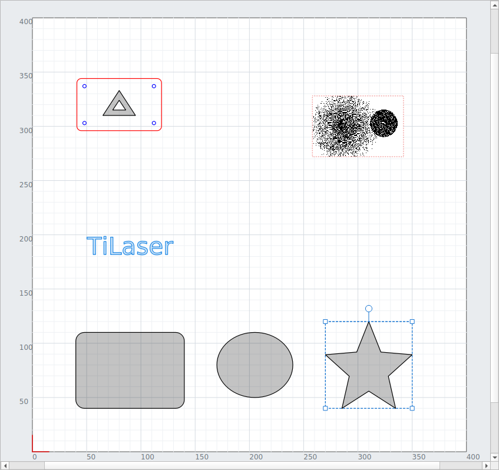
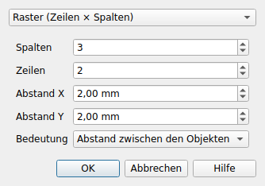
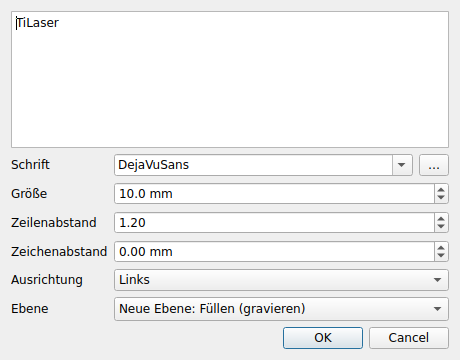
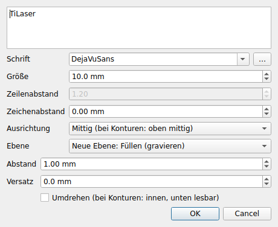
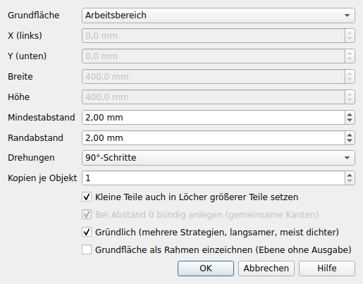
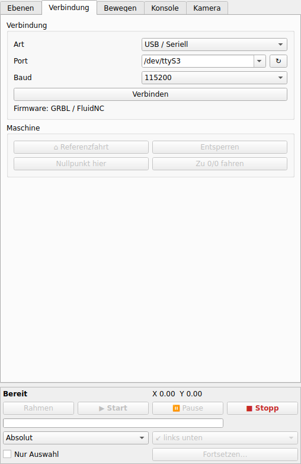
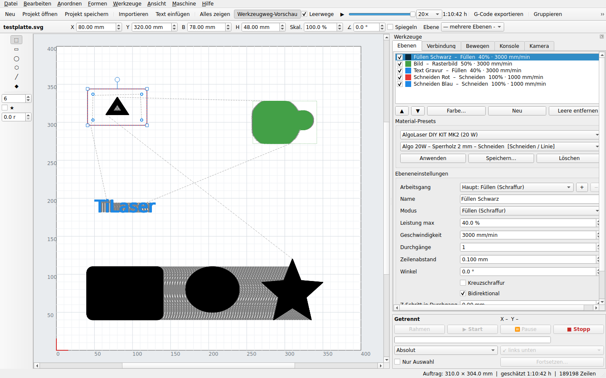
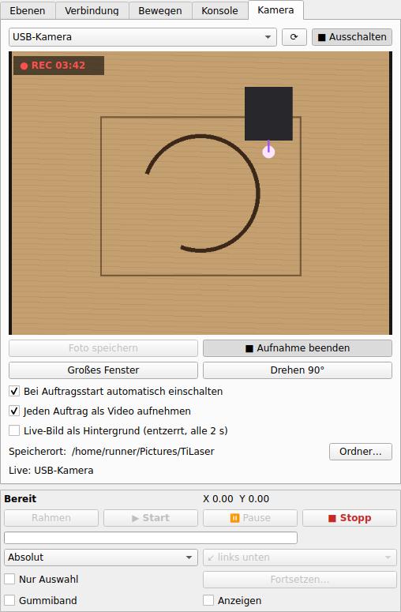

# TiLaser – Bedienungsanleitung

TiLaser ist ein Programm zum Laserschneiden und -gravieren mit G-Code-gesteuerten Lasern
(GRBL/FluidNC, Marlin, Smoothieware). Diese Anleitung beschreibt alle Funktionen der Reihe nach –
vom ersten Start bis zum fertigen Werkstück.

> Die Screenshots werden automatisch aus dem aktuellen Programmstand erzeugt
> (`tools/make_screenshots.py`, GitHub-Workflow „Dokumentation“).

---

## Inhalt

1. [Sicherheit](#1-sicherheit)
2. [Installation](#2-installation)
3. [Schnellstart: das erste Werkstück](#3-schnellstart-das-erste-werkstück)
4. [Die Oberfläche](#4-die-oberfläche)
5. [Dateien öffnen, importieren und exportieren](#5-dateien-öffnen-importieren-und-exportieren)
6. [Objekte bearbeiten](#6-objekte-bearbeiten)
7. [Zeichnen, Formen und Text](#7-zeichnen-formen-und-text)
8. [Nesting – Teile automatisch anordnen](#8-nesting--teile-automatisch-anordnen)
9. [Ebenen und Laserparameter](#9-ebenen-und-laserparameter)
10. [Material-Presets und Materialtest](#10-material-presets-und-materialtest)
11. [Maschine einrichten und verbinden](#11-maschine-einrichten-und-verbinden)
12. [Lasern: Rahmen, Start, Pause, Stopp, Fortsetzen](#12-lasern-rahmen-start-pause-stopp-fortsetzen)
13. [Vorschau und Simulation](#13-vorschau-und-simulation)
14. [Kamera](#14-kamera)
15. [Rotationsachse](#15-rotationsachse)
16. [Einrichtung AlgoLaser DIY KIT MK2 (20 W)](#16-einrichtung-algolaser-diy-kit-mk2-20-w)
17. [Tastenkürzel](#17-tastenkürzel)
18. [Fehlerbehebung](#18-fehlerbehebung)
19. [Speicherorte und portable Version](#19-speicherorte-und-portable-version)
20. [Lizenz und Markenhinweis](#20-lizenz-und-markenhinweis)

---

## 1. Sicherheit

Laser der Klasse 4 – dazu gehören praktisch alle Diodenlaser ab etwa 5 W – können Augen dauerhaft
schädigen und Brände auslösen.

- **Schutzbrille** passend zur Wellenlänge (bei Diodenlasern meist 445–455 nm, OD 5+) tragen – auch für
  alle Personen im Raum.
- **Nie unbeaufsichtigt** lasern. Ein Feuerlöscher (CO₂ oder Pulver) und eine feuerfeste Unterlage gehören dazu.
  Der [Flammenwächter](#flammenwächter) kann zusätzlich warnen, ersetzt die Aufsicht aber nicht.
- **Absaugung** einschalten. Rauch von Holz, Leder und Kunststoffen ist gesundheitsschädlich.
- **Kein PVC, Vinyl, Kunstleder** oder andere chlorhaltige Materialien lasern (Salzsäure- und Chlorgasbildung).
- **Stopp** (in der Auftragsleiste) hält die Maschine sofort an. Bei GRBL wird dafür ein Soft-Reset gesendet;
  der Laser schaltet sofort ab.
- Bei GRBL muss der **Lasermodus aktiv** sein (`$32=1`), sonst brennt der Laser auch bei Leerfahrten weiter.
  TiLaser warnt beim Verbinden, wenn das nicht der Fall ist.

---

## 2. Installation

### Windows

| Variante | Vorgehen |
|---|---|
| **Installer** `TiLaser-<Version>-Setup.exe` | Ausführen und dem Assistenten folgen. Wahlweise für alle Benutzer (mit Admin-Rechten) oder nur für den aktuellen Benutzer. Optional: Desktop-Symbol und Verknüpfung von `.tlp`-Projektdateien mit TiLaser. |
| **Portabel** `TiLaser-<Version>-portable-win64.zip` | Entpacken (z. B. auf einen USB-Stick) und `TiLaser.exe` starten. Einstellungen und Presets liegen im Unterordner `daten` – nichts wird im Benutzerprofil oder in der Registry gespeichert. |

Beim ersten Start meldet Windows SmartScreen eventuell „Unbekannter Herausgeber“. Über
*Weitere Informationen → Trotzdem ausführen* lässt sich das Programm starten.

### Linux

| Variante | Vorgehen |
|---|---|
| **AppImage** (x86_64 oder aarch64) | `chmod +x TiLaser-*.AppImage` und starten. Läuft ohne Installation. |
| **deb-Paket** (amd64 oder arm64) | `sudo apt install ./tilaser_<Version>_<arch>.deb`. Danach im Startmenü unter *Grafik*. |

Für den Zugriff auf den Laser über USB muss der Benutzer in der Gruppe `dialout` sein:

```bash
sudo usermod -aG dialout $USER     # danach ab- und wieder anmelden
```

Systemvoraussetzungen: x86_64 mit glibc ≥ 2.35 (z. B. Ubuntu 22.04, Debian 12), ARM64 mit glibc ≥ 2.39
(z. B. Raspberry Pi OS Trixie, Ubuntu 24.04).

### Optionale Zusatzprogramme

| Programm | Wofür |
|---|---|
| [Ghostscript](https://ghostscript.com/releases/gsdnld.html) oder [Inkscape](https://inkscape.org) | Import von EPS/PostScript und alten Illustrator-Dateien |

### Aus dem Quellcode

```bash
pip install -r requirements.txt
python main.py
```

---

## 3. Schnellstart: das erste Werkstück

1. **Maschine einrichten:** *Maschine → Maschineneinstellungen*. Unter *Maschinenvorlage* eine passende
   Vorlage wählen (z. B. „AlgoLaser DIY KIT MK2 (20 W)“) und *Übernehmen* klicken – oder die Werte von Hand
   eintragen (siehe [Kapitel 11](#11-maschine-einrichten-und-verbinden)).
2. **Verbinden:** In der Seitenleiste den Tab **Verbindung** öffnen, den Port wählen (Windows: `COM3` o. Ä.,
   Linux: `/dev/ttyUSB0` bzw. `/dev/ttyACM0`), Baudrate 115200, *Verbinden*. TiLaser erkennt die Firmware.
3. **Datei importieren:** *Datei → Importieren* (Strg+I) oder die Datei ins Fenster ziehen.
4. **Ebenen einstellen:** Jede Farbe der Zeichnung wird zu einer Ebene. Im Tab **Ebenen** für jede Ebene den
   Modus (Schneiden / Füllen / Rasterbild) und Leistung, Geschwindigkeit, Durchgänge wählen – am einfachsten
   über ein **Material-Preset**.
5. **Positionieren:** Objekte mit der Maus verschieben oder Werte in der Objektleiste eingeben.
6. **Vorschau prüfen:** *Ansicht → Werkzeugweg-Vorschau* (Strg+P) zeigt, was der Laser fährt, und schätzt die Dauer.
7. **Rahmen fahren:** In der Auftragsleiste *Rahmen* – der Laserkopf fährt den Umriss des Auftrags ab.
   So lässt sich das Material ausrichten.
8. **Starten:** *▶ Start*. Die Sicherheitsabfrage bestätigen. Fortschritt, Laufzeit, erwartete Gesamtzeit und Restzeit stehen in der Auftragsleiste.

---

## 4. Die Oberfläche


| Bereich | Inhalt |
|---|---|
| **Menüleiste** | Datei, Bearbeiten, Anordnen, Formen, Werkzeuge, Ansicht, Maschine, Hilfe |
| **Werkzeugleiste** (oben) | Neu, Öffnen, Speichern, Importieren, Text, Alles zeigen, Vorschau, Simulation, Export, Gruppieren und Anordnen |
| **Objektleiste** (darunter) | Eigenschaften des ausgewählten Objekts |
| **Zeichenwerkzeuge** (links) | Auswählen, Rechteck, Ellipse, Polygon/Stern, Linie, Knoten |
| **Arbeitsfläche** (Mitte) | Bett mit 10-mm-Raster, Nullpunkt links unten (rote Ecke) |
| **Seitenleiste** (rechts) | Tabs *Ebenen*, *Verbindung*, *Bewegen*, *Konsole*, *Kamera* |
| **Auftragsleiste** (rechts unten) | Status, Position, Rahmen, Start, Pause, Stopp, Ursprung, Nur Auswahl, Fortsetzen, Gummiband |
| **Statusleiste** (unten) | Mausposition in mm, Auftragsgröße, geschätzte Dauer, Zeilenzahl |

Die Werkzeugleisten zeigen Symbole. Zeigt man mit der Maus darauf, erscheinen Name und Tastenkürzel; die
Menüs verwenden dieselben Symbole.


#### Werkzeugleiste oben

Von links nach rechts:

| Symbol | Funktion | Beschreibung | Taste |
|:------:|------------------|------------------------------------------------------------|--------------|
|  | **Neu** | Leeres Projekt anlegen | Strg+N |
|  | **Öffnen** | Projekt öffnen (TiLaser `.tlp` oder LightBurn `.lbrn2`) | Strg+O |
|  | **Speichern** | Projekt speichern | Strg+S |
|  | **Importieren** | SVG, DXF, PDF/AI, EPS, LightBurn oder Bild hinzufügen | Strg+I |
|  | **Text** | Text aus einer Schrift einfügen | Strg+T |
|  | **Alles zeigen** | Ansicht so zoomen, dass alle Objekte und das Bett sichtbar sind | Strg+0 |
|  | **Vorschau** | Werkzeugweg-Vorschau ein/aus: Brennwege in Ebenenfarbe, Leerfahrten gestrichelt (daneben *Leerwege* zum Ausblenden) | Strg+P |
|  | **Simulation** | Auftrag als Animation abspielen (in der Vorschau). Daneben: Schieberegler für den Zeitpunkt und Abspielgeschwindigkeit 1×–500×. Während des Abspielens wird das Symbol zu Pause |  |
|  | **G-Code exportieren** | Auftrag als `.gcode`-Datei speichern | Strg+E |
|  | **Gruppieren** | Ausgewählte Objekte zu einem Objekt zusammenfassen | Strg+G |
|  | **Gruppierung aufheben** | Gruppe bzw. importierte Datei in Einzelteile zerlegen | Strg+Shift+G |
|  | **Zentrieren** | Auswahl in die Mitte des Arbeitsbereichs setzen |  |
|  | **An 0/0** | Auswahl mit der linken unteren Ecke an den Nullpunkt setzen |  |
|  | **Duplizieren** | Kopie der Auswahl, um 10 mm versetzt | Strg+D |
|  | **Löschen** | Ausgewählte Objekte löschen | Entf |

#### Zeichenwerkzeuge links

| Symbol | Funktion | Beschreibung | Taste |
|:------:|------------------|------------------------------------------------------------|--------------|
|  | **Auswählen** | Objekte anklicken, mit Rahmen auswählen, verschieben; Anfasser zum Skalieren und Drehen | V |
|  | **Rechteck** | Rechteck aufziehen. Shift: Quadrat, Strg: von der Mitte aus. Eckenradius im Feld *r* unten | R |
|  | **Ellipse** | Ellipse aufziehen. Shift: Kreis, Strg: von der Mitte aus | E |
|  | **Polygon/Stern** | Vieleck aufziehen; Eckenzahl im Feld darunter, ★ macht einen Stern | P |
|  | **Linie/Polylinie** | Punkte anklicken; Doppelklick oder Enter beendet, Klick auf den Startpunkt schließt die Form | L |
|  | **Knoten bearbeiten** | Punkte und Kurvenanfasser ziehen; Doppelklick auf eine Linie fügt einen Punkt ein, Entf löscht ihn | N |

Esc schaltet jederzeit zurück zu *Auswählen*.


### Maus und Tastatur auf der Arbeitsfläche

| Aktion | Bedienung |
|---|---|
| Zoomen | Mausrad (zur Mausposition hin) |
| Ansicht verschieben | Mittlere Maustaste oder rechte Maustaste **ziehen**, Bildlaufleisten |
| Seitlich scrollen | Shift+Mausrad oder Touchpad seitwärts wischen |
| Hoch/runter scrollen | Strg+Mausrad |
| Kontextmenü | Rechte Maustaste **klicken** |
| Auswählen | Klicken; mehrere mit Strg+Klick oder Rahmen aufziehen |
| Verschieben | Ziehen, oder Pfeiltasten (1 mm, mit Shift 10 mm) |
| Alles zeigen | Strg+0 |
| Löschen | Entf |

Dateien können direkt aus dem Explorer bzw. Dateimanager auf die Arbeitsfläche gezogen werden.

---

## 5. Dateien öffnen, importieren und exportieren

### Projekte

*Datei → Projekt speichern* (Strg+S) legt eine `.tlp`-Datei an. Sie enthält alle Objekte, Ebenen mit
Parametern und eingebettete Bilder. Kurven bleiben als echte Kurven gespeichert.
*Datei → Auswahl als Projekt speichern…* (auch im Rechtsklick-Menü) speichert nur die ausgewählten Objekte
mit ihren Ebenen als eigene `.tlp`-Datei, in derselben Lage.

### LightBurn-Projekte

TiLaser liest und schreibt LightBurn-Dateien (`.lbrn2`, lesend auch das ältere `.lbrn`).

- **Öffnen:** *Datei → Projekt öffnen* und den Dateityp *LightBurn-Projekt* wählen. Die Datei wird ein neues
  Projekt; *Speichern* fragt danach nach einem Namen für die `.tlp`-Datei.
- **Dazuladen:** *Datei → Importieren* fügt Ebenen und Objekte einer LightBurn-Datei zum aktuellen Projekt hinzu.
- **Speichern:** *Datei → Als LightBurn-Datei speichern* schreibt eine `.lbrn2`.

| Übernommen | Hinweise |
|---|---|
| Ebenen | Name, Modus (*Cut* → Schneiden, *Scan* → Füllen, *Scan+Cut* → Füllen mit Unterebene Schneiden, *Image* → Rasterbild), Geschwindigkeit (mm/s ↔ mm/min), Leistung, Durchgänge, Zeilenabstand, Winkel, Kreuzschraffur, bidirektional, Ausgabe, Reihenfolge, Z-Schritt, Dithering. Die LightBurn-Farbe wird auf die nächstliegende der 32 Ebenenfarben abgebildet. |
| Formen | Pfade mit Bézierkurven, Rechtecke (mit Eckenradius), Ellipsen, Polygone, verschachtelte Gruppen mit Drehung/Spiegelung, Bilder. Lage und Maße bleiben erhalten. |
| Text | Über die von LightBurn mitgespeicherten Umrisse; als Text bearbeitbar ist er danach nicht mehr. |
| Nicht übernommen | Offset-Füllung (wird normale Füllung), variable Texte, Haltestege, Optimierungseinstellungen. Unbekannte Formen werden mit einem Hinweis übersprungen. |

Beim Speichern erhält jede Ebene die LightBurn-Farbe, die ihrer Farbe am nächsten kommt; mehr als 30 Ebenen
passen nicht. Unterebenen (außer *Füllen + Schneiden*) gehen in LightBurn verloren.

### Import

| Format | Hinweise |
|---|---|
| **SVG** | Pfade, Rechtecke (auch abgerundet), Kreise, Ellipsen, Linien, Polygone, Gruppen, `use`, Transformationen. Maße in mm, cm, in, pt oder px (96 dpi). Je Kontur- bzw. Füllfarbe entsteht eine Ebene; gefüllte Flächen ohne Kontur werden Füll-Ebenen. **Text** muss im Grafikprogramm in Pfade umgewandelt werden (Inkscape: *Pfad → Objekt in Pfad*). |
| **DXF** (ASCII) | LINE, LWPOLYLINE/POLYLINE (inkl. Bögen), CIRCLE, ARC, ELLIPSE, SPLINE, Blöcke. Einheit aus `$INSUNITS`. Je DXF-Layer eine Ebene. TEXT, MTEXT, HATCH und Bemaßungen werden übersprungen. |
| **PDF / Illustrator (AI)** | Vektorpfade und Farben; **Text wird in Konturen umgewandelt** (eingebettete TrueType-/CFF-Schrift, sonst Ersatzschrift). Bei mehreren Seiten wird die erste importiert. Eingebettete Bilder werden übersprungen. |
| **EPS / PS** | Wird über Ghostscript oder Inkscape in PDF umgewandelt (muss installiert sein). |
| **Bilder** (PNG, JPG, BMP, GIF, TIFF, WebP) | Für Rastergravur. Größe aus der DPI-Angabe der Datei, sonst 0,1 mm je Pixel (max. 100 mm breit). Transparenz wird weiß. |

Liegt ein importiertes Objekt außerhalb des Arbeitsbereichs, wird es in die Mitte gesetzt.

### Export

| Menüpunkt | Ergebnis |
|---|---|
| *Datei → G-Code exportieren* (Strg+E) | `.gcode`-Datei für SD-Karte oder andere Sender. Berücksichtigt *Ursprung* und *Nur Auswahl*. |
| *Datei → Als SVG exportieren* | Alle Objekte in mm, Ebenen als Inkscape-Ebenen, Bilder eingebettet |
| *Datei → Als DXF exportieren* | Konturen als LWPOLYLINE, je Ebene ein DXF-Layer (ohne Bilder) |
| *Datei → Als LightBurn-Datei speichern* | `.lbrn2` mit Ebenen und Parametern, Kurven und Bildern (siehe *LightBurn-Projekte*) |
| *Ansicht → G-Code anzeigen* | Zeigt den erzeugten G-Code |

---

## 6. Objekte bearbeiten

### Auswahl, Anfasser und Objektleiste



Um die Auswahl erscheint ein gestrichelter Rahmen mit Anfassern:

- **Ecken ziehen:** proportional skalieren (die gegenüberliegende Ecke bleibt stehen).
- **Runder Anfasser oben ziehen:** drehen um die Mitte der Auswahl; mit **Shift** in 15°-Schritten.

In der **Objektleiste** lassen sich Werte exakt eingeben: X/Y (Mittelpunkt), Breite, Höhe (proportional),
Skalierung in %, Drehung, Spiegeln und die Ebene.

### Rückgängig, Kopieren, Einfügen

| Funktion | Kürzel |
|---|---|
| Rückgängig / Wiederholen | Strg+Z / Strg+Y (oder Strg+Shift+Z) |
| Ausschneiden / Kopieren / Einfügen | Strg+X / Strg+C / Strg+V (um 10 mm versetzt) |
| An Originalposition einfügen | Strg+Shift+V |
| Duplizieren | Strg+D |

Im Menü *Bearbeiten* steht jeweils, was rückgängig gemacht wird. Es werden bis zu 60 Schritte gespeichert.

### Anordnen

Menü **Anordnen**:

| Funktion | Beschreibung |
|---|---|
| Ausrichten | Links, horizontal mittig, rechts, oben, vertikal mittig, unten – bezogen auf die Gesamtauswahl (mind. 2 Objekte) |
| Verteilen | Horizontal oder vertikal mit gleichen Abständen zwischen den Objekten (mind. 3 Objekte) |
| Spiegeln | Horizontal oder vertikal um die Mitte der Auswahl |
| 90° drehen | Strg+L (links) / Strg+R (rechts) |
| Array erstellen | Strg+Shift+A, siehe unten |
| Nesting | Strg+Shift+N, siehe [Kapitel 8](#8-nesting--teile-automatisch-anordnen) |
| Zentrieren / An 0/0 | Auswahl in die Mitte des Arbeitsbereichs bzw. an den Nullpunkt schieben |
| Schnittreihenfolge | *Zuerst / Früher / Später / Zuletzt schneiden* (Strg+Shift+Bild↑, Strg+Bild↑, Strg+Bild↓, Strg+Shift+Bild↓) verschiebt die Auswahl in der Reihenfolge des Projekts. *Reihenfolge anzeigen* blendet die Nummern auf der Arbeitsfläche ein (nur Anzeige). Wirksam, wenn in den Maschineneinstellungen *Schnittreihenfolge: Objekt für Objekt* gewählt ist |

**Schnittreihenfolge:** Standard ist *Optimiert* – TiLaser sucht je Ebene den kürzesten Weg über alle Konturen
(innen vor außen). Mit *Objekt für Objekt* (Maschineneinstellungen) wird ein Objekt nach dem anderen in der
Reihenfolge des Projekts fertig gelasert; innerhalb eines Objekts bleibt es bei innen vor außen und kurzen Wegen.
Die Ebenen-Reihenfolge gilt in beiden Fällen weiterhin zuerst.

**Am Raster fangen:** *Ansicht → Am Raster fangen* (Strg+Shift+F). Beim Verschieben rastet die linke untere
Objektecke auf das Raster ein. Rastermaß unter *Ansicht → Rastermaß* (0,5 / 1 / 5 / 10 mm).
Beim Zeichnen rasten auch die Punkte ein.

### Array



- **Raster:** Spalten × Zeilen mit Abstand X/Y. *Abstand zwischen den Objekten* = Lücke, *Rastermaß* =
  Mitte-zu-Mitte-Abstand. Zeilen werden nach unten angelegt.
- **Kreis:** Anzahl (inklusive Original), Mittelpunkt, Gesamtwinkel (360° = voller Kreis) und ob die Kopien
  mitgedreht werden.

### Gruppieren und Ebene zuweisen


- **Gruppieren** (Strg+G): Mehrere Vektorobjekte werden zu einem Objekt.
- **Gruppierung aufheben** (Strg+Shift+G): Ein Objekt zerfällt in seine Teile. Eine Außenkontur bleibt dabei
  mit ihren Löchern zusammen (ein „O“ oder eine Platte mit Bohrungen). Nochmals aufheben zerlegt so ein Teil
  in einzelne Konturen.
- **Ebene zuweisen** (Rechtsklick oder *Bearbeiten*): ordnet die Auswahl einer anderen Ebene zu – auch einer
  **neuen Ebene** mit frei wählbarer Farbe. So lassen sich einzelne Teile z. B. gravieren statt schneiden.

---

## 7. Zeichnen, Formen und Text

### Zeichenwerkzeuge


| Werkzeug | Taste | Bedienung |
|---|---|---|
| Auswählen | V | Standard |
| Rechteck | R | Aufziehen. Shift = Quadrat, Strg = vom Mittelpunkt aus. Eckenradius im Feld unter den Werkzeugen. |
| Ellipse | E | Aufziehen. Shift = Kreis, Strg = vom Mittelpunkt aus. |
| Polygon/Stern | P | Aufziehen. Eckenzahl im Feld darunter, ★ = Stern. |
| Linie/Polylinie | L | Punkte anklicken. Doppelklick oder Enter beendet, Klick auf den Startpunkt schließt die Form, Esc bricht ab. |
| Knoten | N | Knotenbearbeitung, siehe unten |

Neue Formen landen auf der gerade im Tab *Ebenen* gewählten Ebene. Mit **Esc** geht es zurück zum Auswahlwerkzeug.

### Knotenbearbeitung


Mit dem Knotenwerkzeug (N) ein Objekt anklicken. Die Knoten erscheinen als Quadrate, der ausgewählte rot.
Am ausgewählten Knoten erscheinen die **Kurven-Anfasser** (Kreise).

| Aktion | Bedienung |
|---|---|
| Knoten verschieben | Ziehen |
| Kurve formen | Anfasser ziehen. Glatte Knoten bleiben glatt; mit **Alt** wird nur ein Anfasser bewegt (Ecke). |
| Knoten einfügen | Doppelklick auf die Kontur |
| Knoten löschen | Entf |
| Segment in Kurve umwandeln | C (Segment nach dem ausgewählten Knoten) |
| Segment in Linie umwandeln | L |
| Knoten glätten | S |
| Pfad auftrennen | B (geschlossene Kontur öffnen bzw. offene Linie teilen) |
| **Startpunkt setzen** | A (oder *Maschine → Startpunkt auf gewählten Knoten setzen*): Am ausgewählten Knoten beginnt der Schnitt dieser Kontur; TiLaser wählt den Startpunkt dann nicht mehr selbst. Bei offenen Linien geht das an einem der beiden Enden. Mit Kerf-Ausgleich oder Haltestegen wählt TiLaser den Startpunkt weiterhin selbst |

Kurven aus SVG, PDF, DXF, Schriften und den Zeichenwerkzeugen bleiben echte Bézierkurven mit wenigen Knoten.

### Formen kombinieren

Menü **Formen** (mindestens zwei geschlossene Vektorobjekte auswählen):

| Funktion | Ergebnis |
|---|---|
| Vereinigen (Strg+Shift+U) | Gemeinsamer Umriss aller Formen |
| Abziehen (Strg+Shift+D) | Größte Form minus alle anderen (z. B. Platte minus Ausschnitte) |
| Schnittmenge (Strg+Shift+I) | Nur der überlappende Bereich |
| Ausschluss (XOR) | Alles außer den Überlappungen |
| Offset (Alt+O) | Konturen um einen Abstand nach außen (+) oder innen (−) versetzen, eckig oder rund |
| Pfade verbinden / schließen (Alt+J) | Offene Linien mit gemeinsamen Endpunkten verbinden und schließen – nützlich nach DXF-Importen |


### Text



*Datei → Text einfügen* (Strg+T): Text (mehrzeilig), Schrift (alle installierten TrueType-/OpenType-Schriften
oder eine Datei über „…“), Größe in mm, Zeilen- und Zeichenabstand, Ausrichtung und Ebene. Neue Ebenen für
Text sind standardmäßig **Füllen** (Gravur) oder **Schneiden/Kontur**. Den Inhalt eines eingefügten Textes
ändert man später per Rechtsklick → *Inhalt ändern…*.

### Variabler Text, QR-Code und Barcode

Texte und Code-Inhalte dürfen **Platzhalter** enthalten, die vor jedem Auftrag eingesetzt werden:

| Platzhalter | Ergebnis |
|---|---|
| `{nr}` | fortlaufende Nummer, z. B. `17`; `{nr:03}` mit führenden Nullen: `017` |
| `{datum}` / `{zeit}` | Tagesdatum `18.11.2026` / Uhrzeit `14:05`; außerdem `{jahr}`, `{monat}`, `{tag}` |
| `{Spaltenname}` | Wert aus der aktuellen Zeile einer CSV-Datei, z. B. `{Name}` |

*Werkzeuge → Variable Texte…* legt Startnummer und Schrittweite fest, wählt eine CSV-Datei (erste Zeile =
Spaltennamen, Trennzeichen `;` oder `,`) und die aktuelle Zeile. Mit *Nach jedem Auftrag bzw. G-Code-Export
weiterzählen* erhöht TiLaser die Nummer und geht zur nächsten CSV-Zeile, sobald ein Auftrag fertig ist –
für Seriennummern, Namensschilder oder Etiketten. Die Vorschau zeigt immer die nächsten Werte.

*Werkzeuge → QR-Code / Barcode einfügen…* (Strg+Shift+Q) erzeugt einen **QR-Code** (Kantenlänge,
Fehlerkorrektur L/M/Q/H, auch Umlaute und Adressen) oder einen **Barcode Code 128** (Breite, Höhe; Zeichen
ASCII 32–126) als Gravur auf einer Füll-Ebene. Der Inhalt darf Platzhalter enthalten, z. B.
`https://example.com/teil/{nr:05}`. Für zuverlässiges Scannen einen kleinen Zeilenabstand (höchstens ein Viertel
der Modulbreite) und einen hellen Rand um den Code lassen und vor einer Serie mit dem Handy testen.

### Text auf Pfad



Kontur auswählen (Kreis, Bogen, Wellenlinie …) → *Werkzeuge → Text auf Pfad* oder Rechtsklick.
Bei geschlossenen Konturen steht der Text außen und ist oben mittig lesbar; mit **Umdrehen** innen und unten.
*Abstand* = Abstand der Schrift von der Kontur, *Versatz* = Verschiebung entlang der Kontur.

### Bild nachzeichnen


Ein Bild auswählen → *Werkzeuge → Bild nachzeichnen* (Alt+T). Aus dunklen Bereichen werden geschlossene
Konturen, z. B. um ein Logo zu schneiden.

| Einstellung | Wirkung |
|---|---|
| Schwellwert | Pixel dunkler als dieser Wert werden zur Fläche |
| Invertieren | Helle Bereiche nachzeichnen |
| Glättung | Größer = weniger Punkte, glattere Kanten |
| Mindestgröße | Kleinere Flecken werden ignoriert |
| Helligkeit / Kontrast | Bild vorher anpassen |
| Bild behalten | Sonst wird das Bild durch die Konturen ersetzt |

### Box-Generator

*Werkzeuge → Box-Generator…* (Strg+Umschalt+B) erzeugt einen Kasten mit Fingerzinken: Boden, vier
Wände und optional einen Deckel. Die Teile werden zusammengesteckt und bei Bedarf verleimt.

| Einstellung | Wirkung |
|---|---|
| Maße | *Innenmaße* (der Inhalt muss hineinpassen, z. B. eine Platine) oder *Außenmaße* |
| Breite, Tiefe, Höhe | Größe in X, Y und Z |
| Materialstärke | Vorher mit dem Messschieber messen. Sperrholz „3 mm“ ist oft 2,7 oder 3,2 mm dick, und schon 0,2 mm Unterschied machen die Zinken zu locker oder zu stramm |
| Zinkenbreite | Gewünschte Breite; das Programm verteilt eine ungerade Zahl gleich breiter Zinken auf jede Kante |
| Schnittbreite (Kerf) | Wird als Kerf der neuen Ebene „Box“ eingetragen. Größer = strammer. Für eine Presspassung etwa 0,02–0,05 mm über der gemessenen Schnittbreite (siehe [Kerf ermitteln](#kerf-ermitteln)) |
| Mit Deckel | Ohne Häkchen entsteht eine oben offene Schale |
| Leistung, Geschwindigkeit, Durchgänge | Werte für die Ebene „Box“; am einfachsten danach im Ebenen-Tab ein Preset anwenden |
| Teile beschriften | Graviert „Boden“, „Vorne“ usw. mit wenig Leistung auf die Teile (Ebene „Box-Beschriftung“) |

*Vorschau* zeigt den Werkzeugweg, *Ins Projekt* legt die Teile als einzelne Objekte an. Danach lassen sie sich
verschieben, mit [Nesting](#8-nesting--teile-automatisch-anordnen) platzsparend anordnen oder um Löcher,
Lüftungsschlitze und Gravuren ergänzen (z. B. mit *Formen → Abziehen*). Die Zinken bleiben dabei unverändert.

Tipp: Erst eine kleine Probe-Box (z. B. 40 × 30 × 20 mm) schneiden und die Passung prüfen, dann den Kerf anpassen.

---

## 8. Nesting – Teile automatisch anordnen

Nesting ordnet die ausgewählten Teile platzsparend auf einer rechteckigen Grundfläche an und hält dabei
einen **Mindestabstand** ein. Das spart Material, z. B. beim Ausschneiden vieler Gehäuseteile aus einer
Sperrholzplatte.

1. Die Teile auswählen (Strg+A für alle).
2. *Anordnen → Nesting* (Strg+Shift+N).
3. Einstellungen wählen und mit OK starten.



| Einstellung | Beschreibung |
|---|---|
| **Grundfläche** | *Arbeitsbereich* (ganzes Bett), *Eigene Maße* (X/Y der linken unteren Ecke, Breite, Höhe) oder *Größtes ausgewähltes Objekt* – dann dient z. B. ein gezeichnetes Rechteck in Plattengröße als Grundfläche und wird selbst nicht verschoben |
| **Mindestabstand** | Kleinster Abstand zwischen zwei Teilen in mm. Mindestens die Schnittbreite plus etwas Reserve, für Sperrholz z. B. 2–3 mm |
| **Randabstand** | Abstand zum Rand der Grundfläche |
| **Drehungen** | Keine, 0°/180°, 90°-Schritte, 45°-Schritte, 15°-Schritte. Bei sichtbarer Holzmaserung „Keine“ oder „0°/180°“ wählen |
| **Kopien je Objekt** | Legt Kopien an, so viele auf die Fläche passen (bis zur angegebenen Anzahl) |
| **In Löcher setzen** | Kleine Teile dürfen in Aussparungen größerer Teile gelegt werden. Als Aussparung zählt nur eine geschlossene Innenkontur auf einer ausgegebenen *Schneiden*-Ebene – also ein Stück, das wirklich herausfällt. Gravuren, Linien auf ausgeblendeten Ebenen und alles andere innerhalb eines Teils gelten als Material |
| **Bei Abstand 0 bündig anlegen** | Nur bei Mindestabstand 0: Nach dem Anordnen werden die Teile nach links und unten zusammengeschoben, bis sie sich berühren. Gerade Kanten liegen dann genau aufeinander und werden nur einmal geschnitten (siehe *Doppelte Linien* in den Maschineneinstellungen). Spart Material und Laufzeit; die Teile werden dabei um die halbe Schnittbreite kleiner |
| **Gründlich** | Probiert 9 Kombinationen aus Sortierung und Platzierungsregel und nimmt die beste – langsamer, meist dichter |
| **Rahmen einzeichnen** | Zeichnet die Grundfläche als graues Rechteck auf einer Ebene ohne Ausgabe ein |


Nach dem Anordnen meldet TiLaser, wie viele Teile platziert wurden und wie viel der Fläche belegt ist.
**Teile, die nicht passen**, bleiben an ihrem Platz und sind danach ausgewählt. Mit Strg+Z wird das
Nesting vollständig rückgängig gemacht.

**Mehrere Platten nacheinander:** Passen nicht alle Teile, bietet TiLaser im Ergebnisfenster an:

- **Platzierte speichern…** – die angeordneten Teile (mit ihren Ebenen und der Grundfläche, falls
  eingezeichnet) als eigene `.tlp`-Datei speichern, z. B. `platte1.tlp`. Das Projekt bleibt, wie es ist.
- **Speichern und entfernen…** – wie oben, danach werden die gespeicherten Teile aus dem aktuellen
  Projekt entfernt. Übrig bleiben die Teile, die nicht gepasst haben; sie sind ausgewählt und lassen sich
  sofort erneut anordnen (Strg+Shift+N). So entsteht Platte für Platte (`platte2.tlp`, …), bis alles
  verteilt ist. Entfernen lässt sich mit Strg+Z rückgängig machen; die gespeicherte Datei bleibt.

Jede Platte öffnet man später mit *Datei → Projekt öffnen* und lasert sie wie gewohnt.

**Genauigkeit:** Die Teile werden für die Berechnung in ein feines Raster (etwa 0,25–1 mm, abhängig von der
Größe der Grundfläche) umgerechnet. Das Raster ist bewusst großzügig: Der Mindestabstand wird immer
eingehalten, die Teile liegen dafür eventuell einen Bruchteil eines Millimeters weiter auseinander als nötig.
Umrisse aus einzelnen Linien (z. B. DXF-Zeichnungen) werden als geschlossene Teile erkannt, wenn sich die
Linienenden berühren.

---

## 9. Ebenen und Laserparameter


Jede Ebene ist ein Arbeitsgang mit eigenen Parametern. Die **Reihenfolge** in der Liste ist die
Bearbeitungsreihenfolge (▲/▼). Gravuren werden automatisch vor Schnitte gesetzt – **Schneiden gehört nach
unten**, damit Teile erst herausfallen, wenn alles darauf fertig ist.

Das **Häkchen** vor einer Ebene bestimmt, ob sie ausgegeben wird. Ausgeschaltete Ebenen werden blass
dargestellt.

**Ebenenfarben:** Es gibt 32 feste Farben, mit *Farbe…* aus einem Farbfeld (8 × 4) gewählt. Ein Punkt
markiert Farben, die schon eine andere Ebene benutzt; der Tooltip nennt Nummer, Name und Ebene. Beim Import
werden die Farben der Datei auf die nächstliegende der 32 Farben abgebildet – reine Grundfarben (z. B.
Rot `#ff0000`, Blau `#0000ff`) auf die gleichnamige. Sehr ähnliche Farben landen dadurch auf derselben Ebene.

### Modi

| Modus | Wirkung |
|---|---|
| **Schneiden / Linie** | Der Laser fährt die Konturen ab (Schneiden oder Ritzen) |
| **Füllen (Schraffur)** | Geschlossene Flächen werden zeilenweise graviert (Löcher bleiben frei) |
| **Offset-Füllung (Konturen)** | Geschlossene Flächen werden mit Konturlinien im Zeilenabstand von außen nach innen gefüllt – weniger Hin-und-Her als Schraffur, gut für Schriften und schmale Formen |
| **Rasterbild** | Bilder werden pixelweise graviert |

### Parameter

| Parameter | Modi | Beschreibung |
|---|---|---|
| Leistung max | alle | Laserleistung in % |
| Leistung min | Raster (Graustufen) | Leistung für helle Bildbereiche |
| Geschwindigkeit | alle | mm/min |
| Durchgänge | alle | Wie oft der Arbeitsgang wiederholt wird |
| Zeilenabstand | Füllen, Offset-Füllung, Raster | 0,1 mm ≈ 254 DPI; kleiner = dichter und langsamer |
| Winkel, Kreuzschraffur | Füllen | Richtung der Schraffur; zweite Schraffur um 90° gedreht |
| Bildmodus | Raster | Floyd-Steinberg, Jarvis, Stucki, Atkinson (Dithering), Schwellwert, Graustufen |
| Schwellwert, Invertieren | Raster | |
| Helligkeit, Kontrast, Gamma | Raster | Bild vor dem Gravieren anpassen |
| Overscan | Raster | Anlaufweg vor/nach jeder Zeile gegen dunkle Ränder |
| Bidirektional | Füllen, Raster | Hin und zurück gravieren (schneller) |
| Innen vor außen | Schneiden | Löcher vor der Außenkontur schneiden, damit sich Teile nicht vorher lösen |
| **Kerf-Ausgleich** | Schneiden | Schnittbreite in mm. Außenkonturen werden um die Hälfte nach außen, Löcher nach innen versetzt – die Teile werden maßhaltig. Wichtig für Steck- und Presspassungen. |
| **Haltestege** | Schneiden | Anzahl Stege je Kontur und Stegbreite. Die Teile bleiben im Material hängen und fallen nicht durch den Wabentisch. Optional nur an Außenkonturen. |
| Z-Schritt je Durchgang | alle | Fokus nach jedem Durchgang absenken (nur mit motorisierter Z-Achse) |
| Z-Versatz | alle | Vor dieser Ebene fährt Z um den Wert (+ = höher), danach zurück – z. B. leicht defokussiert gravieren (nur mit motorisierter Z-Achse) |
| Air Assist | alle | Sendet M8/M9 (Druckluft ein/aus) |


Die Vorschau eines Bildes auf der Arbeitsfläche zeigt bereits das Ergebnis des gewählten Bildmodus.

### Unterebenen

Mit **+** neben *Arbeitsgang* erhält eine Ebene weitere Arbeitsgänge auf **derselben Geometrie**, jeweils mit
eigenen Parametern – z. B. erst die Fläche gravieren, dann die Kontur ausschneiden. Über die Auswahl
*Arbeitsgang* wird zwischen Haupt- und Unterebenen gewechselt; **−** entfernt die gewählte Unterebene.

### Kerf ermitteln

1. Ein Quadrat von genau 20 × 20 mm zeichnen und mit Kerf 0 ausschneiden.
2. Das Teil mit dem Messschieber messen, z. B. 19,82 mm.
3. Kerf = 20 − 19,82 = **0,18 mm** in die Schneid-Ebene eintragen.

---

## 10. Material-Presets und Materialtest

### Presets

Im Tab *Ebenen* unter **Material-Presets**:

- **Filter** (oben): zeigt Presets für eine bestimmte Maschine. Er folgt automatisch dem aktiven Maschinenprofil.
- **Anwenden:** überträgt die Werte auf die gewählte Ebene bzw. Unterebene.
- **Speichern…:** speichert die aktuellen Einstellungen als eigenes Preset (Name und Material).
- **Löschen:** entfernt ein Preset.

Der Tooltip eines Presets zeigt Material und Herkunft der Werte. Eigene Presets bleiben bei Updates erhalten.

### Materialtest


*Werkzeuge → Materialtest* lasert ein beschriftetes Raster: in den **Spalten** steigt die Leistung, in den
**Zeilen** die Geschwindigkeit. So findet man in einem Durchgang die passenden Werte für ein neues Material.

| Einstellung | Beschreibung |
|---|---|
| Modus | Gravieren (Felder füllen) oder Schneiden (Feldkonturen) |
| Leistung von/bis, Spalten | Leistungsbereich und Anzahl Stufen |
| Geschwindigkeit von/bis, Zeilen | Geschwindigkeitsbereich und Anzahl Stufen (oben die schnellste) |
| Feldgröße, Feldabstand, Zeilenabstand, Durchgänge | |
| Position X/Y | Linke untere Ecke des Testrasters |
| Beschriften | Werte mit eigener (geringer) Leistung daneben schreiben |

Schaltflächen: **Vorschau** (Werkzeugweg auf der Arbeitsfläche), **Exportieren…** (G-Code-Datei) und
**An Laser senden**.

### Fokustest

*Werkzeuge → Fokustest…* findet den besten Abstand zwischen Laser und Material:

- **Ohne Z-Achse – Rampe** (für den AlgoLaser und die meisten Diodenlaser): TiLaser lasert eine lange Linie
  mit Skala. Dafür ein Brett so schräg legen, dass ein Ende etwa 10 mm höher liegt, und auf die Mitte
  fokussieren. Nach dem Lasern die **dünnste Stelle** der Linie suchen und an der Skala ablesen; dort stimmt
  der Abstand. Den Fokus danach auf diese Höhe einstellen.
- **Mit Z-Achse:** mehrere beschriftete Linien, jede mit einem anderen Z-Versatz (z. B. −2 bis +2 mm). Die
  schärfste Linie zeigt den besten Versatz.

### Zeilenabstandstest

*Werkzeuge → Zeilenabstandstest…* graviert gefüllte Quadrate mit steigendem Zeilenabstand (z. B. 0,05–0,30 mm)
und schreibt den Wert darunter. Das Feld, in dem die Linien gerade zu einer gleichmäßigen Fläche verschmelzen,
ist der passende Zeilenabstand für dieses Material und diesen Fokus – kleiner bringt nur mehr Laufzeit.

Beide Tests bieten wie der Materialtest **Vorschau**, **Exportieren…** und **An Laser senden**, zusätzlich
**Ins Projekt** (Test als normale Objekte einfügen, z. B. um ihn zu verschieben).

---

## 11. Maschine einrichten und verbinden

### Maschineneinstellungen


*Maschine → Maschineneinstellungen*:

| Einstellung | Beschreibung |
|---|---|
| Maschinenvorlage | Fertige Profile, z. B. „AlgoLaser DIY KIT MK2 (20 W)“ |
| Firmware / Dialekt | GRBL 1.1/FluidNC, Marlin, Smoothieware, Generisch. *Standardwerte übernehmen* setzt die passenden Werte |
| S-Wert bei 100 % | GRBL: Wert von `$30` (meist 1000), Marlin: 255, Smoothieware: 1 |
| Laser-Ein-Befehl | M4 (dynamische Leistung, GRBL, empfohlen) oder M3 (konstant) |
| Inline-Leistung | S-Wert direkt in jeder G1-Zeile (GRBL, Smoothieware) |
| G0 mit Vorschub | Für Marlin |
| Eilgang | Geschwindigkeit der Leerfahrten |
| Arbeitsbereich | Breite und Tiefe in mm (GRBL: `$130`/`$131`) |
| Rahmen: Leistung / Geschwindigkeit | 0 % = Laser beim Rahmen aus; bis 20 % für einen sichtbaren Punkt |
| Durchgänge | *Bei mehreren Durchgängen jede Kontur fertig schneiden* – an (Standard): jede Kontur bekommt alle Durchgänge, erst dann geht es zur nächsten; offene Linien abwechselnd hin und zurück. Aus: Durchgang 1 über alle Konturen, dann Durchgang 2 usw.; das Material kühlt dazwischen ab, dafür fährt der Laser öfter hin und her. Gilt für Schneid-Ebenen |
| Doppelte Linien | *Übereinanderliegende Linien nur einmal schneiden* (Standard an): Liegen Linien einer Ebene genau aufeinander – etwa die gemeinsame Kante zweier bündiger Teile –, wird das Stück nur einmal geschnitten; im G-Code steht dann ein Kommentar mit der eingesparten Länge. Das gilt nur für die Ausgabe: Die Teile im Projekt bleiben vollständig, wer sie wieder auseinanderschiebt oder mit Abstand neu anordnet, hat alle Linien zurück. Bei eingestellter Schnittbreitenkorrektur (Kerf) liegen die Kanten nicht mehr aufeinander und werden normal geschnitten |
| Schnittreihenfolge | *Optimiert (kürzeste Wege)* oder *Objekt für Objekt (Reihenfolge im Projekt)*, siehe [Anordnen](#anordnen) |
| Rotationsachse | siehe [Kapitel 15](#15-rotationsachse) |
| Air Assist an/aus | Standard M8/M9 |
| G-Code Anfang/Ende | Wird jedem Auftrag voran- bzw. nachgestellt |

### Verbindung



| Art | Einstellungen |
|---|---|
| **USB / Seriell** | Port (↻ aktualisiert die Liste), Baudrate (meist 115200) |
| **Netzwerk (TCP/Telnet)** | IP-Adresse und Port (meist 23) – für ESP32-Steuerungen mit FluidNC oder grblHAL |

Beim Verbinden wartet TiLaser kurz auf die Begrüßung der Steuerung und erkennt **GRBL/FluidNC, Marlin und
Smoothieware** selbst. Weicht die erkannte Firmware vom Profil ab, fragt TiLaser, ob umgestellt werden soll.
Bei GRBL liest TiLaser `$30` (Maximalleistung) aus und warnt bei `$32=0` (Lasermodus aus).

**Automatisch verbinden:** TiLaser merkt sich die zuletzt erfolgreich benutzte Verbindung (Art, Port und Baudrate
bzw. Adresse und TCP-Port). Ist **Beim Start automatisch verbinden** angehakt (Standard), verbindet TiLaser beim
Programmstart von selbst damit – aber nur, wenn der Port vorhanden bzw. der Laser im Netzwerk erreichbar ist.
Ist der Laser aus oder nicht angesteckt, erscheint kein Fehlerfenster, nur ein Hinweis in der Konsole; dann
einfach später *Verbinden* drücken. Die Netzwerksuche läuft im Hintergrund und hält das Programm nicht auf.

Im Tab *Verbindung* liegen außerdem:

| Schaltfläche | GRBL | Marlin u. a. |
|---|---|---|
| Referenzfahrt | `$H` | `G28 X Y` |
| Entsperren (nach Alarm) | `$X` | `M999` |
| Nullpunkt hier | `G10 L20 P1 X0 Y0` | `G92 X0 Y0` |
| Zu 0/0 fahren | `G0 X0 Y0` | `G0 X0 Y0` |

### Bewegen


- **Relativ:** acht Richtungstasten und ⌂ (Referenzfahrt), Schrittweite 0,1–100 mm, Vorschub.
- **Absolut:** X/Y in Werkstückkoordinaten eingeben und *Fahren* klicken (oder Enter). *Aktuelle Position
  übernehmen* füllt die Felder mit der momentanen Kopfposition. Bei Zielen außerhalb des Arbeitsbereichs
  fragt TiLaser nach. Der Laser ist beim Fahren aus.
- **Per Klick:** Rechtsklick auf die Arbeitsfläche → *Laser hierher fahren* fährt den Kopf genau an diese
  Stelle. Mit Objekten in der Auswahl gibt es *Laser zur Auswahl fahren* → Mitte oder eine der vier Ecken
  (auch unter *Maschine*). Praktisch, um zu prüfen, wo ein Teil auf dem Werkstück landet.
- **Makros:** eigene G-Code-Knöpfe, z. B. *Luft an* (`M8`), *Luft aus* (`M9`) oder *Entsperren + Home*.
  *Bearbeiten…* (auch *Maschine → Makros bearbeiten…*) legt Makros an: Name, G-Code (mehrere Zeilen möglich)
  und ein Tastenkürzel, das im ganzen Fenster gilt. Während ein Auftrag läuft, sind Makros gesperrt.

### Konsole


Zeigt alle Meldungen der Steuerung (`<<`) und gesendeten Befehle (`>>`). Unten können eigene Befehle
eingegeben werden, z. B. `$$` (GRBL-Einstellungen anzeigen), `$I` (Version) oder `?` (Status).

### GRBL-Einstellungen

*Maschine → GRBL-Einstellungen ($$)…* liest alle Einstellungen der Steuerung und zeigt sie mit deutscher
Bedeutung, z. B. `$30` maximaler S-Wert, `$32` Lasermodus, `$110/$111` Höchstgeschwindigkeit,
`$120/$121` Beschleunigung, `$130/$131` Verfahrweg. Werte in der Spalte *Wert* ändern und
*Geänderte schreiben* drücken; TiLaser zeigt die Änderungen vorher noch einmal an und liest danach zur
Kontrolle neu. *Exportieren…* sichert alle Werte als Textdatei – das sollte man vor jeder Änderung tun.

---

## 12. Lasern: Rahmen, Start, Pause, Stopp, Fortsetzen

Die **Auftragsleiste** rechts unten ist in jedem Tab sichtbar.

| Element | Funktion |
|---|---|
| Status / Position | Zustand der Maschine (Bereit, Läuft, Pausiert, Alarm …) und Kopfposition |
| **Rahmen** | Fährt den Umriss des Auftrags ab (mit der Rahmen-Leistung aus den Maschineneinstellungen) |
| **Gummiband** | Häkchen unter *Nur Auswahl*: Der Rahmen folgt eng den Teilen (konvexe Hülle) statt dem umschließenden Rechteck – wie ein um alle Teile gespanntes Gummiband. Bei runden oder schräg liegenden Teilen sieht man so genauer, wo gelasert wird, und der Kopf fährt nicht über leere Ecken. Die abgefahrene Linie wird auf der Arbeitsfläche einige Sekunden orange gestrichelt angezeigt. Mit dem Häkchen **Anzeigen** daneben (oder *Ansicht → Gummiband-Rahmen anzeigen*) bleibt sie dauerhaft eingeblendet und folgt beim Verschieben den Teilen – bei *Nur Auswahl* nur den ausgewählten. Die Linie ist reine Anzeige und wird nie gelasert. Beide Einstellungen bleiben gespeichert |
| **▶ Start** | Erzeugt den G-Code und startet nach einer Sicherheitsabfrage (mit geschätzter Dauer und Hinweisen) |
| **⏸ Pause / Fortsetzen** | Hält an bzw. setzt fort (GRBL: Feed-Hold `!` / `~`) |
| **■ Stopp** | Sofortiger Abbruch (GRBL: Soft-Reset); danach ggf. *Entsperren* |
| Fortschritt und Zeit | Während des Laserns: Balken mit Prozent und **Restzeit** („noch ~4:12“), daneben **bisherige Laufzeit / erwartete Gesamtzeit** (z. B. „3:05 / ~7:17“, Minuten:Sekunden, ab einer Stunde Stunden:Minuten:Sekunden). Die erste Schätzung kommt aus Weg und Vorschub jeder G-Code-Zeile; sobald ein Teil gelasert ist, wird sie an das tatsächliche Tempo der Maschine angepasst (Beschleunigung, langsamere Ecken). Pausen zählen nicht mit. Nach dem Ende steht die tatsächliche Dauer da, in der Konsole zusammen mit der ursprünglichen Schätzung |
| **Ursprung** | *Absolut*: Koordinaten wie auf der Arbeitsfläche. *Aktuelle Position*: der gewählte **Ankerpunkt** (z. B. links unten) des Auftrags liegt dort, wo der Laserkopf gerade steht – praktisch zum Positionieren per Jog |
| **Nur Auswahl** | Nur die ausgewählten Objekte lasern bzw. umrahmen |
| **Fortsetzen…** | Nach Stopp, Alarm oder Verbindungsabbruch ab einer wählbaren Zeile weitermachen |

**Fortsetzen:** TiLaser merkt sich, bis zu welcher Zeile die Steuerung den Auftrag bestätigt hat. Weil die
Steuerung einige Befehle im Voraus puffert, wird standardmäßig etwa 15 Zeilen früher begonnen – kurze Stücke
werden dabei doppelt gelasert. Position, Vorschub, Leistung und Air Assist werden wiederhergestellt.
**Das Werkstück darf dazwischen nicht verschoben worden sein.**

---


### Weboberfläche (Handy, Tablet, PC)

Unter *Maschine → Weboberfläche…* lässt sich TiLaser über den Browser eines anderen Geräts im selben Netz
beobachten und bedienen – z. B. vom Handy, wenn TiLaser auf dem Raspberry Pi am Laser läuft, oder vom
Arbeitsplatz-PC aus der Nachbarecke. TiLaser selbst muss dafür laufen.

| Einstellung | Wirkung |
|---|---|
| Weboberfläche einschalten | Startet den Webserver (bleibt auch nach einem Neustart von TiLaser an) |
| Port | Standard 8080 |
| PIN | Wird im Browser abgefragt. Die Anmeldung gilt bis zu 24 Stunden, endet aber, wenn TiLaser neu startet oder dieser Dialog mit OK geschlossen wird. Nach 10 falschen Eingaben ist die Anmeldung 5 Minuten gesperrt. Leer = ohne Anmeldung (nicht empfohlen) |
| Aufträge aus der Ferne starten erlauben | Zeigt einen Knopf *Auftrag starten*, der das aktuell geöffnete Projekt mit den Einstellungen der Auftragsleiste startet. Standardmäßig aus |

Der Dialog zeigt die Adresse (z. B. `http://192.168.1.20:8080/`) und einen QR-Code, den man mit der
Handykamera scannt. Die Seite zeigt:

- Zustand, Position, Fortschritt als „abbrennenden“ Holzstreifen, Laufzeit und Restzeit
- das Live-Kamerabild (etwa ein Bild pro Sekunde, wenn die Kamera in TiLaser läuft)
- Knöpfe **Pause/Fortsetzen** und **Stopp** (mit Rückfrage), optional *Auftrag starten*
- die letzten Zeilen der Konsole
- eine rote Meldung mit Ton und Vibration, wenn der [Flammenwächter](#flammenwächter) auslöst

Auf dem Handy steht alles untereinander, auf dem PC (ab etwa 900 Pixel Breite) ist das Kamerabild groß
links und die Bedienung rechts; dort gilt außerdem **Leertaste** = Pause/Fortsetzen und **Esc** = Stopp.

> Nur im eigenen Netz verwenden und **keine Portfreigabe im Router** einrichten. Unter Windows fragt die
> Firewall beim ersten Start, ob TiLaser im privaten Netz erreichbar sein darf – das mit *Zulassen*
> bestätigen. Auch mit Weboberfläche gilt: den Laser nie unbeaufsichtigt lassen.

## 13. Vorschau und Simulation



*Ansicht → Werkzeugweg-Vorschau* (Strg+P) erzeugt den G-Code und zeigt:

- **Brennwege** in der Farbe der Ebene,
- **Leerfahrten** gestrichelt grau (abschaltbar über *Leerwege* in der Werkzeugleiste).

Die Statusleiste zeigt die **geschätzte Dauer** und die Zeilenzahl. Die Schätzung berücksichtigt keine
Beschleunigung; reale Aufträge dauern meist etwas länger.


**Simulation:** Bei eingeschalteter Vorschau mit ▶ abspielen oder den Schieberegler ziehen. Ein roter Kreis
zeigt den Laserkopf, bereits gelaserte Wege erscheinen kräftig. Die Abspielgeschwindigkeit (1× bis 500×) ist
daneben wählbar.

---

## 14. Kamera

Eine Webcam über dem Bett hat in TiLaser zwei Aufgaben: Sie zeigt **live**, was der Laser gerade macht
(Abschnitt *Live-Kamera*), und sie legt – einmal ausgerichtet – ein entzerrtes Bild des Werkstücks unter die
Arbeitsfläche, damit Gravuren genau auf vorhandene Teile gesetzt werden können (Abschnitt *Ausrichten*).
Beides nutzt dieselbe Kamera.

### Live-Kamera

Der Tab **Kamera** in der Seitenleiste (oder *Maschine → Kamera → Live-Kamera*, Strg+Shift+K) zeigt das
Live-Bild.



| Element | Funktion |
|---|---|
| Kameraliste, ⟳ | Webcam wählen; ⟳ sucht neu angeschlossene Kameras |
| ▶ Einschalten / ■ Ausschalten | Live-Bild starten oder beenden |
| Foto speichern | Aktuelles Bild als JPG speichern |
| ● Video aufnehmen | Video (MP4) starten; oben links im Bild läuft „● REC“ mit der Aufnahmedauer |
| Großes Fenster | Live-Bild in einem eigenen Fenster, z. B. auf einem zweiten Bildschirm. Auch per Doppelklick aufs Bild. Im Fenster schaltet F11 oder ein Doppelklick auf Vollbild, Esc beendet das Vollbild |
| Drehen 90° | Dreht nur die Anzeige (für hochkant oder kopfüber montierte Kameras) |
| Bei Auftragsstart automatisch einschalten | Die Kamera geht beim Start eines Auftrags an, und der Tab *Kamera* wird angezeigt |
| Jeden Auftrag als Video aufnehmen | Beim Auftragsstart beginnt eine Aufnahme `Auftrag_<Datum>_<Uhrzeit>.mp4`; sie endet 3 s nach dem Auftragsende (auch bei Stopp oder Alarm) |
| Live-Bild als Hintergrund | Legt alle 2 s das entzerrte Live-Bild unter die Arbeitsfläche, so sieht man den Fortschritt direkt an den Objekten. Nur nach dem Ausrichten möglich |
| Speicherort, Ordner… | Ordner für Fotos und Videos (Standard: `Bilder/TiLaser`) |

Alle Einstellungen werden im Maschinenprofil gespeichert.

> **Tipp:** Die Live-Kamera ersetzt nicht die Aufsicht am Gerät. Der Laser darf nie unbeaufsichtigt laufen –
> das Bild hilft beim Beobachten aus einem Meter Entfernung oder durch die Schutzhaube, nicht aus dem
> Nebenzimmer.

Läuft das Live-Bild, verwenden *Kamera ausrichten* und *Kamerabild aktualisieren* direkt das aktuelle Bild,
statt die Kamera ein zweites Mal zu öffnen.

### Flammenwächter

Der Flammenwächter wertet während eines Auftrags das Live-Bild aus und schlägt Alarm, wenn irgendwo eine
Flamme stehen bleibt. Er ist **standardmäßig aus** und wird im Tab *Kamera* unter **Flammenwächter**
eingeschaltet.

| Einstellung | Wirkung |
|---|---|
| Flammen während des Auftrags erkennen | Ein/aus. Bei Auftragsstart wird die Kamera dann automatisch eingeschaltet |
| Bei Flamme | *Nur warnen* (Alarmton und Meldung), *Auftrag pausieren* (Standard) oder *Auftrag stoppen* |
| Empfindlichkeit | 1–10. Höher = schon kleinere Flammen lösen aus, aber eher Fehlalarme |
| Auslösen nach | So viele Sekunden muss eine Stelle brennen (Standard 2 s) |
| Erkannte Stellen rot zeigen | Markiert im Live-Bild, was der Wächter für Flamme hält – hilfreich beim Einstellen |
| Testen | Wächter ohne Auftrag laufen lassen, z. B. mit einem Feuerzeug unter der Kamera. Löst nur eine Meldung aus |

**So funktioniert es:** Gesucht werden helle, gelb-orange Stellen, die deutlich heller sind als im Bild beim
Auftragsstart. Der glühende Laserpunkt wandert ständig weiter und löst deshalb nicht aus; eine Flamme bleibt
an einer Stelle. Feste Lichtquellen wie eine orange Kontroll-LED oder ein Kreuzlaser gehören zum
Anfangsbild und stören nicht.

Löst der Wächter aus, piept TiLaser, speichert ein Foto im Kamera-Speicherort (`Flamme_…jpg`), schreibt
eine Zeile in die Konsole und zeigt eine Meldung mit drei Möglichkeiten:

- **Auftrag stoppen**
- **Weiter beobachten** – nach dem Nachsehen; einen pausierten Auftrag mit *Fortsetzen* weiterlaufen lassen
- **Wächter für diesen Auftrag aus** – bei Fehlalarmen, z. B. durch Sonnenlicht

Ist der Wächter eingeschaltet, aber keine Kamera verfügbar, steht in der Konsole eine Warnung. Der Auftrag
läuft dann trotzdem.

> **Wichtig:** Der Flammenwächter ist eine zusätzliche Absicherung und **kein Ersatz für die Aufsicht**. Er
> sieht nur, was die Kamera sieht, und kann eine Flamme unter dem Werkstück oder im Rauch übersehen. Bei
> GRBL schaltet der Laser bei *Pause* im Lasermodus (`$32=1`) ab; Air Assist läuft weiter.

Tipp zum Einstellen: Einen typischen Auftrag mit *Erkannte Stellen rot zeigen* beobachten. Erscheinen dabei
schon rote Stellen, die Empfindlichkeit senken oder die Zeit erhöhen.

### Ausrichten

1. *Maschine → Kamera → Kamera wählen*: USB-Kamera oder **„Bild aus Datei“** (z. B. ein Handyfoto, das immer
   von derselben Stelle aufgenommen wird).
2. *Passmarken lasern*: **9 Marken** (3 × 3, mit Linsenkorrektur – empfohlen) oder 4 Marken. Die Kreuze werden
   mit 10 % Leistung 30 mm vom Bettrand gelasert – ein Stück Pappe unterlegen.
3. *Kamera ausrichten*: Bild aufnehmen und die Kreuze **in der angezeigten Reihenfolge** anklicken
   (Mausrad zoomt). Bei 9 Marken wird auch die Objektivverzeichnung berechnet; die Restabweichung in mm
   wird angezeigt.


4. *Kamerabild aktualisieren* (F5) legt das entzerrte Bild unter die Arbeitsfläche.
   *Kamerabild anzeigen* blendet es ein oder aus.

Wird die Kamera bewegt, muss sie neu ausgerichtet werden.

---

## 15. Rotationsachse

Für zylindrische Werkstücke mit einer **Rollen-Rotationsachse**, die anstelle der Y-Achse angeschlossen wird:

1. *Maschine → Maschineneinstellungen*: **Y-Weg je Rollenumdrehung** und **Rollendurchmesser** eintragen.
   Den Y-Weg ermittelt man so: eine Markierung auf die Antriebsrolle machen, in der Konsole z. B.
   `G91 G0 Y40` senden und prüfen, ob sich die Rolle genau einmal dreht – sonst den Wert anpassen.
2. *Maschine → Rotationsachse aktiv* einschalten. Die Y-Koordinaten werden dann automatisch umgerechnet;
   die Zeichnung entspricht der abgewickelten Oberfläche des Werkstücks.
3. Nach dem Lasern die Rotationsachse wieder ausschalten.

---

## 16. Einrichtung AlgoLaser DIY KIT MK2 (20 W)

1. *Maschine → Maschineneinstellungen → Maschinenvorlage* „AlgoLaser DIY KIT MK2 (20 W)“ → *Übernehmen* → OK.
   Damit sind GRBL, M4, S 1000, 400 × 400 mm, Eilgang 6000 mm/min und Rahmen mit 1 % gesetzt.
2. Per USB-C verbinden (115200 Baud). In der **Konsole** `$$` senden und prüfen:
   `$32=1` (sonst `$32=1` senden); `$130`/`$131` = Verfahrweg X/Y → ggf. als Arbeitsbereich eintragen.
3. Im Tab *Ebenen* sind die Presets automatisch auf den MK2 gefiltert. Sie stammen aus der
   AlgoLaser-Parametertabelle für den DIY KIT 20 W. **Sperrholz 2 mm**, *Linie ritzen* und die Foto-Presets
   sind Startwerte (im Tooltip gekennzeichnet) – vorher testen, z. B. mit dem Materialtest.
4. Air Assist ist in den Presets aus. Wird die Pumpe über `M8`/`M9` geschaltet, das Häkchen pro Ebene setzen.
5. Während TiLaser verbunden ist, keinen Auftrag gleichzeitig über Touchscreen oder App starten.

---

## 17. Tastenkürzel

| Kürzel | Funktion | | Kürzel | Funktion |
|---|---|---|---|---|
| Strg+N | Neues Projekt | | Strg+Z / Strg+Y | Rückgängig / Wiederholen |
| Strg+O | Projekt öffnen | | Strg+X / C / V | Ausschneiden / Kopieren / Einfügen |
| Strg+S | Projekt speichern | | Strg+Shift+V | An Originalposition einfügen |
| Strg+Shift+S | Speichern unter | | Strg+D | Duplizieren |
| Strg+I | Importieren | | Strg+A | Alles auswählen |
| Strg+T | Text einfügen | | Entf | Löschen |
| Strg+E | G-Code exportieren | | Pfeiltasten | 1 mm verschieben (Shift: 10 mm) |
| Strg+P | Werkzeugweg-Vorschau | | Strg+G / Strg+Shift+G | Gruppieren / aufheben |
| Strg+0 | Alles zeigen | | Strg+L / Strg+R | 90° links / rechts drehen |
| Strg+Shift+F | Am Raster fangen | | Strg+Shift+A | Array |
| F5 | Kamerabild aktualisieren | | Strg+Shift+N | Nesting |
| Strg+Shift+K | Live-Kamera | | Strg+Shift+Q | QR-Code / Barcode einfügen |
| Strg+Bild↑ / Strg+Bild↓ | Früher / später schneiden | | Strg+Shift+Bild↑ / ↓ | Zuerst / zuletzt schneiden |
| V R E P L N | Zeichenwerkzeuge | | Strg+Shift+←/→/↑/↓ | Links/rechts/oben/unten ausrichten |
| Esc | Zurück zum Auswählen | | Strg+Shift+U / D / I | Vereinigen / Abziehen / Schnittmenge |
| Alt+T | Bild nachzeichnen | | Alt+O / Alt+J | Offset / Pfade verbinden |
| Strg+Shift+B | Box-Generator | | | |

Im Knotenmodus: Entf, C, L, S, B, A (siehe [Knotenbearbeitung](#knotenbearbeitung)). Makros können eigene
Tastenkürzel bekommen.

---

## 18. Fehlerbehebung

| Problem | Lösung |
|---|---|
| Kein Port in der Liste | USB-Kabel prüfen (manche Kabel sind nur zum Laden); ↻ klicken. Windows: ggf. CH340-Treiber installieren. Linux: Benutzer in Gruppe `dialout`. |
| „Firmware: nicht erkannt“ | Baudrate prüfen (115200, bei manchen Marlin-Boards 250000). Danach Firmware in den Maschineneinstellungen von Hand wählen. |
| Laser brennt bei Leerfahrten / Linien an den Ecken zu dunkel | GRBL: `$32=1` setzen. Laser-Ein-Befehl M4 verwenden. |
| Leistung stimmt nicht (z. B. 10 % brennt wie 100 %) | S-Wert bei 100 % muss zu `$30` passen (GRBL). TiLaser übernimmt `$30` beim Verbinden automatisch. |
| ALARM nach Stopp | Normal nach einem Soft-Reset während der Fahrt: *Entsperren* klicken. |
| Teile sind zu klein / Passungen zu locker | Kerf-Ausgleich einstellen (siehe [Kerf ermitteln](#kerf-ermitteln)). |
| Teile fallen durch den Wabentisch | Haltestege verwenden. |
| Rasterbild ruckelt, Laser stockt | Geschwindigkeit verringern oder Zeilenabstand vergrößern – bei feinem Dithering kommt die USB-Verbindung sonst nicht hinterher. |
| SVG-Text fehlt | Text im Grafikprogramm in Pfade umwandeln oder den Text in TiLaser einfügen. |
| EPS-Import meldet fehlendes Programm | Ghostscript oder Inkscape installieren, oder die Datei als PDF/SVG speichern. |
| Boolesche Operationen melden „pyclipper benötigt“ | Nur bei Start aus dem Quellcode: `pip install pyclipper`. In den fertigen Paketen enthalten. |
| Nesting platziert nicht alle Teile | Grundfläche vergrößern, Mindest- oder Randabstand verringern, mehr Drehungen erlauben, *Gründlich* einschalten. |
| Kamerabild verschoben | Kamera wurde bewegt: neu ausrichten. |
| Live-Kamera: „Keine Kamera gefunden“ | Webcam anschließen und ⟳ klicken. Linux: Benutzer in Gruppe `video`. Windows: unter *Datenschutz → Kamera* den Zugriff für Desktop-Apps erlauben. Eine Kamera kann nur von einem Programm gleichzeitig benutzt werden – andere Video-Programme schließen. |
| Live-Kamera: Videoaufnahme schlägt fehl | Ist der Speicherort beschreibbar? Bei Start aus dem Quellcode mit einer Qt-Version vor 6.5 benötigt Linux zusätzlich die GStreamer-Plugins. |

---

## 19. Speicherorte und portable Version

| Inhalt | Ort |
|---|---|
| Maschinenprofil, eigene Presets | Windows: `%USERPROFILE%\.tilaser`, Linux/macOS: `~/.tilaser` |
| Portable Version | Unterordner `daten` neben `TiLaser.exe` (aktiv, solange `portable.txt` existiert) |
| Eigener Ordner | Umgebungsvariable `TILASER_HOME` |
| Projekte | Beliebig, Dateiendung `.tlp` |

## 20. Lizenz und Markenhinweis

TiLaser ist freie Software unter der GNU General Public License Version 3. Die verwendeten Bibliotheken und ihre Lizenzen stehen unter *Hilfe → Lizenzen…*.

LightBurn ist eine Marke der LightBurn Software LLC. TiLaser ist ein unabhängiges Projekt und steht in keiner Verbindung zu LightBurn Software; es wird von ihr weder unterstützt noch geprüft. Die Unterstützung von `.lbrn2`- und `.lbrn`-Dateien dient allein dem Datenaustausch; TiLaser enthält keinen Code von LightBurn. Alle anderen genannten Produktnamen (z. B. AlgoLaser, GRBL, Inkscape) sind Marken ihrer jeweiligen Inhaber.
