# TiLaser – Bedienungsanleitung

TiLaser ist ein Programm zum Laserschneiden und -gravieren mit G-Code-gesteuerten Lasern
(GRBL/FluidNC, Marlin, Smoothieware). Diese Anleitung beschreibt alle Funktionen der Reihe nach –
vom ersten Start bis zum fertigen Werkstück.

> Die Screenshots werden automatisch aus dem aktuellen Programmstand erzeugt
> (`tools/make_screenshots.py`, GitHub-Workflow „Dokumentation“).

---

## Inhalt

1. [Sicherheit](#1-sicherheit)
2. [Installation](#2-installation)
3. [Schnellstart: das erste Werkstück](#3-schnellstart-das-erste-werkstück)
4. [Die Oberfläche](#4-die-oberfläche)
5. [Dateien öffnen, importieren und exportieren](#5-dateien-öffnen-importieren-und-exportieren)
6. [Objekte bearbeiten](#6-objekte-bearbeiten)
7. [Zeichnen, Formen und Text](#7-zeichnen-formen-und-text)
8. [Nesting – Teile automatisch anordnen](#8-nesting--teile-automatisch-anordnen)
9. [Ebenen und Laserparameter](#9-ebenen-und-laserparameter)
10. [Material-Presets und Materialtest](#10-material-presets-und-materialtest)
11. [Maschine einrichten und verbinden](#11-maschine-einrichten-und-verbinden)
12. [Lasern: Rahmen, Start, Pause, Stopp, Fortsetzen](#12-lasern-rahmen-start-pause-stopp-fortsetzen)
13. [Vorschau und Simulation](#13-vorschau-und-simulation)
14. [Kamera](#14-kamera)
15. [Rotationsachse](#15-rotationsachse)
16. [Einrichtung AlgoLaser DIY KIT MK2 (20 W)](#16-einrichtung-algolaser-diy-kit-mk2-20-w)
17. [Tastenkürzel](#17-tastenkürzel)
18. [Fehlerbehebung](#18-fehlerbehebung)
19. [Speicherorte und portable Version](#19-speicherorte-und-portable-version)
20. [Lizenz und Markenhinweis](#20-lizenz-und-markenhinweis)
21. [Sprache und Übersetzungen](#21-sprache-und-übersetzungen)
22. [Referenz: alle Menüs, Fenster und Bedienelemente](#22-referenz-alle-menüs-fenster-und-bedienelemente)

---

<!-- hilfe: sicherheit -->
## 1. Sicherheit

Laser der Klasse 4 – dazu gehören praktisch alle Diodenlaser ab etwa 5 W – können Augen dauerhaft
schädigen und Brände auslösen.

- **Schutzbrille** passend zur Wellenlänge (bei Diodenlasern meist 445–455 nm, OD 5+) tragen – auch für
  alle Personen im Raum.
- **Nie unbeaufsichtigt** lasern. Ein Feuerlöscher (CO₂ oder Pulver) und eine feuerfeste Unterlage gehören dazu.
  Der [Flammenwächter](#flammenwächter) kann zusätzlich warnen, ersetzt die Aufsicht aber nicht.
- **Absaugung** einschalten. Rauch von Holz, Leder und Kunststoffen ist gesundheitsschädlich.
- **Kein PVC, Vinyl, Kunstleder** oder andere chlorhaltige Materialien lasern (Salzsäure- und Chlorgasbildung).
- **Stopp** (in der Auftragsleiste) hält die Maschine sofort an. Bei GRBL wird dafür ein Soft-Reset gesendet;
  der Laser schaltet sofort ab.
- Bei GRBL muss der **Lasermodus aktiv** sein (`$32=1`), sonst brennt der Laser auch bei Leerfahrten weiter.
  TiLaser warnt beim Verbinden, wenn das nicht der Fall ist, und startet dann keinen Auftrag, der den Laser
  einschaltet. Zusätzlich setzt TiLaser bei GRBL vor jeder Leerfahrt die Leistung ausdrücklich auf `S0`.
- Meldet die Steuerung während eines Auftrags einen Fehler (`error:…`), wird der Auftrag **angehalten**
  statt mit der nächsten Zeile weiterzumachen. In der Konsole steht, bei welcher Zeile; danach *Fortsetzen*
  oder *Stopp*.

---

<!-- hilfe: installation -->
## 2. Installation

### Windows

| Variante | Vorgehen |
|---|---|
| **Installer** `TiLaser-<Version>-Setup.exe` | Ausführen und dem Assistenten folgen. Wahlweise für alle Benutzer (mit Admin-Rechten) oder nur für den aktuellen Benutzer. Optional: Desktop-Symbol und Verknüpfung von `.tlp`-Projektdateien mit TiLaser. |
| **Portabel** `TiLaser-<Version>-portable-win64.zip` | Entpacken (z. B. auf einen USB-Stick) und `TiLaser.exe` starten. Einstellungen und Presets liegen im Unterordner `daten` – nichts wird im Benutzerprofil oder in der Registry gespeichert. |

Beim ersten Start meldet Windows SmartScreen eventuell „Unbekannter Herausgeber“. Über
*Weitere Informationen → Trotzdem ausführen* lässt sich das Programm starten.

### Linux

| Variante | Vorgehen |
|---|---|
| **AppImage** (x86_64 oder aarch64) | `chmod +x TiLaser-*.AppImage` und starten. Läuft ohne Installation. |
| **deb-Paket** (amd64 oder arm64) | `sudo apt install ./tilaser_<Version>_<arch>.deb`. Danach im Startmenü unter *Grafik*. |

Für den Zugriff auf den Laser über USB muss der Benutzer in der Gruppe `dialout` sein:

```bash
sudo usermod -aG dialout $USER     # danach ab- und wieder anmelden
```

Systemvoraussetzungen: x86_64 mit glibc ≥ 2.35 (z. B. Ubuntu 22.04, Debian 12), ARM64 mit glibc ≥ 2.39
(z. B. Raspberry Pi OS Trixie, Ubuntu 24.04).

### Optionale Zusatzprogramme

| Programm | Wofür |
|---|---|
| [Ghostscript](https://ghostscript.com/releases/gsdnld.html) oder [Inkscape](https://inkscape.org) | Import von EPS/PostScript und alten Illustrator-Dateien |

### Aus dem Quellcode

```bash
pip install -r requirements.txt
python main.py
```

Die Sprache der Oberfläche stellt man unter *Ansicht → Sprache / Language* ein (siehe
[Kapitel 21](#21-sprache-und-übersetzungen)). Beim ersten Start gilt die Systemsprache (Deutsch auf deutschen
Systemen, sonst Englisch). An English manual is available: [Manual_en.md](Manual_en.md).

---

<!-- hilfe: schnellstart -->
## 3. Schnellstart: das erste Werkstück

1. **Maschine einrichten:** *Maschine → Maschineneinstellungen*. Unter *Maschinenvorlage* eine passende
   Vorlage wählen (z. B. „AlgoLaser DIY KIT MK2 (20 W)“) und *Übernehmen* klicken – oder die Werte von Hand
   eintragen (siehe [Kapitel 11](#11-maschine-einrichten-und-verbinden)).
2. **Verbinden:** In der Seitenleiste den Tab **Verbindung** öffnen, den Port wählen (Windows: `COM3` o. Ä.,
   Linux: `/dev/ttyUSB0` bzw. `/dev/ttyACM0`), Baudrate 115200, *Verbinden*. TiLaser erkennt die Firmware.
3. **Datei importieren:** *Datei → Importieren* (Strg+I) oder die Datei ins Fenster ziehen.
4. **Ebenen einstellen:** Jede Farbe der Zeichnung wird zu einer Ebene. Im Tab **Ebenen** für jede Ebene den
   Modus (Schneiden / Füllen / Rasterbild) und Leistung, Geschwindigkeit, Durchgänge wählen – am einfachsten
   über ein **Material-Preset**.
5. **Positionieren:** Objekte mit der Maus verschieben oder Werte in der Objektleiste eingeben.
6. **Vorschau prüfen:** *Ansicht → Werkzeugweg-Vorschau* (Strg+P) zeigt, was der Laser fährt, und schätzt die Dauer.
7. **Rahmen fahren:** In der Auftragsleiste *Rahmen* – der Laserkopf fährt den Umriss des Auftrags ab.
   So lässt sich das Material ausrichten.
8. **Starten:** *▶ Start*. Die Sicherheitsabfrage bestätigen. Fortschritt, Laufzeit, erwartete Gesamtzeit und Restzeit stehen in der Auftragsleiste.

---

<!-- hilfe: oberflaeche -->
## 4. Die Oberfläche


| Bereich | Inhalt |
|---|---|
| **Menüleiste** | Datei, Bearbeiten, Anordnen, Formen, Werkzeuge, Ansicht, Maschine, Hilfe |
| **Werkzeugleiste** (oben) | Neu, Öffnen, Speichern, Importieren, Text, Alles zeigen, Vorschau, Simulation, Export, Gruppieren und Anordnen |
| **Objektleiste** (darunter) | Eigenschaften des ausgewählten Objekts |
| **Zeichenwerkzeuge** (links) | Auswählen, Rechteck, Ellipse, Polygon/Stern, Linie, Knoten |
| **Arbeitsfläche** (Mitte) | Bett mit 10-mm-Raster, Nullpunkt links unten (rote Ecke) |
| **Seitenleiste** (rechts) | Tabs *Ebenen*, *Verbindung*, *Bewegen*, *Konsole*, *Kamera* |
| **Auftragsleiste** (rechts unten) | Status, Position, Rahmen, Start, Pause, Stopp, Ursprung, Nur Auswahl, Fortsetzen, Gummiband |
| **Statusleiste** (unten) | Mausposition in mm, Auftragsgröße, geschätzte Dauer, Zeilenzahl |

**Hilfe:** *Hilfe → Bedienungsanleitung* oder **F1** öffnet diese Anleitung im Programm – F1 springt dabei direkt zu dem Abschnitt, der zum gerade benutzten Menüpunkt, Fenster oder Bedienelement passt ([Hilfe im Programm](#hilfe-im-programm)). Kapitel 22 beschreibt jedes Bedienelement einzeln.

Die Werkzeugleisten zeigen Symbole. Zeigt man mit der Maus darauf, erscheinen Name und Tastenkürzel; die
Menüs verwenden dieselben Symbole.


#### Werkzeugleiste oben

Von links nach rechts:

| Symbol | Funktion | Beschreibung | Taste |
|:------:|------------------|------------------------------------------------------------|--------------|
|  | **Neu** | Leeres Projekt anlegen | Strg+N |
|  | **Öffnen** | Projekt öffnen (TiLaser `.tlp` oder LightBurn `.lbrn2`) | Strg+O |
|  | **Speichern** | Projekt speichern | Strg+S |
|  | **Importieren** | SVG, DXF, PDF/AI, EPS, LightBurn oder Bild hinzufügen | Strg+I |
|  | **Text** | Text aus einer Schrift einfügen | Strg+T |
|  | **Alles zeigen** | Ansicht so zoomen, dass alle Objekte und das Bett sichtbar sind | Strg+0 |
|  | **Vorschau** | Werkzeugweg-Vorschau ein/aus: Brennwege in Ebenenfarbe, Leerfahrten gestrichelt (daneben *Leerwege* zum Ausblenden) | Strg+P |
|  | **Simulation** | Auftrag als Animation abspielen (in der Vorschau). Daneben: Schieberegler für den Zeitpunkt und Abspielgeschwindigkeit 1×–500×. Während des Abspielens wird das Symbol zu Pause |  |
|  | **G-Code exportieren** | Auftrag als `.gcode`-Datei speichern | Strg+E |
|  | **Gruppieren** | Ausgewählte Objekte zu einem Objekt zusammenfassen | Strg+G |
|  | **Gruppierung aufheben** | Gruppe bzw. importierte Datei in Einzelteile zerlegen | Strg+Shift+G |
|  | **Zentrieren** | Auswahl in die Mitte des Arbeitsbereichs setzen |  |
|  | **An 0/0** | Auswahl mit der linken unteren Ecke an den Nullpunkt setzen |  |
|  | **Duplizieren** | Kopie der Auswahl, um 10 mm versetzt | Strg+D |
|  | **Löschen** | Ausgewählte Objekte löschen | Entf |

#### Zeichenwerkzeuge links

| Symbol | Funktion | Beschreibung | Taste |
|:------:|------------------|------------------------------------------------------------|--------------|
|  | **Auswählen** | Objekte anklicken, mit Rahmen auswählen, verschieben; Anfasser zum Skalieren und Drehen | V |
|  | **Rechteck** | Rechteck aufziehen. Shift: Quadrat, Strg: von der Mitte aus. Eckenradius im Feld *r* unten | R |
|  | **Ellipse** | Ellipse aufziehen. Shift: Kreis, Strg: von der Mitte aus | E |
|  | **Polygon/Stern** | Vieleck aufziehen; Eckenzahl im Feld darunter, ★ macht einen Stern | P |
|  | **Linie/Polylinie** | Punkte anklicken; Doppelklick oder Enter beendet, Klick auf den Startpunkt schließt die Form; mit gedrückter Umschalttaste (Shift) nur waagrecht oder senkrecht | L |
|  | **Knoten bearbeiten** | Punkte und Kurvenanfasser ziehen; Doppelklick auf eine Linie fügt einen Punkt ein, Entf löscht ihn | N |

Esc schaltet jederzeit zurück zu *Auswählen*.


<!-- hilfe: maus -->
### Maus und Tastatur auf der Arbeitsfläche

| Aktion | Bedienung |
|---|---|
| Zoomen | Mausrad (zur Mausposition hin) |
| Ansicht verschieben | Mittlere Maustaste oder rechte Maustaste **ziehen**, Bildlaufleisten |
| Seitlich scrollen | Shift+Mausrad oder Touchpad seitwärts wischen |
| Hoch/runter scrollen | Strg+Mausrad |
| Kontextmenü | Rechte Maustaste **klicken** |
| Auswählen | Klicken; mehrere mit Strg+Klick oder Rahmen aufziehen: **nach rechts** gezogen (von oben links) werden nur Objekte ausgewählt, die ganz im Rahmen liegen, **nach links** gezogen (von unten rechts) alle, die der Rahmen berührt. Mit Strg oder Shift kommt die Rahmenauswahl zur bestehenden Auswahl hinzu |
| Verschieben | Ziehen, oder Pfeiltasten (1 mm, mit Shift 10 mm) |
| Alles zeigen | Strg+0 |
| Löschen | Entf |

Dateien können direkt aus dem Explorer bzw. Dateimanager auf die Arbeitsfläche gezogen werden.

---

<!-- hilfe: dateien -->
## 5. Dateien öffnen, importieren und exportieren

<!-- hilfe: projekte -->
### Projekte

*Datei → Projekt speichern* (Strg+S) legt eine `.tlp`-Datei an. Sie enthält alle Objekte, Ebenen mit
Parametern und eingebettete Bilder. Kurven bleiben als echte Kurven gespeichert.
*Datei → Auswahl als Projekt speichern…* (auch im Rechtsklick-Menü) speichert nur die ausgewählten Objekte
mit ihren Ebenen als eigene `.tlp`-Datei, in derselben Lage.

<!-- hilfe: lightburn -->
### LightBurn-Projekte

TiLaser liest und schreibt LightBurn-Dateien (`.lbrn2`, lesend auch das ältere `.lbrn`).

- **Öffnen:** *Datei → Projekt öffnen* und den Dateityp *LightBurn-Projekt* wählen. Die Datei wird ein neues
  Projekt; *Speichern* fragt danach nach einem Namen für die `.tlp`-Datei.
- **Dazuladen:** *Datei → Importieren* fügt Ebenen und Objekte einer LightBurn-Datei zum aktuellen Projekt hinzu.
- **Speichern:** *Datei → Als LightBurn-Datei speichern* schreibt eine `.lbrn2`.

| Übernommen | Hinweise |
|---|---|
| Ebenen | Name, Modus (*Cut* → Schneiden, *Scan* → Füllen, *Scan+Cut* → Füllen mit Unterebene Schneiden, *Image* → Rasterbild), Geschwindigkeit (mm/s ↔ mm/min), Leistung, Durchgänge, Zeilenabstand, Winkel, Kreuzschraffur, bidirektional, Ausgabe, Reihenfolge, Z-Schritt, Dithering. Die LightBurn-Farbe wird auf die nächstliegende der 32 Ebenenfarben abgebildet. |
| Formen | Pfade mit Bézierkurven, Rechtecke (mit Eckenradius), Ellipsen, Polygone, verschachtelte Gruppen mit Drehung/Spiegelung, Bilder. Lage und Maße bleiben erhalten. |
| Text | Über die von LightBurn mitgespeicherten Umrisse; als Text bearbeitbar ist er danach nicht mehr. |
| Nicht übernommen | Offset-Füllung (wird normale Füllung), variable Texte, Haltestege, Optimierungseinstellungen. Unbekannte Formen werden mit einem Hinweis übersprungen. |

Beim Speichern erhält jede Ebene die LightBurn-Farbe, die ihrer Farbe am nächsten kommt; mehr als 30 Ebenen
passen nicht. Unterebenen (außer *Füllen + Schneiden*) gehen in LightBurn verloren.

<!-- hilfe: import -->
### Import

| Format | Hinweise |
|---|---|
| **SVG** | Pfade, Rechtecke (auch abgerundet), Kreise, Ellipsen, Linien, Polygone, Gruppen, `use`, Transformationen. Maße in mm, cm, in, pt oder px (96 dpi). Je Kontur- bzw. Füllfarbe entsteht eine Ebene; gefüllte Flächen ohne Kontur werden Füll-Ebenen. **Text** muss im Grafikprogramm in Pfade umgewandelt werden (Inkscape: *Pfad → Objekt in Pfad*). |
| **DXF** (ASCII) | LINE, LWPOLYLINE/POLYLINE (inkl. Bögen), CIRCLE, ARC, ELLIPSE, SPLINE, Blöcke. Einheit aus `$INSUNITS`. Je DXF-Layer eine Ebene. TEXT, MTEXT, HATCH und Bemaßungen werden übersprungen. |
| **PDF / Illustrator (AI)** | Vektorpfade und Farben; **Text wird in Konturen umgewandelt** (eingebettete TrueType-/CFF-Schrift, sonst Ersatzschrift). Bei mehreren Seiten wird die erste importiert. Eingebettete Bilder werden übersprungen. |
| **EPS / PS** | Wird über Ghostscript oder Inkscape in PDF umgewandelt (muss installiert sein). |
| **Bilder** (PNG, JPG, BMP, GIF, TIFF, WebP) | Für Rastergravur. Größe aus der DPI-Angabe der Datei, sonst 0,1 mm je Pixel (max. 100 mm breit). Transparenz wird weiß. |

Liegt ein importiertes Objekt außerhalb des Arbeitsbereichs, wird es in die Mitte gesetzt.

<!-- hilfe: export -->
### Export

| Menüpunkt | Ergebnis |
|---|---|
| *Datei → G-Code exportieren* (Strg+E) | `.gcode`-Datei für SD-Karte oder andere Sender. Berücksichtigt *Ursprung* und *Nur Auswahl*. |
| *Datei → Als SVG exportieren* | Alle Objekte in mm, Ebenen als Inkscape-Ebenen, Bilder eingebettet |
| *Datei → Als DXF exportieren* | Konturen als LWPOLYLINE, je Ebene ein DXF-Layer (ohne Bilder) |
| *Datei → Als LightBurn-Datei speichern* | `.lbrn2` mit Ebenen und Parametern, Kurven und Bildern (siehe *LightBurn-Projekte*) |
| *Ansicht → G-Code anzeigen* | Zeigt den erzeugten G-Code |

---

<!-- hilfe: objekte -->
## 6. Objekte bearbeiten

<!-- hilfe: auswahl -->
### Auswahl, Anfasser und Objektleiste


Um die Auswahl erscheint ein gestrichelter Rahmen mit Anfassern:

- **Ecken ziehen:** proportional skalieren (die gegenüberliegende Ecke bleibt stehen).
- **Runder Anfasser oben ziehen:** drehen um die Mitte der Auswahl; mit **Shift** in 15°-Schritten.

In der **Objektleiste** lassen sich Werte exakt eingeben: X/Y (Mittelpunkt), Breite, Höhe (proportional),
Skalierung in %, Drehung, Spiegeln und die Ebene.

<!-- hilfe: rueckgaengig -->
### Rückgängig, Kopieren, Einfügen

| Funktion | Kürzel |
|---|---|
| Rückgängig / Wiederholen | Strg+Z / Strg+Y (oder Strg+Shift+Z) |
| Ausschneiden / Kopieren / Einfügen | Strg+X / Strg+C / Strg+V (um 10 mm versetzt) |
| An Originalposition einfügen | Strg+Shift+V |
| Duplizieren | Strg+D |

Im Menü *Bearbeiten* steht jeweils, was rückgängig gemacht wird. Es werden bis zu 60 Schritte gespeichert.

<!-- hilfe: anordnen -->
### Anordnen

Menü **Anordnen**:

| Funktion | Beschreibung |
|---|---|
| Ausrichten | Links, horizontal mittig, rechts, oben, vertikal mittig, unten – bezogen auf die Gesamtauswahl (mind. 2 Objekte) |
| Verteilen | Horizontal oder vertikal mit gleichen Abständen zwischen den Objekten (mind. 3 Objekte) |
| Spiegeln | Horizontal oder vertikal um die Mitte der Auswahl |
| 90° drehen | Strg+L (links) / Strg+R (rechts) |
| Array erstellen | Strg+Shift+A, siehe unten |
| Nesting | Strg+Shift+N, siehe [Kapitel 8](#8-nesting--teile-automatisch-anordnen) |
| Zentrieren / An 0/0 | Auswahl in die Mitte des Arbeitsbereichs bzw. an den Nullpunkt schieben |
| Schnittreihenfolge | *Zuerst / Früher / Später / Zuletzt schneiden* (Strg+Shift+Bild↑, Strg+Bild↑, Strg+Bild↓, Strg+Shift+Bild↓) verschiebt die Auswahl in der Reihenfolge des Projekts. *Reihenfolge anzeigen* blendet die Nummern auf der Arbeitsfläche ein (nur Anzeige). Wirksam, wenn in den Maschineneinstellungen *Schnittreihenfolge: Objekt für Objekt* gewählt ist |

**Schnittreihenfolge:** Standard ist *Optimiert* – TiLaser sucht je Ebene den kürzesten Weg über alle Konturen
(innen vor außen). Mit *Objekt für Objekt* (Maschineneinstellungen) wird ein Objekt nach dem anderen in der
Reihenfolge des Projekts fertig gelasert; innerhalb eines Objekts bleibt es bei innen vor außen und kurzen Wegen.
Die Ebenen-Reihenfolge gilt in beiden Fällen weiterhin zuerst.

**Am Raster fangen:** *Ansicht → Am Raster fangen* (Strg+Shift+F). Beim Verschieben rastet die linke untere
Objektecke auf das Raster ein. Rastermaß unter *Ansicht → Rastermaß* (0,5 / 1 / 5 / 10 mm).
Beim Zeichnen rasten auch die Punkte ein.

<!-- hilfe: kanten-anlegen -->
### Kanten aneinanderlegen

Legt ein Teil mit einer seiner geraden Kanten bündig an die Kante eines anderen Teils – passend gedreht,
ohne Überlappung. Praktisch vor dem [Verzinken](#fingerzinken-an-kante) oder um Teile ohne Lücke
aneinanderzusetzen.

1. *Anordnen → Kanten aneinanderlegen* (Alt+K). Die Statuszeile zeigt, was zu tun ist.
2. Mit der Maus über eine Kante des Teils fahren, das **bewegt** werden soll – die Kante wird orange
   hervorgehoben – und klicken. Sie bleibt blau markiert.
3. Die **Zielkante** am anderen Teil anklicken. Das erste Teil wird gedreht und verschoben, so dass die beiden
   Kanten genau aufeinanderliegen und die Teile nebeneinander liegen.

| Beim zweiten Klick | Ausrichtung entlang der Kante |
|---|---|
| ohne Taste | Mitten bündig |
| mit Umschalt | links bzw. unten bündig |
| mit Strg | rechts bzw. oben bündig |

Als Kante zählt das ganze gerade Stück, auch wenn es aus mehreren Punkten besteht. Bei Kurven wird nur das
kleine Stück unter der Maus genommen. Esc bricht ab, Strg+Z macht das Anlegen rückgängig.

<!-- hilfe: array -->
### Array


- **Raster:** Spalten × Zeilen mit Abstand X/Y. *Abstand zwischen den Objekten* = Lücke, *Rastermaß* =
  Mitte-zu-Mitte-Abstand. Zeilen werden nach unten angelegt.
- **Kreis:** Anzahl (inklusive Original), Mittelpunkt, Gesamtwinkel (360° = voller Kreis) und ob die Kopien
  mitgedreht werden.

<!-- hilfe: gruppieren -->
### Gruppieren und Ebene zuweisen


- **Gruppieren** (Strg+G): Mehrere Vektorobjekte werden zu einem Objekt.
- **Gruppierung aufheben** (Strg+Shift+G): Ein Objekt zerfällt in seine Teile. Eine Außenkontur bleibt dabei
  mit ihren Löchern zusammen (ein „O“ oder eine Platte mit Bohrungen). Nochmals aufheben zerlegt so ein Teil
  in einzelne Konturen.
- **Ebene zuweisen** (Rechtsklick oder *Bearbeiten*): ordnet die Auswahl einer anderen Ebene zu – auch einer
  **neuen Ebene** mit frei wählbarer Farbe. So lassen sich einzelne Teile z. B. gravieren statt schneiden.

---

<!-- hilfe: zeichnen -->
## 7. Zeichnen, Formen und Text

<!-- hilfe: zeichenwerkzeuge -->
### Zeichenwerkzeuge

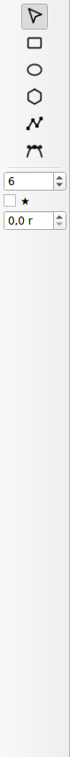

| Werkzeug | Taste | Bedienung |
|---|---|---|
| Auswählen | V | Standard. Rahmen nach rechts ziehen = nur ganz umschlossene Objekte, nach links ziehen = alle berührten Objekte |
| Rechteck | R | Aufziehen. Shift = Quadrat, Strg = vom Mittelpunkt aus. Eckenradius im Feld unter den Werkzeugen. |
| Ellipse | E | Aufziehen. Shift = Kreis, Strg = vom Mittelpunkt aus. |
| Polygon/Stern | P | Aufziehen. Eckenzahl im Feld darunter, ★ = Stern. |
| Linie/Polylinie | L | Punkte anklicken. Doppelklick oder Enter beendet, Klick auf den Startpunkt schließt die Form, Esc bricht ab. Mit gedrückter Umschalttaste (Shift) verläuft das nächste Segment nur waagrecht oder senkrecht – je nachdem, in welche Richtung die Maus weiter vom letzten Punkt entfernt ist. |
| Knoten | N | Knotenbearbeitung, siehe unten |

Neue Formen landen auf der gerade im Tab *Ebenen* gewählten Ebene. Mit **Esc** geht es zurück zum Auswahlwerkzeug.

<!-- hilfe: knoten -->
### Knotenbearbeitung

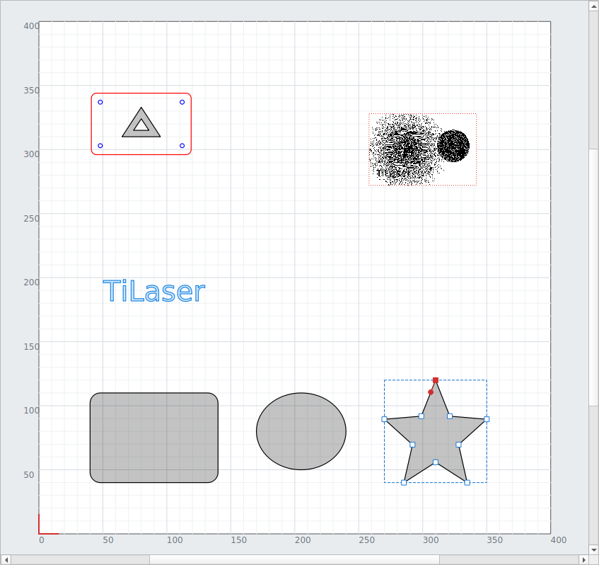

Mit dem Knotenwerkzeug (N) ein Objekt anklicken. Die Knoten erscheinen als Quadrate, der ausgewählte rot.
Am ausgewählten Knoten erscheinen die **Kurven-Anfasser** (Kreise).

| Aktion | Bedienung |
|---|---|
| Knoten verschieben | Ziehen |
| Kurve formen | Anfasser ziehen. Glatte Knoten bleiben glatt; mit **Alt** wird nur ein Anfasser bewegt (Ecke). |
| Knoten einfügen | Doppelklick auf die Kontur |
| Knoten löschen | Entf |
| Segment in Kurve umwandeln | C (Segment nach dem ausgewählten Knoten) |
| Segment in Linie umwandeln | L |
| Knoten glätten | S |
| Pfad auftrennen | B (geschlossene Kontur öffnen bzw. offene Linie teilen) |
| **Startpunkt setzen** | A (oder *Maschine → Startpunkt auf gewählten Knoten setzen*): Am ausgewählten Knoten beginnt der Schnitt dieser Kontur; TiLaser wählt den Startpunkt dann nicht mehr selbst. Bei offenen Linien geht das an einem der beiden Enden. Mit Kerf-Ausgleich oder Haltestegen wählt TiLaser den Startpunkt weiterhin selbst |

Kurven aus SVG, PDF, DXF, Schriften und den Zeichenwerkzeugen bleiben echte Bézierkurven mit wenigen Knoten.

<!-- hilfe: formen -->
### Formen kombinieren

Menü **Formen** (mindestens zwei geschlossene Vektorobjekte auswählen):

| Funktion | Ergebnis |
|---|---|
| Vereinigen (Strg+Shift+U) | Gemeinsamer Umriss aller Formen |
| Abziehen (Strg+Shift+D) | Größte Form minus alle anderen (z. B. Platte minus Ausschnitte) |
| Schnittmenge (Strg+Shift+I) | Nur der überlappende Bereich |
| Ausschluss (XOR) | Alles außer den Überlappungen |
| Offset (Alt+O) | Konturen um einen Abstand nach außen (+) oder innen (−) versetzen, eckig oder rund |
| Pfade verbinden / schließen (Alt+J) | Offene Linien mit gemeinsamen Endpunkten verbinden und schließen – nützlich nach DXF-Importen |


<!-- hilfe: text -->
### Text


*Datei → Text einfügen* (Strg+T): Text (mehrzeilig), Schrift (alle installierten TrueType-/OpenType-Schriften
oder eine Datei über „…“), Größe in mm, Zeilen- und Zeichenabstand, Ausrichtung und Ebene. Neue Ebenen für
Text sind standardmäßig **Füllen** (Gravur) oder **Schneiden/Kontur**. Den Inhalt eines eingefügten Textes
ändert man später per Rechtsklick → *Inhalt ändern…*.

<!-- hilfe: variabler-text -->
### Variabler Text, QR-Code und Barcode

Texte und Code-Inhalte dürfen **Platzhalter** enthalten, die vor jedem Auftrag eingesetzt werden:

| Platzhalter | Ergebnis |
|---|---|
| `{nr}` | fortlaufende Nummer, z. B. `17`; `{nr:03}` mit führenden Nullen: `017` |
| `{datum}` / `{zeit}` | Tagesdatum `18.11.2026` / Uhrzeit `14:05`; außerdem `{jahr}`, `{monat}`, `{tag}` |
| `{Spaltenname}` | Wert aus der aktuellen Zeile einer CSV-Datei, z. B. `{Name}` |

*Werkzeuge → Variable Texte…* legt Startnummer und Schrittweite fest, wählt eine CSV-Datei (erste Zeile =
Spaltennamen, Trennzeichen `;` oder `,`) und die aktuelle Zeile. Mit *Nach jedem Auftrag bzw. G-Code-Export
weiterzählen* erhöht TiLaser die Nummer und geht zur nächsten CSV-Zeile, sobald ein Auftrag fertig ist –
für Seriennummern, Namensschilder oder Etiketten. Die Vorschau zeigt immer die nächsten Werte.

*Werkzeuge → QR-Code / Barcode einfügen…* (Strg+Shift+Q) erzeugt einen **QR-Code** (Kantenlänge,
Fehlerkorrektur L/M/Q/H, auch Umlaute und Adressen) oder einen **Barcode Code 128** (Breite, Höhe; Zeichen
ASCII 32–126) als Gravur auf einer Füll-Ebene. Der Inhalt darf Platzhalter enthalten, z. B.
`https://example.com/teil/{nr:05}`. Für zuverlässiges Scannen einen kleinen Zeilenabstand (höchstens ein Viertel
der Modulbreite) und einen hellen Rand um den Code lassen und vor einer Serie mit dem Handy testen.

<!-- hilfe: text-auf-pfad -->
### Text auf Pfad


Kontur auswählen (Kreis, Bogen, Wellenlinie …) → *Werkzeuge → Text auf Pfad* oder Rechtsklick.
Bei geschlossenen Konturen steht der Text außen und ist oben mittig lesbar; mit **Umdrehen** innen und unten.
*Abstand* = Abstand der Schrift von der Kontur, *Versatz* = Verschiebung entlang der Kontur.

<!-- hilfe: nachzeichnen -->
### Bild nachzeichnen


Ein Bild auswählen → *Werkzeuge → Bild nachzeichnen* (Alt+T). Aus dunklen Bereichen werden geschlossene
Konturen, z. B. um ein Logo zu schneiden.

| Einstellung | Wirkung |
|---|---|
| Schwellwert | Pixel dunkler als dieser Wert werden zur Fläche |
| Invertieren | Helle Bereiche nachzeichnen |
| Glättung | Größer = weniger Punkte, glattere Kanten |
| Mindestgröße | Kleinere Flecken werden ignoriert |
| Helligkeit / Kontrast | Bild vorher anpassen |
| Bild behalten | Sonst wird das Bild durch die Konturen ersetzt |

<!-- hilfe: box -->
### Box-Generator

*Werkzeuge → Generatoren → Box-Generator…* (Strg+Umschalt+B) erzeugt einen Kasten mit Fingerzinken: Boden, vier
Wände und optional einen Deckel. Die Teile werden zusammengesteckt und bei Bedarf verleimt.

| Einstellung | Wirkung |
|---|---|
| Maße | *Innenmaße* (der Inhalt muss hineinpassen, z. B. eine Platine) oder *Außenmaße* |
| Breite, Tiefe, Höhe | Größe in X, Y und Z |
| Materialstärke | Vorher mit dem Messschieber messen. Sperrholz „3 mm“ ist oft 2,7 oder 3,2 mm dick, und schon 0,2 mm Unterschied machen die Zinken zu locker oder zu stramm |
| Zinkenbreite | Gewünschte Breite; das Programm verteilt eine ungerade Zahl gleich breiter Zinken auf jede Kante |
| Schnittbreite (Kerf) | Wird als Kerf der neuen Ebene „Box“ eingetragen. Größer = strammer. Für eine Presspassung etwa 0,02–0,05 mm über der gemessenen Schnittbreite (siehe [Kerf ermitteln](#kerf-ermitteln)) |
| Mit Deckel | Ohne Häkchen entsteht eine oben offene Schale |
| Leistung, Geschwindigkeit, Durchgänge | Werte für die Ebene „Box“; am einfachsten danach im Ebenen-Tab ein Preset anwenden |
| Teile beschriften | Graviert „Boden“, „Vorne“ usw. mit wenig Leistung auf die Teile (Ebene „Box-Beschriftung“) |

*Vorschau* zeigt den Werkzeugweg, *Ins Projekt* legt die Teile als einzelne Objekte an. Danach lassen sie sich
verschieben, mit [Nesting](#8-nesting--teile-automatisch-anordnen) platzsparend anordnen oder um Löcher,
Lüftungsschlitze und Gravuren ergänzen (z. B. mit *Formen → Abziehen*). Die Zinken bleiben dabei unverändert.

Tipp: Erst eine kleine Probe-Box (z. B. 40 × 30 × 20 mm) schneiden und die Passung prüfen, dann den Kerf anpassen.

<!-- hilfe: muster -->
### Muster in einer Fläche

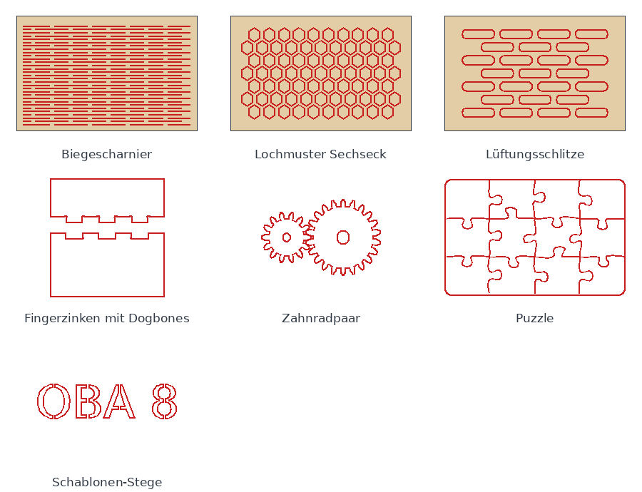

Unter *Werkzeuge → Muster in Fläche* füllt TiLaser eine **ausgewählte geschlossene Kontur** (z. B. ein
Rechteck oder die Umrisslinie eines Teils, auch mit Löchern). Das Ergebnis ist ein neues Objekt; die
Kontur selbst bleibt unverändert und wird wie gewohnt ausgeschnitten.

**Biegescharnier** – versetzte Schnittlinien, mit denen sich Sperrholz biegen lässt (Living Hinge).

| Einstellung | Wirkung |
|---|---|
| Art | *Normal* (gerade Schlitze), *Dreifach versetzt* (weicher) oder *Wellenschlitze* (weicher, dekorativ), siehe unten |
| Schlitzlänge, Steg | Länge der Schnitte und der stehen bleibenden Stege dazwischen |
| Abstand der Reihen | Kleiner = biegsamer, aber zerbrechlicher. 3-mm-Sperrholz: etwa 1,5 mm |
| Abstand zum Rand | Abstand der Schlitze zum Rand (siehe unten) |
| Richtung der Schlitze | 0° = waagerecht; die Biegeachse liegt parallel zu den Schlitzen |

Das Muster ist symmetrisch: Die Reihen liegen mittig in der Fläche, und jede Reihe ist links und rechts
gleich aufgebaut. Die beiden äußeren Reihen und jede zweite Reihe dazwischen halten den *Abstand zum Rand*
ein. Die Reihen dazwischen sind um eine halbe Teilung versetzt: Ihre Stege liegen genau in der Mitte der
Schlitze der Nachbarreihen, und sie laufen bis an den Rand durch. Damit jede Reihe aufgeht, wird die
Schlitzlänge minimal angepasst. In runden oder schrägen Flächen richtet sich jede Reihe nach ihrer eigenen
Breite.

Wie weich das Scharnier wird, hängt von den Holzstreifen zwischen den Reihen ab: Sie verdrehen sich beim
Biegen zwischen den Stegen. Je länger das freie Stück und je schmaler der Streifen, desto weicher.

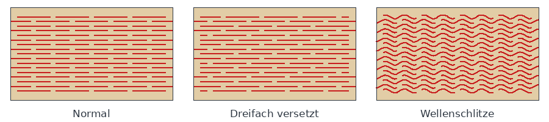

- **Normal** – gerade Schlitze, jede Reihe um eine halbe Teilung versetzt (wie oben beschrieben). Jede
  Reihe ist spiegelsymmetrisch.
- **Dreifach versetzt** – jede Reihe ist um eine drittel Teilung gegen die vorige versetzt. Die Stege
  benachbarter Reihen liegen dadurch weiter auseinander, und die Streifen können sich auf längerer Strecke
  verdrehen: spürbar weicher, aber noch formstabil – gut für Boxdeckel und runde Ecken. Auch hier halten
  die äußeren Reihen und jede zweite den Randabstand ein. Weil eine Drittelteilung nicht spiegelbar ist,
  ist das Muster punktsymmetrisch zur Mitte (um 180° gedreht sieht es gleich aus).
- **Wellenschlitze** – Aufbau wie *Normal*, aber die Schlitze sind Wellen (Höhe 40 % des Reihenabstands,
  zwei Wellen je Teilung). Alle Wellen laufen parallel, sodass der Abstand zwischen den Reihen erhalten
  bleibt. Die längeren Streifen verteilen die Spannung besser, das Holz bricht seltener; dafür dauert das
  Lasern etwas länger. Ebenfalls punktsymmetrisch.

**Lochmuster / Lüftungsgitter** – Kreise, Sechsecke, Quadrate oder Langlöcher, als Raster oder versetzt
(Waben). Es werden nur ganze Löcher gesetzt, die mit dem Randabstand vollständig in der Fläche liegen –
ideal für Lüftungsgitter in Gehäusewänden.

**Gravurmuster** – Flächenmuster auf einer Füll-Ebene:

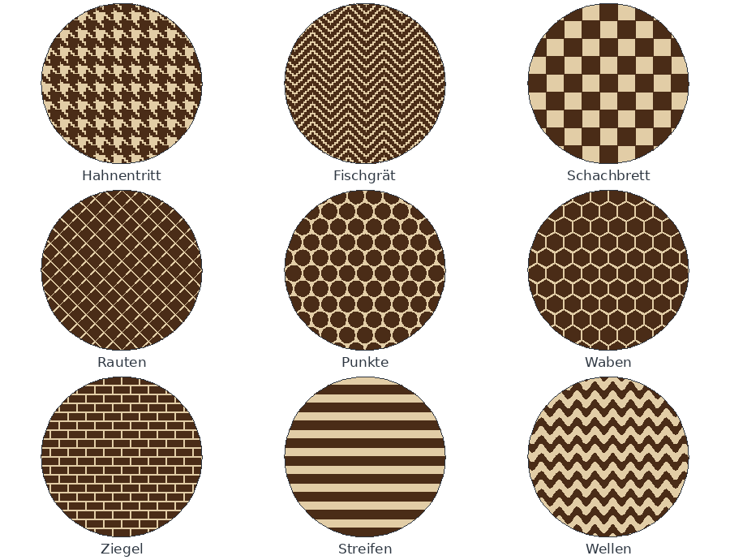

*Größe* ist der Rapport (Wiederholung), *Fuge* der Abstand zwischen den Elementen (Rauten, Punkte, Waben,
Ziegel, Wellen), *Drehung* dreht das Muster. Hahnentritt und Fischgrät sind wie beim Stoff aus kleinen
Quadraten aufgebaut.

<!-- hilfe: biegezone -->
### Biegescharnier zwischen zwei Kanten

*Werkzeuge → Biegescharnier zwischen zwei Kanten…* verbindet zwei Teile über eine **Biegezone** zu einem
Teil – z. B. Boden und Wand eines Gehäuses mit runder Ecke. Die Länge der Biegezone berechnet TiLaser aus
**Radius und Winkel**.

1. Werkzeug aufrufen und die **Kante des ersten Teils** anklicken – dieses Teil wird gedreht und
   verschoben (die Kante wird beim Darüberfahren orange markiert, die erste gewählte blau).
2. Die **Kante des zweiten Teils** anklicken, an die die Biegezone anschließen soll.
3. Im Dialog Radius, Winkel und Materialstärke eingeben, dazu die Einstellungen des Schnittmusters.

TiLaser legt das erste Teil so, dass seine Kante der anderen im Abstand der Biegelänge gegenüberliegt (Mitten
bündig), füllt den Streifen dazwischen und vereinigt alles zu **einem Teil**. Der Streifen bekommt das
[Biegescharnier-Muster](#muster-in-einer-fläche); die Schlitze laufen parallel zu den Kanten. Löcher und
Gravuren beider Teile bleiben erhalten. *Bearbeiten → Rückgängig* stellt die beiden Teile wieder her.

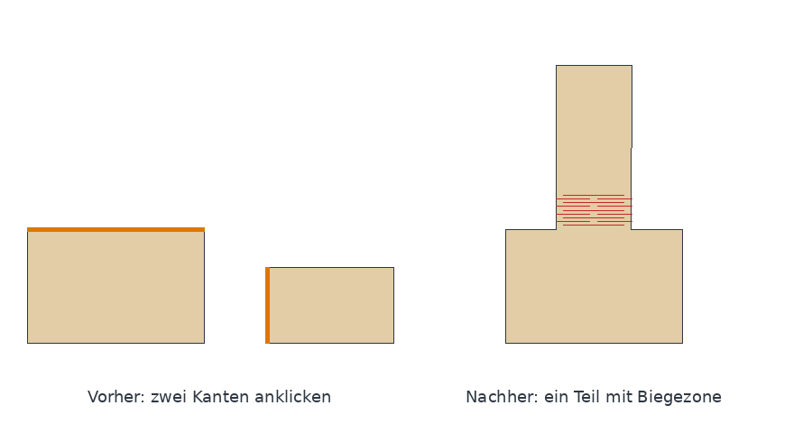

| Einstellung | Wirkung |
|---|---|
| Biegeradius (innen) | Innenradius der Biegung |
| Biegewinkel | Um wie viel Grad gebogen wird (90° = rechtwinklige Ecke, 180° = Kehre) |
| Materialstärke | Biegelänge = Winkel × (Radius + halbe Materialstärke), gemessen in der Mitte des Materials – z. B. 90° bei 10 mm Radius und 3 mm Material: 18,1 mm |
| Art, Schlitzlänge, Steg, Abstand der Reihen | Wie beim [Biegescharnier](#muster-in-einer-fläche) in einer Fläche |
| Abstand zum Rand | Abstand der geschlossenen Schlitzreihen von den Enden der Biegezone |

Die Biegezone ist so breit, wie sich die beiden Kanten nach dem Ausrichten überdecken. Sind die Kanten
verschieden lang, steht das längere Teil seitlich über.

<!-- hilfe: fingerzinken -->
### Fingerzinken an Kante

Verzinkt zwei beliebige Teile miteinander – z. B. eine selbst gezeichnete Rückwand mit einem Boden: Das
eine Teil bekommt Zinken, das andere genau passende Aussparungen. So geht es:

1. Die beiden Teile so hinlegen, dass die zu verbindenden **Kanten aufeinanderliegen** (gleiche Linie,
   überlappend). Am einfachsten mit [Kanten aneinanderlegen](#kanten-aneinanderlegen) (Alt+K).
2. Beide Teile auswählen → *Werkzeuge → Fingerzinken an Kante…*
3. Unter **Zinken an** wählen, welches Teil die Zinken bekommt; die Liste nennt beide Teile mit ihrer Lage
   (z. B. „Boden (unten)“).

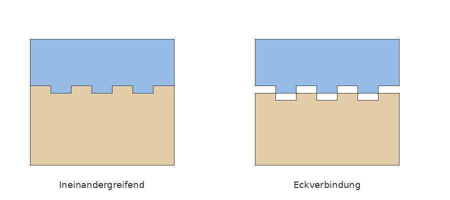

| Einstellung | Wirkung |
|---|---|
| Art | **Ineinandergreifend: ein Teil mit Zinken, das andere mit Aussparungen** (Standard): Die Zinken ragen um die Materialstärke über die Kante hinaus, das Gegenstück bekommt an denselben Stellen gleich tiefe Aussparungen. So wie die Teile liegen, füllen die Zinken die Aussparungen lückenlos (Bild links); die gemeinsame Linie wird nur einmal geschnitten. Für eine 90°-Ecke zeichnet man das Teil mit den Zinken um die Materialstärke kürzer. **Eckverbindung: beide Teile mit versetzten Aussparungen, Außenmaße bleiben**: wie beim Box-Generator – beide Teile behalten ihr Außenmaß und bekommen abwechselnd Aussparungen (Bild rechts). Flach nebeneinander bleiben Lücken; erst um 90° gedreht greifen sie ineinander |
| Zinken an | Teil, das die Zinken bekommt (bei *Eckverbindung*: Teil, dessen äußere Zinken stehen bleiben) |
| Materialstärke | Tiefe der Zinken/Aussparungen |
| Zinkenbreite | Gewünschte Breite; auf der Kante wird eine ungerade Anzahl gleich breiter Zinken verteilt |
| Dogbone-Durchmesser | Rundet jede **Innenecke** mit einem kleinen Kreis frei („Hundeknochen“), damit eckige Zinken ganz hineinpassen – wichtig bei dickem Material, starker Kegelform des Strahls oder beim Fräsen. 0 = aus |
| Toleranz | Wie weit die Kanten auseinanderliegen dürfen und trotzdem als „berührend“ gelten |
| Alle gemeinsamen Kanten | Sonst wird nur die längste gemeinsame Kante bearbeitet |

Kurven der Teile werden dabei in feine Linienzüge umgewandelt. Für die Passung den Kerf-Ausgleich der Ebene
nutzen ([Kerf ermitteln](#kerf-ermitteln)).

<!-- hilfe: puzzle-verbindung -->
### Puzzle-Verbindung an Kante

Verbindet zwei Teile, die **flach Kante an Kante** liegen, mit runden Nasen wie bei Puzzleteilen – z. B. um
eine Platte, die größer als die Arbeitsfläche ist, aus zwei Teilen zusammenzusetzen, oder für Schilder und
Spiele. Der Hals jeder Nase ist schmaler als ihr Kopf, deshalb lassen sich die Teile in der Ebene nicht
auseinanderziehen.

1. Die beiden Teile so hinlegen, dass die zu verbindenden **Kanten aufeinanderliegen** – am einfachsten mit
   [Kanten aneinanderlegen](#kanten-aneinanderlegen) (Alt+K).
2. Beide Teile auswählen → *Werkzeuge → Puzzle-Verbindung an Kante…*
3. Unter **Nasen an** wählen, welches Teil die Nasen bekommt; das andere bekommt genau passende Aussparungen.

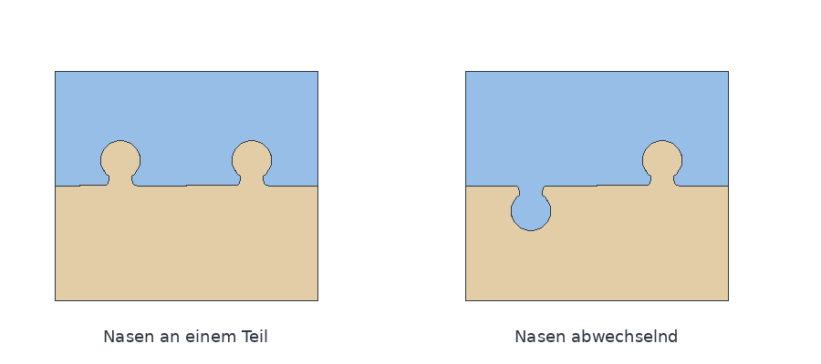

| Einstellung | Wirkung |
|---|---|
| Nasen an | Teil, das die Nasen bekommt (bei *abwechselnd*: Teil mit der ersten Nase) |
| Nasengröße (Kopfdurchmesser) | Durchmesser des runden Kopfes. Der Hals ist 60 % so breit, die Nase ragt etwa 1,15 × Kopfdurchmesser über die Kante – so tief muss auch das andere Teil mindestens sein |
| Anzahl je Kante | 0 = automatisch: etwa alle 2,5 Kopfdurchmesser eine Nase, gleichmäßig verteilt |
| Nasen abwechselnd an beiden Teilen | Die Nasen sitzen abwechselnd am einen und am anderen Teil (Bild rechts) – hält auch bei Zug in beide Richtungen quer zur Kante gleich gut |
| Spiel | Abstand zwischen Nase und Aussparung (je zur Hälfte an beiden Teilen). Positiv = lockerer, negativ = strammer. Der Laser schneidet selbst schon etwas Material weg (Kerf); bei Sperrholz passt meist 0 oder ein leicht negativer Wert, siehe [Kerf ermitteln](#kerf-ermitteln) |
| Toleranz | Wie weit die Kanten auseinanderliegen dürfen und trotzdem als „berührend“ gelten |
| Alle gemeinsamen Kanten | Sonst wird nur die längste gemeinsame Kante bearbeitet |

Ist ein Teil an der Kante zu schmal für die Nasen oder passen nicht so viele Nasen auf die Kante, meldet
TiLaser das und ändert nichts. Kurven der Teile werden in feine Linienzüge umgewandelt. Für die Puzzle-Teile
eines ganzen Bildes gibt es den [Puzzle-Generator](#zahnrad-puzzle-und-schablonen-stege).

<!-- hilfe: snap-lock -->
### Snap-Lock an Kante

Steckverbindung **im rechten Winkel ohne Leim und Schrauben**: Das eine Teil bekommt Laschen aus zwei
federnden Zungen mit kleinen Haken, das andere passende rechteckige Schlitze. Beim Durchstecken werden die
Zungen zusammengedrückt, auf der Rückseite rasten die Haken ein. Zum Lösen die Zungen mit den Fingern
zusammendrücken. Typisch für Gehäuse, Boxen und Halterungen.

1. Die beiden Teile so hinlegen, dass die zu verbindenden **Kanten aufeinanderliegen** – am einfachsten mit
   [Kanten aneinanderlegen](#kanten-aneinanderlegen) (Alt+K). Die Kante des einen Teils wird später an die
   Fläche des anderen gesteckt.
2. Beide Teile auswählen → *Werkzeuge → Snap-Lock an Kante…*
3. Unter **Laschen an** wählen, welches Teil die Laschen bekommt.

TiLaser setzt die Laschen an die Kante, schneidet die Schlitze in das andere Teil und schiebt das Teil mit
den Laschen anschließend etwas weg, damit sich nichts überlappt (die Statusleiste nennt den Weg).

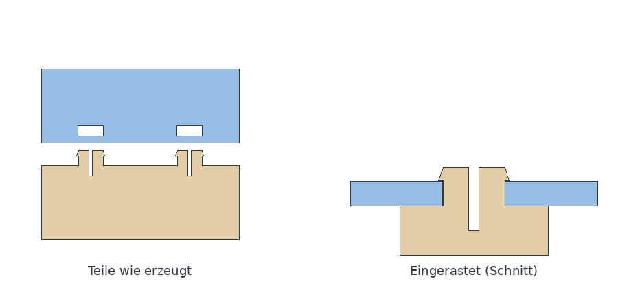

| Einstellung | Wirkung |
|---|---|
| Laschen an | Teil, das die Laschen bekommt; das andere bekommt die Schlitze |
| Materialstärke | Dicke des Materials (beide Teile). Die Haken sitzen knapp darüber, die Schlitze sind so breit |
| Laschenbreite | Breite einer Lasche (beide Zungen und der Federschlitz zusammen) |
| Anzahl je Kante | 0 = automatisch: etwa eine Lasche je 4 Laschenbreiten, gleichmäßig verteilt |
| Haken (seitlicher Überstand) | Wie weit jeder Haken seitlich übersteht. Mehr = hält fester, lässt sich schwerer stecken. Muss zusammen kleiner sein als Federschlitz + Spiel, sonst kommen die Zungen nicht durch |
| Federschlitz | Breite des Schlitzes zwischen den beiden Zungen. Er reicht etwas in das Teil hinein, damit die Zungen länger und weicher federn |
| Spiel | Luft im Schlitz und unter den Haken |
| Abstand der Schlitze zur Kante | Wie weit die Schlitze vom Rand des anderen Teils entfernt sind – das Teil mit den Laschen steht später genau dort |
| Toleranz | Wie weit die Kanten auseinanderliegen dürfen und trotzdem als „berührend“ gelten |
| Alle gemeinsamen Kanten | Sonst wird nur die längste gemeinsame Kante bearbeitet |

**Tipps:** Die Federwirkung hängt stark vom Material ab – Sperrholz und Acryl (spröde!) vorher mit einem
Probestück testen. Bei Acryl kleine Haken (0,3–0,5 mm) und einen breiteren Federschlitz wählen. Passen die
Schlitze nicht in das andere Teil (zu schmal oder zu nah am Rand), meldet TiLaser das und ändert nichts.

<!-- hilfe: hammerverbindung -->
### Hammerverbindung an Kante

Zapfenverbindung **im rechten Winkel ohne Schrauben und Leim** nach der „Hammer Joint“-Zeichnung von
Jiskar Schmitz (Lasersheets, frei verwendbar): Das eine Teil bekommt Zapfen mit einem sich verjüngenden
Schlitz, das andere passende Zapfenlöcher. Der **Keil wird direkt im Schlitz mitgelasert** und hängt nur an
zwei kurzen Stegen; er steht über den Zapfen hinaus.

**Zusammenbau:** Zapfen durch das Loch stecken und den Keil mit dem Hammer einschlagen. Die Stege brechen,
der Keil rutscht in den engen Teil des Schlitzes und drückt die beiden Zapfenhälften im Loch auseinander –
die Verbindung klemmt. Danach ist der Keil bündig mit dem Zapfen, der seinerseits minimal übersteht
(*Überstand des Zapfens*) und bündig geschliffen werden kann. Die Verbindung lässt sich nicht mehr
zerstörungsfrei lösen.

1. Die beiden Teile so hinlegen, dass die zu verbindenden **Kanten aufeinanderliegen** – am einfachsten mit
   [Kanten aneinanderlegen](#kanten-aneinanderlegen) (Alt+K).
2. Beide Teile auswählen → *Werkzeuge → Hammerverbindung an Kante…*
3. Unter **Zapfen an** wählen, welches Teil die Zapfen bekommt.

TiLaser setzt Zapfen samt Keil an die Kante, schneidet die Löcher in das andere Teil und schiebt das Teil mit
den Zapfen etwas weg, damit sich nichts überlappt.

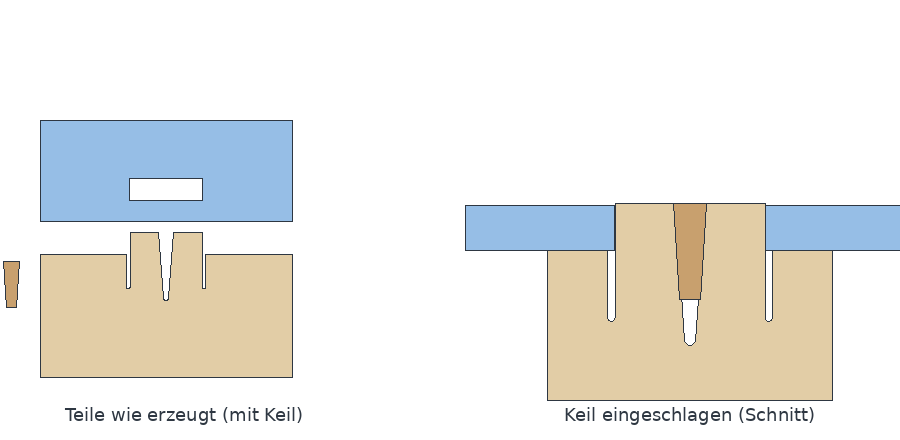

| Einstellung | Wirkung |
|---|---|
| Zapfen an | Teil, das die Zapfen bekommt; das andere bekommt die Zapfenlöcher |
| Materialstärke | Dicke des Materials (beide Teile); das Zapfenloch ist so breit plus *Spiel*, der Zapfen so lang plus *Überstand* |
| Zapfenbreite | Länge des Zapfenlochs (bewährt: 20 mm). Der Zapfen selbst ist um das *Übermaß* breiter |
| Anzahl je Kante | 0 = automatisch: etwa ein Zapfen je 3 Zapfenbreiten, gleichmäßig verteilt |
| Überstand des Zapfens | So weit steht der Zapfen über das Gegenstück hinaus (zum Bündigschleifen) |
| Keilüberstand vor dem Einschlagen | So weit ragt der Keil über den Zapfen – das ist auch der Weg, den er beim Einschlagen in den Schlitz rutscht. Die Originalzeichnung verwendet für alle Stärken 10 mm |
| Spreizung durch den Keil | Um so viel ist der Keil oben breiter als der Schlitz an der Zapfenspitze (gesamt). Mehr = fester, aber höhere Bruchgefahr |
| Länge der Haltestege | Die zwei Stege links und rechts, an denen der Keil hängt (5 mm unter der Zapfenspitze). Zu lang = lässt sich schwer einschlagen, zu kurz = Keil fällt beim Lasern heraus |
| Schlitztiefe in das Teil | Wie tief Keilschlitz und Entlastungsschlitze unter die Kante reichen (Original: 20 mm) |
| Entlastungsschlitze | Keilförmige Schlitze links und rechts neben dem Zapfen (oben so breit, unten spitz). Sie machen die Zapfenhälften beweglich. 0 = keine |
| Übermaß des Zapfens (Breite) | So viel ist der Zapfen breiter als das Loch lang (Original: 0,15 mm) – klemmt zusätzlich quer |
| Spiel im Zapfenloch | So viel ist das Loch breiter als das Material dick (Original: 0,075 mm) |
| Abstand der Zapfenlöcher zur Kante | Wie weit die Löcher vom Rand des anderen Teils entfernt sind – dort steht später das Teil mit den Zapfen |
| Toleranz, Alle gemeinsamen Kanten | Wie bei den anderen Verbindungen |

Die Voreinstellungen entsprechen der Originalzeichnung (für 3 bis 12 mm gleich aufgebaut; nur Zapfenlänge
und Lochbreite wachsen mit der Materialstärke). **Tipps:** Am besten geeignet sind Birken-Sperrholz und
Massivholz ab 6 mm, MDF geht auch. Spröde oder sehr glatte Materialien (Acryl, Bambus quer zur Faser, POM)
sind ungeeignet. Die Klemmkraft hängt stark von Material, Kerf und Strahlkegel ab – unbedingt vorher an
einem Probestück testen. Beim Einschlagen die Verbindung flach auf den Tisch legen, damit sich der Zapfen
nicht schräg stellt.

<!-- hilfe: zahnrad-puzzle -->
### Zahnrad, Puzzle und Schablonen-Stege

**Zahnrad** (*Werkzeuge → Generatoren*) – Stirnrad mit Evolventenverzahnung. Wichtig ist das **Modul**:
Teilkreis = Modul × Zähnezahl, nur Räder mit gleichem Modul passen zusammen. Mit *Gegenrad erzeugen*
entstehen zwei kämmende Räder im richtigen Achsabstand (Modul × (z1 + z2) / 2, steht nach dem Erzeugen
in der Statusleiste). Das *Flankenspiel* macht die Zähne etwas schmaler, damit die Räder nicht klemmen.
Unter etwa 17 Zähnen werden die Zahnfüße nicht unterschnitten – die Räder laufen dann etwas rauer.

**Puzzle** – Rahmen und Schnittlinien mit zufälligen Nasen. Breite, Höhe, Spalten und Reihen festlegen;
*Nasengröße* und *Unregelmäßigkeit* bestimmen das Aussehen. Die *Zufallszahl* steht nach dem Erzeugen in
der Statusleiste – dieselbe Zahl ergibt wieder dasselbe Puzzle. Tipp: erst ein Foto auf die Fläche
gravieren, dann das Puzzle ausschneiden.

**Schablonen-Stege** (*Werkzeuge → Schablonen-Stege…*) – für Schablonen, bei denen Buchstaben aus einer
Platte ausgeschnitten werden: Innenteile wie im O, A, B oder 8 würden herausfallen. Text oder Form
auswählen; TiLaser legt durch jedes Innenteil einen Steg (senkrecht oder waagerecht) der eingestellten
Breite.

<!-- hilfe: knoechelscharnier -->
### Knöchelscharnier an Kante

*Werkzeuge → Knöchelscharnier an Kante…* baut ein **Scharnier nur aus Laserteilen** zwischen zwei Teilen
einer Box – typisch die **Rückwand der Box und die Rückwand des Deckels**. Die Knöchel sind Scheiben aus dem
Material, die senkrecht außen auf den Wänden stehen, abwechselnd an beiden Teilen. Jeder Knöchel steckt mit
**zwei kleinen Fingerzinken** in Schlitzen seiner Wand. Das Auge mit dem Loch sitzt genau über der
gemeinsamen Kante, zum Ende hin ist der Knöchel **abgeschrägt**. Durch alle Augen geht der **Stift**, um den
sich der Deckel dreht.

1. Die beiden Rückwände so hinlegen, wie sie bei geschlossener Box aneinanderstoßen: **Kante an Kante**
   (am einfachsten mit [Kanten aneinanderlegen](#kanten-aneinanderlegen), Alt+K).
2. Beide auswählen → *Werkzeuge → Knöchelscharnier an Kante…*

TiLaser schneidet die Schlitze in beide Rückwände und legt die Knöchel (und die Stifte) rechts neben die
Teile. Knöchel 1, 3, 5 … jedes Scharniers gehören zu dem zuerst ausgewählten Teil, 2, 4 … zum anderen – die
Statusleiste nennt die Zuordnung.

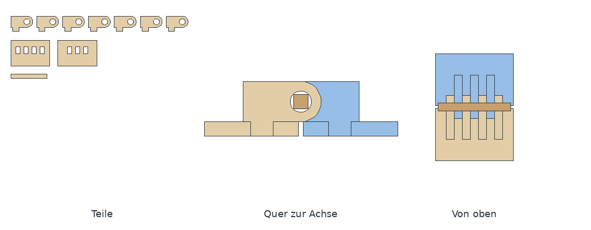

**Zusammenbau:** Die Knöchel in die Schlitze stecken (gerne verleimen), Box und Deckel zusammenstellen, so
dass die Knöchel abwechselnd stehen und die Augen fluchten, dann den Stift durchschieben. Der mitgelaserte
Stift steht beidseitig eine Materialstärke über; ein Tropfen Leim an den Enden hält ihn.

| Einstellung | Wirkung |
|---|---|
| Materialstärke | Dicke des Materials – Breite jedes Knöchels, Tiefe der Fingerzinken |
| Anzahl Scharniere | 1 = ein Scharnier in der Mitte der Kante. Ab 2 sitzen die äußeren nahe den Enden, die übrigen gleichmäßig dazwischen – für breite Teile |
| Abstand der äußeren Scharniere vom Ende der Kante | Ab zwei Scharnieren: wie weit die äußeren von den Enden der Kante entfernt sind |
| Knöchel je Scharnier | Ein Scharnier ist *Knöchel × Materialstärke* lang. Bei ungerader Anzahl sitzen außen beide Knöchel am ersten Teil |
| Knöchellänge | Wie weit der Knöchel ab der Kante auf der Wand liegt |
| Höhe am abgeschrägten Ende | Der Knöchel fällt vom Auge bis hierhin ab |
| Länge der Fingerzinken | Länge der beiden Zinken (und Schlitze) entlang der Wand; einer sitzt gleich hinter dem Auge, einer kurz vor dem Ende |
| Stiftdurchmesser | 0 = ein **Vierkantstift** wird mitgelasert (Kantenlänge = Materialstärke); er dreht sich im runden Loch, dessen Durchmesser der Diagonale entspricht. Sonst der Durchmesser eines Rundstabs oder Drahts |
| Wandstärke um das Loch | Material zwischen Loch und Außenrand des Auges |
| Spiel | Luft im Loch um den Stift und in den Schlitzen um die Zinken |
| Toleranz | Wie weit die Kanten auseinanderliegen dürfen und trotzdem als „berührend“ gelten |

---

<!-- hilfe: nesting -->
## 8. Nesting – Teile automatisch anordnen

Nesting ordnet die ausgewählten Teile platzsparend auf einer rechteckigen Grundfläche an und hält dabei
einen **Mindestabstand** ein. Das spart Material, z. B. beim Ausschneiden vieler Gehäuseteile aus einer
Sperrholzplatte.

1. Die Teile auswählen (Strg+A für alle).
2. *Anordnen → Nesting* (Strg+Shift+N).
3. Einstellungen wählen und mit OK starten.


| Einstellung | Beschreibung |
|---|---|
| **Grundfläche** | *Arbeitsbereich* (ganzes Bett), *Eigene Maße* (X/Y der linken unteren Ecke, Breite, Höhe) oder *Größtes ausgewähltes Objekt* – dann dient z. B. ein gezeichnetes Rechteck in Plattengröße als Grundfläche und wird selbst nicht verschoben |
| **Mindestabstand** | Kleinster Abstand zwischen zwei Teilen in mm. Mindestens die Schnittbreite plus etwas Reserve, für Sperrholz z. B. 2–3 mm |
| **Randabstand** | Abstand zum Rand der Grundfläche |
| **Drehungen** | Keine, 0°/180°, 90°-Schritte, 45°-Schritte, 15°-Schritte. Bei sichtbarer Holzmaserung „Keine“ oder „0°/180°“ wählen |
| **Kopien je Objekt** | Legt Kopien an, so viele auf die Fläche passen (bis zur angegebenen Anzahl) |
| **In Löcher setzen** | Kleine Teile dürfen in Aussparungen größerer Teile gelegt werden. Als Aussparung zählt nur eine geschlossene Innenkontur auf einer ausgegebenen *Schneiden*-Ebene – also ein Stück, das wirklich herausfällt. Gravuren, Linien auf ausgeblendeten Ebenen und alles andere innerhalb eines Teils gelten als Material |
| **Bei Abstand 0 bündig anlegen** | Nur bei Mindestabstand 0: Nach dem Anordnen werden die Teile nach links und unten zusammengeschoben, bis sie sich berühren. Gerade Kanten liegen dann genau aufeinander und werden nur einmal geschnitten (siehe *Doppelte Linien* in den Maschineneinstellungen). Spart Material und Laufzeit; die Teile werden dabei um die halbe Schnittbreite kleiner |
| **Gründlich** | Probiert 9 Kombinationen aus Sortierung und Platzierungsregel und nimmt die beste – langsamer, meist dichter |
| **Rahmen einzeichnen** | Zeichnet die Grundfläche als graues Rechteck auf einer Ebene ohne Ausgabe ein |

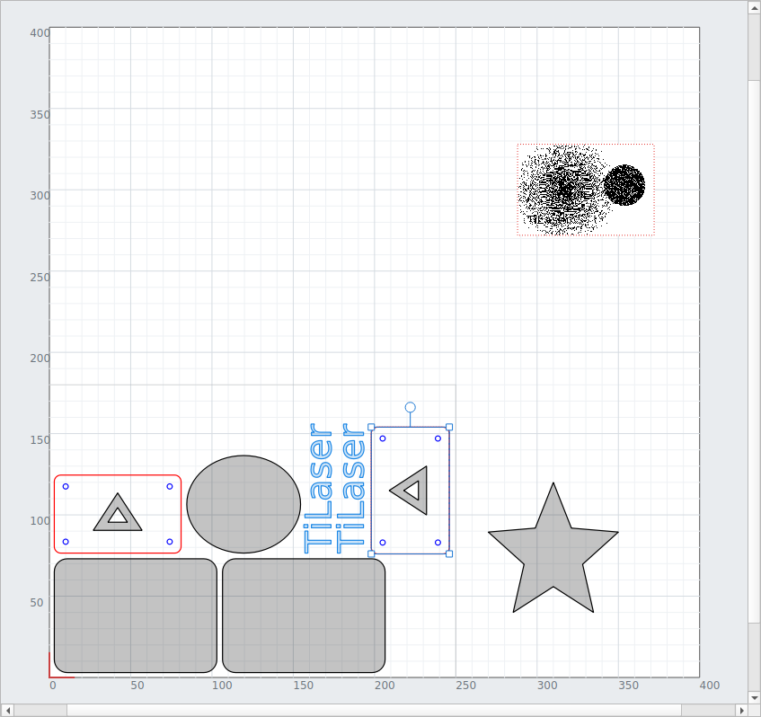

Nach dem Anordnen meldet TiLaser, wie viele Teile platziert wurden und wie viel der Fläche belegt ist.
**Teile, die nicht passen**, bleiben an ihrem Platz und sind danach ausgewählt. Mit Strg+Z wird das
Nesting vollständig rückgängig gemacht.

**Mehrere Platten nacheinander:** Passen nicht alle Teile, bietet TiLaser im Ergebnisfenster an:

- **Platzierte speichern…** – die angeordneten Teile (mit ihren Ebenen und der Grundfläche, falls
  eingezeichnet) als eigene `.tlp`-Datei speichern, z. B. `platte1.tlp`. Das Projekt bleibt, wie es ist.
- **Speichern und entfernen…** – wie oben, danach werden die gespeicherten Teile aus dem aktuellen
  Projekt entfernt. Übrig bleiben die Teile, die nicht gepasst haben; sie sind ausgewählt und lassen sich
  sofort erneut anordnen (Strg+Shift+N). So entsteht Platte für Platte (`platte2.tlp`, …), bis alles
  verteilt ist. Entfernen lässt sich mit Strg+Z rückgängig machen; die gespeicherte Datei bleibt.

Jede Platte öffnet man später mit *Datei → Projekt öffnen* und lasert sie wie gewohnt.

**Genauigkeit:** Die Teile werden für die Berechnung in ein feines Raster (etwa 0,25–1 mm, abhängig von der
Größe der Grundfläche) umgerechnet. Das Raster ist bewusst großzügig: Der Mindestabstand wird immer
eingehalten, die Teile liegen dafür eventuell einen Bruchteil eines Millimeters weiter auseinander als nötig.
Umrisse aus einzelnen Linien (z. B. DXF-Zeichnungen) werden als geschlossene Teile erkannt, wenn sich die
Linienenden berühren.

---

<!-- hilfe: ebenen -->
## 9. Ebenen und Laserparameter

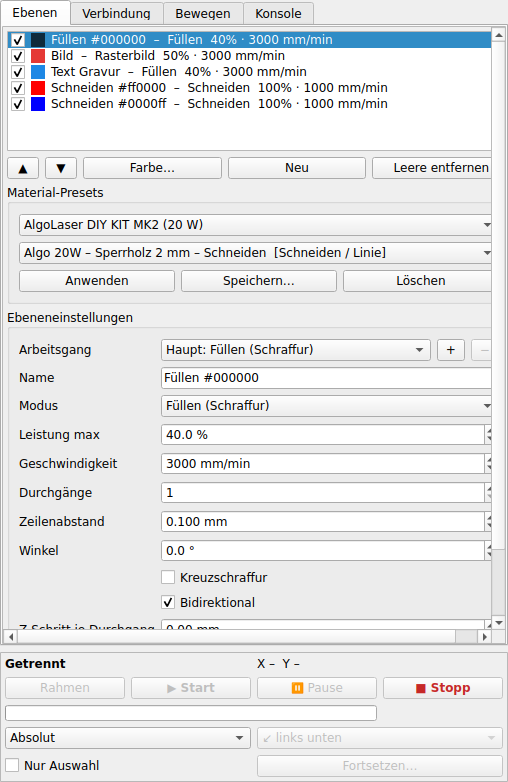

Jede Ebene ist ein Arbeitsgang mit eigenen Parametern. Die **Reihenfolge** in der Liste ist die
Bearbeitungsreihenfolge (▲/▼). Gravuren werden automatisch vor Schnitte gesetzt – **Schneiden gehört nach
unten**, damit Teile erst herausfallen, wenn alles darauf fertig ist.

Das **Häkchen** vor einer Ebene bestimmt, ob sie ausgegeben wird. Ausgeschaltete Ebenen werden blass
dargestellt.

**Ebenenfarben:** Es gibt 32 feste Farben, mit *Farbe…* aus einem Farbfeld (8 × 4) gewählt. Ein Punkt
markiert Farben, die schon eine andere Ebene benutzt; der Tooltip nennt Nummer, Name und Ebene. Beim Import
werden die Farben der Datei auf die nächstliegende der 32 Farben abgebildet – reine Grundfarben (z. B.
Rot `#ff0000`, Blau `#0000ff`) auf die gleichnamige. Sehr ähnliche Farben landen dadurch auf derselben Ebene.

<!-- hilfe: modi -->
### Modi

| Modus | Wirkung |
|---|---|
| **Schneiden / Linie** | Der Laser fährt die Konturen ab (Schneiden oder Ritzen) |
| **Füllen (Schraffur)** | Geschlossene Flächen werden zeilenweise graviert (Löcher bleiben frei) |
| **Offset-Füllung (Konturen)** | Geschlossene Flächen werden mit Konturlinien im Zeilenabstand von außen nach innen gefüllt – weniger Hin-und-Her als Schraffur, gut für Schriften und schmale Formen |
| **Rasterbild** | Bilder werden pixelweise graviert |

<!-- hilfe: parameter -->
### Parameter

| Parameter | Modi | Beschreibung |
|---|---|---|
| Leistung max | alle | Laserleistung in % |
| Leistung min | Raster (Graustufen) | Leistung für helle Bildbereiche |
| Geschwindigkeit | alle | mm/min |
| Durchgänge | alle | Wie oft der Arbeitsgang wiederholt wird |
| Zeilenabstand | Füllen, Offset-Füllung, Raster | 0,1 mm ≈ 254 DPI; kleiner = dichter und langsamer |
| Winkel, Kreuzschraffur | Füllen | Richtung der Schraffur; zweite Schraffur um 90° gedreht |
| Überlappende Objekte vereinigen | Füllen | Aus (Standard): Überlappen sich zwei Objekte derselben Ebene, bleibt die Überlappung frei – wie bei Löchern (Even-Odd-Regel). An: überlappende Objekte werden zu einer gemeinsamen Fläche zusammengefasst. Löcher innerhalb eines Objekts (z. B. in Buchstaben) bleiben in beiden Fällen Löcher |
| Bildmodus | Raster | Floyd-Steinberg, Jarvis, Stucki, Atkinson (Dithering), Schwellwert, Graustufen |
| Schwellwert, Invertieren | Raster | |
| Helligkeit, Kontrast, Gamma | Raster | Bild vor dem Gravieren anpassen |
| Overscan | Raster | Anlaufweg vor/nach jeder Zeile gegen dunkle Ränder |
| Bidirektional | Füllen, Raster | Hin und zurück gravieren (schneller) |
| Innen vor außen | Schneiden | Löcher vor der Außenkontur schneiden, damit sich Teile nicht vorher lösen |
| **Kerf-Ausgleich** | Schneiden | Schnittbreite in mm. Außenkonturen werden um die Hälfte nach außen, Löcher nach innen versetzt – die Teile werden maßhaltig. Wichtig für Steck- und Presspassungen. Löcher, die kleiner als die Schnittbreite sind, verschwinden dabei; TiLaser meldet das beim Start als Hinweis. |
| **Haltestege** | Schneiden | Anzahl Stege je Kontur und Stegbreite. Die Teile bleiben im Material hängen und fallen nicht durch den Wabentisch. Optional nur an Außenkonturen. |
| Z-Schritt je Durchgang | alle | Fokus nach jedem Durchgang absenken (nur mit motorisierter Z-Achse) |
| Z-Versatz | alle | Vor dieser Ebene fährt Z um den Wert (+ = höher), danach zurück – z. B. leicht defokussiert gravieren (nur mit motorisierter Z-Achse) |
| Air Assist | alle | Sendet M8/M9 (Druckluft ein/aus) |

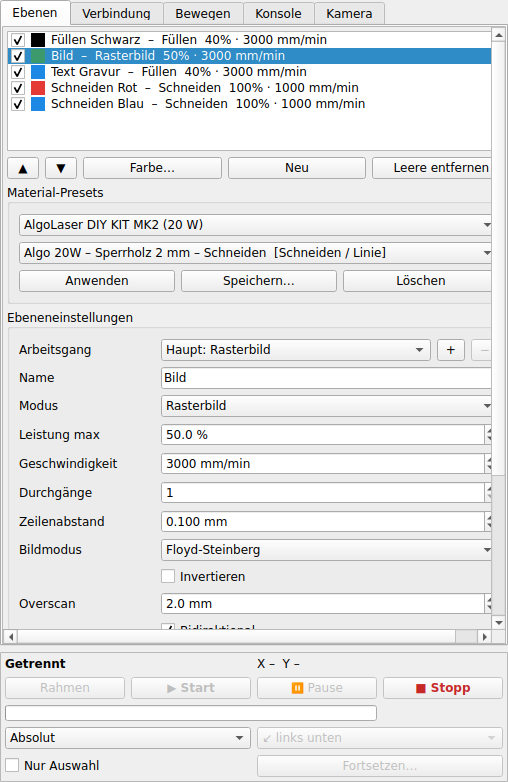

Die Vorschau eines Bildes auf der Arbeitsfläche zeigt bereits das Ergebnis des gewählten Bildmodus.

<!-- hilfe: unterebenen -->
### Unterebenen

Mit **+** neben *Arbeitsgang* erhält eine Ebene weitere Arbeitsgänge auf **derselben Geometrie**, jeweils mit
eigenen Parametern – z. B. erst die Fläche gravieren, dann die Kontur ausschneiden. Über die Auswahl
*Arbeitsgang* wird zwischen Haupt- und Unterebenen gewechselt; **−** entfernt die gewählte Unterebene.

<!-- hilfe: kerf -->
### Kerf ermitteln

1. Ein Quadrat von genau 20 × 20 mm zeichnen und mit Kerf 0 ausschneiden.
2. Das Teil mit dem Messschieber messen, z. B. 19,82 mm.
3. Kerf = 20 − 19,82 = **0,18 mm** in die Schneid-Ebene eintragen.

---

<!-- hilfe: presets-kapitel -->
## 10. Material-Presets und Materialtest

<!-- hilfe: presets -->
### Presets

Im Tab *Ebenen* unter **Material-Presets**:

- **Filter** (oben): zeigt Presets für eine bestimmte Maschine. Er folgt automatisch dem aktiven Maschinenprofil.
- **Anwenden:** überträgt die Werte auf die gewählte Ebene bzw. Unterebene.
- **Speichern…:** speichert die aktuellen Einstellungen als eigenes Preset (Name und Material).
- **Löschen:** entfernt ein Preset.

Der Tooltip eines Presets zeigt Material und Herkunft der Werte. Eigene Presets bleiben bei Updates erhalten.

<!-- hilfe: materialtest -->
### Materialtest


*Werkzeuge → Materialtest* lasert ein beschriftetes Raster: in den **Spalten** steigt die Leistung, in den
**Zeilen** die Geschwindigkeit. So findet man in einem Durchgang die passenden Werte für ein neues Material.

| Einstellung | Beschreibung |
|---|---|
| Modus | Gravieren (Felder füllen) oder Schneiden (Feldkonturen) |
| Leistung von/bis, Spalten | Leistungsbereich und Anzahl Stufen |
| Geschwindigkeit von/bis, Zeilen | Geschwindigkeitsbereich und Anzahl Stufen (oben die schnellste) |
| Feldgröße, Feldabstand, Zeilenabstand, Durchgänge | |
| Position X/Y | Linke untere Ecke des Testrasters |
| Beschriften | Werte mit eigener (geringer) Leistung daneben schreiben |

Schaltflächen: **Vorschau** (Werkzeugweg auf der Arbeitsfläche), **Exportieren…** (G-Code-Datei) und
**An Laser senden**.

<!-- hilfe: fokustest -->
### Fokustest

*Werkzeuge → Fokustest…* findet den besten Abstand zwischen Laser und Material:

- **Ohne Z-Achse – Rampe** (für den AlgoLaser und die meisten Diodenlaser): TiLaser lasert eine lange Linie
  mit Skala. Dafür ein Brett so schräg legen, dass ein Ende etwa 10 mm höher liegt, und auf die Mitte
  fokussieren. Nach dem Lasern die **dünnste Stelle** der Linie suchen und an der Skala ablesen; dort stimmt
  der Abstand. Den Fokus danach auf diese Höhe einstellen.
- **Mit Z-Achse:** mehrere beschriftete Linien, jede mit einem anderen Z-Versatz (z. B. −2 bis +2 mm). Die
  schärfste Linie zeigt den besten Versatz.

<!-- hilfe: zeilenabstandstest -->
### Zeilenabstandstest

*Werkzeuge → Zeilenabstandstest…* graviert gefüllte Quadrate mit steigendem Zeilenabstand (z. B. 0,05–0,30 mm)
und schreibt den Wert darunter. Das Feld, in dem die Linien gerade zu einer gleichmäßigen Fläche verschmelzen,
ist der passende Zeilenabstand für dieses Material und diesen Fokus – kleiner bringt nur mehr Laufzeit.

Beide Tests bieten wie der Materialtest **Vorschau**, **Exportieren…** und **An Laser senden**, zusätzlich
**Ins Projekt** (Test als normale Objekte einfügen, z. B. um ihn zu verschieben).

---

<!-- hilfe: maschine -->
## 11. Maschine einrichten und verbinden

<!-- hilfe: maschineneinstellungen -->
### Maschineneinstellungen

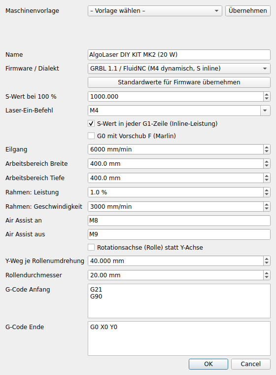

*Maschine → Maschineneinstellungen*:

| Einstellung | Beschreibung |
|---|---|
| Maschinenvorlage | Fertige Profile, z. B. „AlgoLaser DIY KIT MK2 (20 W)“ |
| Firmware / Dialekt | GRBL 1.1/FluidNC, Marlin, Smoothieware, Generisch. *Standardwerte übernehmen* setzt die passenden Werte |
| S-Wert bei 100 % | GRBL: Wert von `$30` (meist 1000), Marlin: 255, Smoothieware: 1 |
| Laser-Ein-Befehl | M4 (dynamische Leistung, GRBL, empfohlen) oder M3 (konstant) |
| Inline-Leistung | S-Wert direkt in jeder G1-Zeile (GRBL, Smoothieware) |
| G0 mit Vorschub | Für Marlin |
| Eilgang | Geschwindigkeit der Leerfahrten |
| Arbeitsbereich | Breite und Tiefe in mm (GRBL: `$130`/`$131`) |
| Rahmen: Leistung / Geschwindigkeit | 0 % = Laser beim Rahmen aus; bis 20 % für einen sichtbaren Punkt |
| Durchgänge | *Bei mehreren Durchgängen jede Kontur fertig schneiden* – an (Standard): jede Kontur bekommt alle Durchgänge, erst dann geht es zur nächsten; offene Linien abwechselnd hin und zurück. Aus: Durchgang 1 über alle Konturen, dann Durchgang 2 usw.; das Material kühlt dazwischen ab, dafür fährt der Laser öfter hin und her. Gilt für Schneid-Ebenen |
| Doppelte Linien | *Übereinanderliegende Linien nur einmal schneiden* (Standard an): Liegen Linien einer Ebene genau aufeinander – etwa die gemeinsame Kante zweier bündiger Teile –, wird das Stück nur einmal geschnitten; im G-Code steht dann ein Kommentar mit der eingesparten Länge. Das gilt nur für die Ausgabe: Die Teile im Projekt bleiben vollständig, wer sie wieder auseinanderschiebt oder mit Abstand neu anordnet, hat alle Linien zurück. Bei eingestellter Schnittbreitenkorrektur (Kerf) liegen die Kanten nicht mehr aufeinander und werden normal geschnitten |
| Schnittreihenfolge | *Optimiert (kürzeste Wege)* oder *Objekt für Objekt (Reihenfolge im Projekt)*, siehe [Anordnen](#anordnen) |
| Rotationsachse | siehe [Kapitel 15](#15-rotationsachse) |
| Air Assist an/aus | Standard M8/M9 |
| G-Code Anfang/Ende | Wird jedem Auftrag voran- bzw. nachgestellt |

<!-- hilfe: verbindung -->
### Verbindung


| Art | Einstellungen |
|---|---|
| **USB / Seriell** | Port (↻ aktualisiert die Liste), Baudrate (meist 115200) |
| **Netzwerk (TCP/Telnet)** | IP-Adresse und Port (meist 23) – für ESP32-Steuerungen mit FluidNC oder grblHAL |

Beim Verbinden wartet TiLaser kurz auf die Begrüßung der Steuerung und erkennt **GRBL/FluidNC, Marlin und
Smoothieware** selbst. Weicht die erkannte Firmware vom Profil ab, fragt TiLaser, ob umgestellt werden soll.
Bei GRBL liest TiLaser `$30` (Maximalleistung) aus und warnt bei `$32=0` (Lasermodus aus).

**Automatisch verbinden:** TiLaser merkt sich die zuletzt erfolgreich benutzte Verbindung (Art, Port und Baudrate
bzw. Adresse und TCP-Port). Ist **Beim Start automatisch verbinden** angehakt (Standard), verbindet TiLaser beim
Programmstart von selbst damit – aber nur, wenn der Port vorhanden bzw. der Laser im Netzwerk erreichbar ist.
Ist der Laser aus oder nicht angesteckt, erscheint kein Fehlerfenster, nur ein Hinweis in der Konsole; dann
einfach später *Verbinden* drücken. Die Netzwerksuche läuft im Hintergrund und hält das Programm nicht auf.

Im Tab *Verbindung* liegen außerdem:

| Schaltfläche | GRBL | Marlin u. a. |
|---|---|---|
| Referenzfahrt | `$H` | `G28 X Y` |
| Entsperren (nach Alarm) | `$X` | `M999` |
| Nullpunkt hier | `G10 L20 P1 X0 Y0` | `G92 X0 Y0` |
| Zu 0/0 fahren | `G0 X0 Y0` | `G0 X0 Y0` |

<!-- hilfe: bewegen -->
### Bewegen

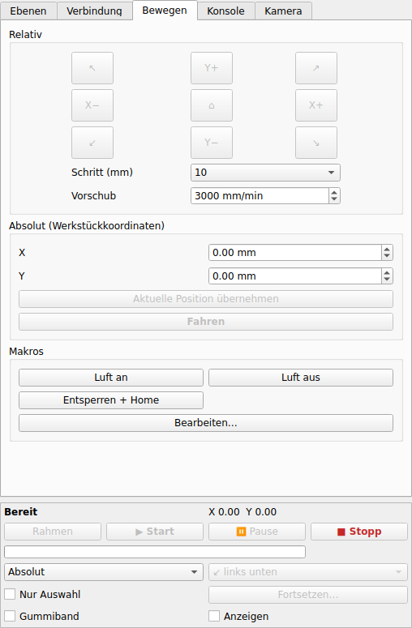

- **Relativ:** acht Richtungstasten und ⌂ (Referenzfahrt), Schrittweite 0,1–100 mm, Vorschub.
- **Absolut:** X/Y in Werkstückkoordinaten eingeben und *Fahren* klicken (oder Enter). *Aktuelle Position
  übernehmen* füllt die Felder mit der momentanen Kopfposition. Bei Zielen außerhalb des Arbeitsbereichs
  fragt TiLaser nach. Der Laser ist beim Fahren aus.
- **Per Klick:** Rechtsklick auf die Arbeitsfläche → *Laser hierher fahren* fährt den Kopf genau an diese
  Stelle. Mit Objekten in der Auswahl gibt es *Laser zur Auswahl fahren* → Mitte oder eine der vier Ecken
  (auch unter *Maschine*). Praktisch, um zu prüfen, wo ein Teil auf dem Werkstück landet.
- **Makros:** eigene G-Code-Knöpfe, z. B. *Luft an* (`M8`), *Luft aus* (`M9`) oder *Entsperren + Home*.
  *Bearbeiten…* (auch *Maschine → Makros bearbeiten…*) legt Makros an: Name, G-Code (mehrere Zeilen möglich)
  und ein Tastenkürzel, das im ganzen Fenster gilt. Während ein Auftrag läuft, sind Makros gesperrt.

<!-- hilfe: konsole -->
### Konsole


Zeigt alle Meldungen der Steuerung (`<<`) und gesendeten Befehle (`>>`). Unten können eigene Befehle
eingegeben werden, z. B. `$$` (GRBL-Einstellungen anzeigen), `$I` (Version) oder `?` (Status).

<!-- hilfe: grbl -->
### GRBL-Einstellungen

*Maschine → GRBL-Einstellungen (\$\$)…* liest alle Einstellungen der Steuerung und zeigt sie mit deutscher
Bedeutung, z. B. `$30` maximaler S-Wert, `$32` Lasermodus, `$110/$111` Höchstgeschwindigkeit,
`$120/$121` Beschleunigung, `$130/$131` Verfahrweg. Werte in der Spalte *Wert* ändern und
*Geänderte schreiben* drücken; TiLaser zeigt die Änderungen vorher noch einmal an und liest danach zur
Kontrolle neu. *Exportieren…* sichert alle Werte als Textdatei – das sollte man vor jeder Änderung tun.

---

<!-- hilfe: lasern -->
## 12. Lasern: Rahmen, Start, Pause, Stopp, Fortsetzen

Die **Auftragsleiste** rechts unten ist in jedem Tab sichtbar.

| Element | Funktion |
|---|---|
| Status / Position | Zustand der Maschine (Bereit, Läuft, Pausiert, Alarm …) und Kopfposition |
| **Rahmen** | Fährt den Umriss des Auftrags ab (mit der Rahmen-Leistung aus den Maschineneinstellungen) |
| **Gummiband** | Häkchen unter *Nur Auswahl*: Der Rahmen folgt eng den Teilen (konvexe Hülle) statt dem umschließenden Rechteck – wie ein um alle Teile gespanntes Gummiband. Bei runden oder schräg liegenden Teilen sieht man so genauer, wo gelasert wird, und der Kopf fährt nicht über leere Ecken. Die abgefahrene Linie wird auf der Arbeitsfläche einige Sekunden orange gestrichelt angezeigt. Mit dem Häkchen **Anzeigen** daneben (oder *Ansicht → Gummiband-Rahmen anzeigen*) bleibt sie dauerhaft eingeblendet und folgt beim Verschieben den Teilen – bei *Nur Auswahl* nur den ausgewählten. Die Linie ist reine Anzeige und wird nie gelasert. Beide Einstellungen bleiben gespeichert |
| **▶ Start** | Erzeugt den G-Code und startet nach einer Sicherheitsabfrage (mit geschätzter Dauer und Hinweisen) |
| **⏸ Pause / Fortsetzen** | Hält an bzw. setzt fort (GRBL: Feed-Hold `!` / `~`). Bei Marlin/Smoothie sendet TiLaser sofort `M5` – die Steuerung fährt die schon gepufferten Bewegungen noch zu Ende, der Laser brennt danach aber nicht im Stillstand weiter; beim Fortsetzen wird er wieder eingeschaltet |
| **■ Stopp** | Sofortiger Abbruch (GRBL: Soft-Reset); danach ggf. *Entsperren*. Bei Marlin/Smoothie sofort `M410` (Quickstop), `M5` und der Befehl *Luft aus* |
| Fortschritt und Zeit | Während des Laserns: Balken mit Prozent und **Restzeit** („noch ~4:12“), daneben **bisherige Laufzeit / erwartete Gesamtzeit** (z. B. „3:05 / ~7:17“, Minuten:Sekunden, ab einer Stunde Stunden:Minuten:Sekunden). Die erste Schätzung kommt aus Weg und Vorschub jeder G-Code-Zeile; sobald ein Teil gelasert ist, wird sie an das tatsächliche Tempo der Maschine angepasst (Beschleunigung, langsamere Ecken). Pausen zählen nicht mit. Nach dem Ende steht die tatsächliche Dauer da, in der Konsole zusammen mit der ursprünglichen Schätzung. *Fertig* meldet TiLaser erst, wenn die Maschine wirklich steht: bei GRBL, sobald sie nach der letzten Zeile *Idle* meldet, bei Marlin/Smoothie über ein angehängtes `M400` (wartet auf das Ende aller Bewegungen) |
| **Ursprung** | *Absolut*: Koordinaten wie auf der Arbeitsfläche. *Aktuelle Position*: der gewählte **Ankerpunkt** (z. B. links unten) des Auftrags liegt dort, wo der Laserkopf gerade steht – praktisch zum Positionieren per Jog |
| **Nur Auswahl** | Nur die ausgewählten Objekte lasern bzw. umrahmen |
| **Fortsetzen…** | Nach Stopp, Alarm oder Verbindungsabbruch ab einer wählbaren Zeile weitermachen |

**Fortsetzen:** TiLaser merkt sich, bis zu welcher Zeile die Steuerung den Auftrag bestätigt hat. Weil die
Steuerung einige Befehle im Voraus puffert, wird standardmäßig etwa 15 Zeilen früher begonnen – kurze Stücke
werden dabei doppelt gelasert. Position, Vorschub, Leistung und Air Assist werden wiederhergestellt, ebenso ein
Fokus-Versatz der Z-Achse (Z-Versatz der Ebene, Absenken je Durchgang). Verstellt der Auftrag Z, fragt TiLaser,
ob der Kopf noch auf der Höhe beim Abbruch steht oder der Fokus neu auf die Ausgangshöhe eingestellt wurde.
**Das Werkstück darf dazwischen nicht verschoben worden sein.**

---


<!-- hilfe: weboberflaeche -->
### Weboberfläche (Handy, Tablet, PC)

Unter *Maschine → Weboberfläche…* lässt sich TiLaser über den Browser eines anderen Geräts im selben Netz
beobachten und bedienen – z. B. vom Handy, wenn TiLaser auf dem Raspberry Pi am Laser läuft, oder vom
Arbeitsplatz-PC aus der Nachbarecke. TiLaser selbst muss dafür laufen.

| Einstellung | Wirkung |
|---|---|
| Weboberfläche einschalten | Startet den Webserver (bleibt auch nach einem Neustart von TiLaser an) |
| Port | Standard 8080 |
| PIN | Wird im Browser abgefragt. Die Anmeldung gilt bis zu 24 Stunden, endet aber, wenn TiLaser neu startet oder dieser Dialog mit OK geschlossen wird. Nach 10 falschen Eingaben ist die Anmeldung 5 Minuten gesperrt. Die PIN ist Pflicht und muss mindestens 4 Zeichen haben; ist sie leer oder kürzer, erzeugt TiLaser eine neue. Aufrufe über fremde Rechnernamen (statt IP-Adresse oder eigenem Rechnernamen) werden abgewiesen – das schützt vor Webseiten, die den Browser auf TiLaser umleiten |
| Aufträge aus der Ferne starten erlauben | Zeigt einen Knopf *Auftrag starten*, der das aktuell geöffnete Projekt mit den Einstellungen der Auftragsleiste startet. Standardmäßig aus |

Der Dialog zeigt die Adresse (z. B. `http://192.168.1.20:8080/`) und einen QR-Code, den man mit der
Handykamera scannt. Die Seite zeigt:

- Zustand, Position, Fortschritt als „abbrennenden“ Holzstreifen, Laufzeit und Restzeit
- das Live-Kamerabild (etwa ein Bild pro Sekunde, wenn die Kamera in TiLaser läuft)
- Knöpfe **Pause/Fortsetzen** und **Stopp** (mit Rückfrage), optional *Auftrag starten*
- die letzten Zeilen der Konsole
- eine rote Meldung mit Ton und Vibration, wenn der [Flammenwächter](#flammenwächter) auslöst

Auf dem Handy steht alles untereinander, auf dem PC (ab etwa 900 Pixel Breite) ist das Kamerabild groß
links und die Bedienung rechts; dort gilt außerdem **Leertaste** = Pause/Fortsetzen und **Esc** = Stopp.

> Nur im eigenen Netz verwenden und **keine Portfreigabe im Router** einrichten. Unter Windows fragt die
> Firewall beim ersten Start, ob TiLaser im privaten Netz erreichbar sein darf – das mit *Zulassen*
> bestätigen. Auch mit Weboberfläche gilt: den Laser nie unbeaufsichtigt lassen.

<!-- hilfe: auftragsprotokoll -->
### Auftragsprotokoll

*Maschine → Auftragsprotokoll…* zeigt alle Aufträge: Start, Dauer, Ergebnis (fertig, gestoppt, Alarm …),
Art (Auftrag oder Testmuster), Projektdatei, Ebenen mit Leistung und Geschwindigkeit, ob über die
Weboberfläche gestartet wurde, ein Flammenalarm und die Kosten. Darunter stehen die Summen.

Für die **Kosten** drei Werte eintragen (0 = nicht berechnen):

- *Stundensatz* – z. B. Abnutzung der Laserdiode und Maschine oder die eigene Arbeitszeit
- *Leistungsaufnahme* – Laser, Absaugung und Luftpumpe zusammen in Watt
- *Strompreis* je kWh

Kosten = Laufzeit × Stundensatz + Laufzeit × Leistungsaufnahme × Strompreis (Pausen zählen nicht mit).
Das Protokoll ist die Datei `auftraege.csv` im Einstellungsordner (siehe Kapitel 19), mit Semikolon
getrennt, so dass Excel und LibreOffice sie direkt öffnen. *Als CSV speichern…* legt eine Kopie ab,
*Protokoll leeren…* löscht alle Einträge. Rahmenfahrten werden nicht protokolliert; das Protokollieren
lässt sich im selben Dialog ausschalten.

<!-- hilfe: vorschau -->
## 13. Vorschau und Simulation


*Ansicht → Werkzeugweg-Vorschau* (Strg+P) erzeugt den G-Code und zeigt:

- **Brennwege** in der Farbe der Ebene,
- **Leerfahrten** gestrichelt grau (abschaltbar über *Leerwege* in der Werkzeugleiste).

Die Statusleiste zeigt die **geschätzte Dauer** und die Zeilenzahl. Die Schätzung berücksichtigt keine
Beschleunigung; reale Aufträge dauern meist etwas länger.


**Simulation:** Bei eingeschalteter Vorschau mit ▶ abspielen oder den Schieberegler ziehen. Ein roter Kreis
zeigt den Laserkopf, bereits gelaserte Wege erscheinen kräftig. Die Abspielgeschwindigkeit (1× bis 500×) ist
daneben wählbar.

---

<!-- hilfe: kamera -->
## 14. Kamera

Eine Webcam über dem Bett hat in TiLaser zwei Aufgaben: Sie zeigt **live**, was der Laser gerade macht
(Abschnitt *Live-Kamera*), und sie legt – einmal ausgerichtet – ein entzerrtes Bild des Werkstücks unter die
Arbeitsfläche, damit Gravuren genau auf vorhandene Teile gesetzt werden können (Abschnitt *Ausrichten*).
Beides nutzt dieselbe Kamera.

<!-- hilfe: live-kamera -->
### Live-Kamera

Der Tab **Kamera** in der Seitenleiste (oder *Maschine → Kamera → Live-Kamera*, Strg+Shift+K) zeigt das
Live-Bild.


| Element | Funktion |
|---|---|
| Kameraliste, ⟳ | Webcam wählen; ⟳ sucht neu angeschlossene Kameras |
| ▶ Einschalten / ■ Ausschalten | Live-Bild starten oder beenden |
| Foto speichern | Aktuelles Bild als JPG speichern |
| ● Video aufnehmen | Video (MP4) starten; oben links im Bild läuft „● REC“ mit der Aufnahmedauer |
| Großes Fenster | Live-Bild in einem eigenen Fenster, z. B. auf einem zweiten Bildschirm. Auch per Doppelklick aufs Bild. Im Fenster schaltet F11 oder ein Doppelklick auf Vollbild, Esc beendet das Vollbild |
| Drehen 90° | Dreht nur die Anzeige (für hochkant oder kopfüber montierte Kameras) |
| Bei Auftragsstart automatisch einschalten | Die Kamera geht beim Start eines Auftrags an, und der Tab *Kamera* wird angezeigt |
| Jeden Auftrag als Video aufnehmen | Beim Auftragsstart beginnt eine Aufnahme `Auftrag_<Datum>_<Uhrzeit>.mp4`; sie endet 3 s nach dem Auftragsende (auch bei Stopp oder Alarm) |
| Live-Bild als Hintergrund | Legt alle 2 s das entzerrte Live-Bild unter die Arbeitsfläche, so sieht man den Fortschritt direkt an den Objekten. Nur nach dem Ausrichten möglich |
| Speicherort, Ordner… | Ordner für Fotos und Videos (Standard: `Bilder/TiLaser`) |

Alle Einstellungen werden im Maschinenprofil gespeichert.

> **Tipp:** Die Live-Kamera ersetzt nicht die Aufsicht am Gerät. Der Laser darf nie unbeaufsichtigt laufen –
> das Bild hilft beim Beobachten aus einem Meter Entfernung oder durch die Schutzhaube, nicht aus dem
> Nebenzimmer.

Läuft das Live-Bild, verwenden *Kamera ausrichten* und *Kamerabild aktualisieren* direkt das aktuelle Bild,
statt die Kamera ein zweites Mal zu öffnen.

<!-- hilfe: flammenwaechter -->
### Flammenwächter

Der Flammenwächter wertet während eines Auftrags das Live-Bild aus und schlägt Alarm, wenn irgendwo eine
Flamme stehen bleibt. Er ist **standardmäßig aus** und wird im Tab *Kamera* unter **Flammenwächter**
eingeschaltet.

| Einstellung | Wirkung |
|---|---|
| Flammen während des Auftrags erkennen | Ein/aus. Bei Auftragsstart wird die Kamera dann automatisch eingeschaltet |
| Bei Flamme | *Nur warnen* (Alarmton und Meldung), *Auftrag pausieren* (Standard) oder *Auftrag stoppen* |
| Empfindlichkeit | 1–10. Höher = schon kleinere Flammen lösen aus, aber eher Fehlalarme |
| Auslösen nach | So viele Sekunden muss eine Stelle brennen (Standard 2 s) |
| Erkannte Stellen rot zeigen | Markiert im Live-Bild, was der Wächter für Flamme hält – hilfreich beim Einstellen |
| Testen | Wächter ohne Auftrag laufen lassen, z. B. mit einem Feuerzeug unter der Kamera. Löst nur eine Meldung aus |

**So funktioniert es:** Gesucht werden helle, gelb-orange Stellen, die deutlich heller sind als im Bild beim
Auftragsstart. Der glühende Laserpunkt wandert ständig weiter und löst deshalb nicht aus; eine Flamme bleibt
an einer Stelle. Feste Lichtquellen wie eine orange Kontroll-LED oder ein Kreuzlaser gehören zum
Anfangsbild und stören nicht.

Löst der Wächter aus, piept TiLaser, speichert ein Foto im Kamera-Speicherort (`Flamme_…jpg`), schreibt
eine Zeile in die Konsole und zeigt eine Meldung mit drei Möglichkeiten:

- **Auftrag stoppen**
- **Weiter beobachten** – nach dem Nachsehen; einen pausierten Auftrag mit *Fortsetzen* weiterlaufen lassen
- **Wächter für diesen Auftrag aus** – bei Fehlalarmen, z. B. durch Sonnenlicht

Ist der Wächter eingeschaltet, aber keine Kamera verfügbar, steht in der Konsole eine Warnung. Der Auftrag
läuft dann trotzdem.

> **Wichtig:** Der Flammenwächter ist eine zusätzliche Absicherung und **kein Ersatz für die Aufsicht**. Er
> sieht nur, was die Kamera sieht, und kann eine Flamme unter dem Werkstück oder im Rauch übersehen. Bei
> GRBL schaltet der Laser bei *Pause* im Lasermodus (`$32=1`) ab; Air Assist läuft weiter. Bei Marlin und
> Smoothieware **stoppt** der Wächter den Auftrag auch dann, wenn *Pausieren* eingestellt ist, weil diese
> Steuerungen gepufferte Bewegungen nach einer Pause noch ausführen.

Tipp zum Einstellen: Einen typischen Auftrag mit *Erkannte Stellen rot zeigen* beobachten. Erscheinen dabei
schon rote Stellen, die Empfindlichkeit senken oder die Zeit erhöhen.

<!-- hilfe: kamera-ausrichten -->
### Ausrichten

1. *Maschine → Kamera → Kamera wählen*: USB-Kamera oder **„Bild aus Datei“** (z. B. ein Handyfoto, das immer
   von derselben Stelle aufgenommen wird).
2. *Passmarken lasern*: **9 Marken** (3 × 3, mit Linsenkorrektur – empfohlen) oder 4 Marken. Die Kreuze werden
   mit 10 % Leistung 30 mm vom Bettrand gelasert – ein Stück Pappe unterlegen.
3. *Kamera ausrichten*: Bild aufnehmen und die Kreuze **in der angezeigten Reihenfolge** anklicken
   (Mausrad zoomt). Bei 9 Marken wird auch die Objektivverzeichnung berechnet; die Restabweichung in mm
   wird angezeigt.


4. *Kamerabild aktualisieren* (F5) legt das entzerrte Bild unter die Arbeitsfläche.
   *Kamerabild anzeigen* blendet es ein oder aus.

Wird die Kamera bewegt, muss sie neu ausgerichtet werden.

---

<!-- hilfe: rotation -->
## 15. Rotationsachse

Für zylindrische Werkstücke mit einer **Rollen-Rotationsachse**, die anstelle der Y-Achse angeschlossen wird:

1. *Maschine → Maschineneinstellungen*: **Y-Weg je Rollenumdrehung** und **Rollendurchmesser** eintragen.
   Den Y-Weg ermittelt man so: eine Markierung auf die Antriebsrolle machen, in der Konsole z. B.
   `G91 G0 Y40` senden und prüfen, ob sich die Rolle genau einmal dreht – sonst den Wert anpassen.
2. *Maschine → Rotationsachse aktiv* einschalten. Die Y-Koordinaten werden dann automatisch umgerechnet;
   die Zeichnung entspricht der abgewickelten Oberfläche des Werkstücks.
3. Nach dem Lasern die Rotationsachse wieder ausschalten.

---

<!-- hilfe: algolaser -->
## 16. Einrichtung AlgoLaser DIY KIT MK2 (20 W)

1. *Maschine → Maschineneinstellungen → Maschinenvorlage* „AlgoLaser DIY KIT MK2 (20 W)“ → *Übernehmen* → OK.
   Damit sind GRBL, M4, S 1000, 400 × 400 mm, Eilgang 6000 mm/min und Rahmen mit 1 % gesetzt.
2. Per USB-C verbinden (115200 Baud). In der **Konsole** `$$` senden und prüfen:
   `$32=1` (sonst `$32=1` senden); `$130`/`$131` = Verfahrweg X/Y → ggf. als Arbeitsbereich eintragen.
3. Im Tab *Ebenen* sind die Presets automatisch auf den MK2 gefiltert. Sie stammen aus der
   AlgoLaser-Parametertabelle für den DIY KIT 20 W. **Sperrholz 2 mm**, *Linie ritzen* und die Foto-Presets
   sind Startwerte (im Tooltip gekennzeichnet) – vorher testen, z. B. mit dem Materialtest.
4. Air Assist ist in den Presets aus. Wird die Pumpe über `M8`/`M9` geschaltet, das Häkchen pro Ebene setzen.
5. Während TiLaser verbunden ist, keinen Auftrag gleichzeitig über Touchscreen oder App starten.

---

<!-- hilfe: tasten -->
## 17. Tastenkürzel

| Kürzel | Funktion | | Kürzel | Funktion |
|---|---|---|---|---|
| Strg+N | Neues Projekt | | Strg+Z / Strg+Y | Rückgängig / Wiederholen |
| Strg+O | Projekt öffnen | | Strg+X / C / V | Ausschneiden / Kopieren / Einfügen |
| Strg+S | Projekt speichern | | Strg+Shift+V | An Originalposition einfügen |
| Strg+Shift+S | Speichern unter | | Strg+D | Duplizieren |
| Strg+I | Importieren | | Strg+A | Alles auswählen |
| Strg+T | Text einfügen | | Entf | Löschen |
| Strg+E | G-Code exportieren | | Pfeiltasten | 1 mm verschieben (Shift: 10 mm) |
| Strg+P | Werkzeugweg-Vorschau | | Strg+G / Strg+Shift+G | Gruppieren / aufheben |
| Strg+0 | Alles zeigen | | Strg+L / Strg+R | 90° links / rechts drehen |
| Strg+Shift+F | Am Raster fangen | | Strg+Shift+A | Array |
| F5 | Kamerabild aktualisieren | | Strg+Shift+N | Nesting |
| Strg+Shift+K | Live-Kamera | | Strg+Shift+Q | QR-Code / Barcode einfügen |
| Strg+Bild↑ / Strg+Bild↓ | Früher / später schneiden | | Strg+Shift+Bild↑ / ↓ | Zuerst / zuletzt schneiden |
| V R E P L N | Zeichenwerkzeuge | | Strg+Shift+←/→/↑/↓ | Links/rechts/oben/unten ausrichten |
| Esc | Zurück zum Auswählen | | Strg+Shift+U / D / I | Vereinigen / Abziehen / Schnittmenge |
| Alt+T | Bild nachzeichnen | | Alt+O / Alt+J | Offset / Pfade verbinden |
| Strg+Shift+B | Box-Generator | | Alt+K | Kanten aneinanderlegen |

Im Knotenmodus: Entf, C, L, S, B, A (siehe [Knotenbearbeitung](#knotenbearbeitung)). Makros können eigene
Tastenkürzel bekommen.

---

<!-- hilfe: fehler -->
## 18. Fehlerbehebung

| Problem | Lösung |
|---|---|
| Kein Port in der Liste | USB-Kabel prüfen (manche Kabel sind nur zum Laden); ↻ klicken. Windows: ggf. CH340-Treiber installieren. Linux: Benutzer in Gruppe `dialout`. |
| „Firmware: nicht erkannt“ | Baudrate prüfen (115200, bei manchen Marlin-Boards 250000). Danach Firmware in den Maschineneinstellungen von Hand wählen. |
| Laser brennt bei Leerfahrten / Linien an den Ecken zu dunkel | GRBL: `$32=1` setzen. Laser-Ein-Befehl M4 verwenden. |
| Leistung stimmt nicht (z. B. 10 % brennt wie 100 %) | S-Wert bei 100 % muss zu `$30` passen (GRBL). TiLaser übernimmt `$30` beim Verbinden automatisch. |
| ALARM nach Stopp | Normal nach einem Soft-Reset während der Fahrt: *Entsperren* klicken. |
| Teile sind zu klein / Passungen zu locker | Kerf-Ausgleich einstellen (siehe [Kerf ermitteln](#kerf-ermitteln)). |
| Teile fallen durch den Wabentisch | Haltestege verwenden. |
| Rasterbild ruckelt, Laser stockt | Geschwindigkeit verringern oder Zeilenabstand vergrößern – bei feinem Dithering kommt die USB-Verbindung sonst nicht hinterher. |
| SVG-Text fehlt | Text im Grafikprogramm in Pfade umwandeln oder den Text in TiLaser einfügen. |
| EPS-Import meldet fehlendes Programm | Ghostscript oder Inkscape installieren, oder die Datei als PDF/SVG speichern. |
| Ausschluss (XOR) meldet „pyclipper benötigt“ | Nur bei Start aus dem Quellcode: `pip install pyclipper`. In den fertigen Paketen enthalten. Vereinigen, Abziehen und Schnittmenge funktionieren auch ohne. |
| Nesting platziert nicht alle Teile | Grundfläche vergrößern, Mindest- oder Randabstand verringern, mehr Drehungen erlauben, *Gründlich* einschalten. |
| Kamerabild verschoben | Kamera wurde bewegt: neu ausrichten. |
| Live-Kamera: „Keine Kamera gefunden“ | Webcam anschließen und ⟳ klicken. Linux: Benutzer in Gruppe `video`. Windows: unter *Datenschutz → Kamera* den Zugriff für Desktop-Apps erlauben. Eine Kamera kann nur von einem Programm gleichzeitig benutzt werden – andere Video-Programme schließen. |
| Live-Kamera: Videoaufnahme schlägt fehl | Ist der Speicherort beschreibbar? Bei Start aus dem Quellcode mit einer Qt-Version vor 6.5 benötigt Linux zusätzlich die GStreamer-Plugins. |

---

<!-- hilfe: speicherorte -->
## 19. Speicherorte und portable Version

| Inhalt | Ort |
|---|---|
| Maschinenprofil, eigene Presets | Windows: `%USERPROFILE%\.tilaser`, Linux/macOS: `~/.tilaser` |
| Portable Version | Unterordner `daten` neben `TiLaser.exe` (aktiv, solange `portable.txt` existiert) |
| Auftragsprotokoll | `auftraege.csv` im selben Ordner wie das Maschinenprofil |
| Eigene Sprachdateien | Unterordner `lang` im selben Ordner |
| Eigener Ordner | Umgebungsvariable `TILASER_HOME` |
| Projekte | Beliebig, Dateiendung `.tlp` |

<!-- hilfe: lizenz -->
## 20. Lizenz und Markenhinweis

TiLaser ist freie Software unter der GNU General Public License Version 3. Die verwendeten Bibliotheken und ihre Lizenzen stehen unter *Hilfe → Lizenzen…*.

LightBurn ist eine Marke der LightBurn Software LLC. TiLaser ist ein unabhängiges Projekt und steht in keiner Verbindung zu LightBurn Software; es wird von ihr weder unterstützt noch geprüft. Die Unterstützung von `.lbrn2`- und `.lbrn`-Dateien dient allein dem Datenaustausch; TiLaser enthält keinen Code von LightBurn. Alle anderen genannten Produktnamen (z. B. AlgoLaser, GRBL, Inkscape) sind Marken ihrer jeweiligen Inhaber.

---

<!-- hilfe: sprache -->
## 21. Sprache und Übersetzungen

Die Oberfläche gibt es auf **Deutsch** und **Englisch**. Umgestellt wird unter *Ansicht → Sprache / Language*;
die neue Sprache gilt nach einem Neustart von TiLaser. Beim ersten Start wird die Systemsprache verwendet.
Für einen einzelnen Start überschreibt die Umgebungsvariable `TILASER_LANG` (z. B. `TILASER_LANG=en`) die
Einstellung.

**Eine weitere Sprache hinzufügen** geht ohne Programmierkenntnisse, nur mit einem Texteditor:

1. *Ansicht → Sprache / Language → Eigene Übersetzung anlegen / bearbeiten…* und einen Sprachcode eingeben,
   z. B. `fr`.
2. TiLaser legt im Einstellungsordner (siehe [Kapitel 19](#19-speicherorte-und-portable-version)) die Datei
   `lang/fr.json` an und öffnet den Ordner. In jeder Zeile steht links der deutsche Text und rechts die
   Übersetzung, vorbelegt mit Englisch:

   ```json
   "Projekt speichern": "Save project",
   "{0} Objekte ausgewählt": "{0} objects selected",
   ```

3. Die rechten Texte übersetzen. Platzhalter wie `{0}` (stehen für Zahlen oder Namen), `&` in Menünamen
   (markiert den unterstrichenen Buchstaben) und `\n` (Zeilenumbruch) beibehalten. `_name` ist der Name im
   Sprachmenü.
4. Die Sprache im Menü wählen und TiLaser neu starten.

Noch nicht übersetzte Texte erscheinen auf Englisch (fehlen sie auch dort, auf Deutsch). Beim Beenden schreibt
TiLaser alle Texte, die ihm ohne Übersetzung begegnet sind, nach `lang/fehlend_<code>.json` – diese in die eigene
Sprachdatei übernehmen und übersetzen. Eigene Dateien haben Vorrang vor den mitgelieferten; so lassen sich auch
einzelne englische Texte korrigieren.

Übersetzungen sind willkommen: die Datei als Issue auf GitHub schicken oder per Pull Request nach
`tilaser/data/lang/<code>.json`. Entwickler sammeln alle Texte mit `python tools/i18n_extract.py`
(`--missing en` zeigt fehlende Übersetzungen, `--update` trägt neue Texte in alle Sprachdateien ein).

---

<!-- hilfe: referenz -->
## 22. Referenz: alle Menüs, Fenster und Bedienelemente

Dieses Kapitel listet jedes Menü, jeden Knopf, jedes Feld und jedes Fenster von TiLaser mit seiner
Bedeutung auf. Ausführliche Erklärungen mit Beispielen stehen in den vorigen Kapiteln; die Verweise führen
dorthin. In TiLaser öffnet **F1** genau den passenden Abschnitt (siehe [Hilfe im Programm](#hilfe-im-programm)).

<!-- hilfe: menu-datei -->
### Menü Datei

| Menüpunkt | Taste | Funktion |
|---|---|---|
| Neu | Strg+N | Leeres Projekt anlegen. Ungespeicherte Änderungen werden vorher abgefragt |
| Projekt öffnen… | Strg+O | TiLaser-Projekt (`.tlp`) oder LightBurn-Datei (`.lbrn2`, `.lbrn`) öffnen; ersetzt das aktuelle Projekt |
| Projekt speichern | Strg+S | Unter dem bisherigen Namen speichern (beim ersten Mal wie *Speichern unter*) |
| Projekt speichern unter… | Strg+Umschalt+S | Unter neuem Namen als `.tlp` speichern |
| Auswahl als Projekt speichern… | | Nur die ausgewählten Objekte mit ihren Ebenen als eigene `.tlp`-Datei speichern |
| Importieren… | Strg+I | SVG, DXF, PDF/AI, EPS, LightBurn oder Bild zum Projekt hinzufügen ([Kapitel 5](#5-dateien-öffnen-importieren-und-exportieren)) |
| Text einfügen… | Strg+T | Text aus einer Schrift einfügen ([Text](#text)) |
| G-Code exportieren… | Strg+E | Auftrag als `.gcode`-Datei speichern; beachtet *Ursprung* und *Nur Auswahl* |
| Als SVG exportieren… | | Alle Objekte als SVG (mm, Ebenen als Gruppen) |
| Als DXF exportieren… | | Konturen als DXF, je Ebene ein DXF-Layer (ohne Bilder) |
| Als LightBurn-Datei speichern… | | Projekt als `.lbrn2` speichern ([LightBurn-Projekte](#lightburn-projekte)) |
| Beenden | Strg+Q | TiLaser schließen. Läuft ein Auftrag, wird vorher gefragt (der Laser wird dann gestoppt) |

<!-- hilfe: menu-bearbeiten -->
### Menü Bearbeiten

| Menüpunkt | Taste | Funktion |
|---|---|---|
| Rückgängig | Strg+Z | Letzten Schritt zurücknehmen; der Menütext nennt den Schritt |
| Wiederholen | Strg+Y | Zurückgenommenen Schritt wiederholen |
| Ausschneiden | Strg+X | Auswahl in die Zwischenablage verschieben |
| Kopieren | Strg+C | Auswahl in die Zwischenablage kopieren |
| Einfügen | Strg+V | Aus der Zwischenablage einfügen, um 10 mm versetzt |
| An Originalposition einfügen | Strg+Umschalt+V | Einfügen an der ursprünglichen Stelle |
| Duplizieren | Strg+D | Kopie der Auswahl, um 10 mm versetzt |
| Löschen | Entf | Ausgewählte Objekte löschen |
| Alles auswählen | Strg+A | Alle Objekte auswählen |
| Gruppieren | Strg+G | Ausgewählte Vektorobjekte zu einem Objekt zusammenfassen |
| Gruppierung aufheben | Strg+Umschalt+G | In Einzelteile zerlegen; eine Außenkontur bleibt mit ihren Löchern zusammen |
| Zentrieren | | Auswahl in die Mitte des Arbeitsbereichs setzen |
| An 0/0 | | Linke untere Ecke der Auswahl an den Nullpunkt setzen |
| Ebene zuweisen | | Untermenü: Auswahl auf eine vorhandene oder eine neue Ebene verschieben |

<!-- hilfe: menu-anordnen -->
### Menü Anordnen

| Menüpunkt | Taste | Funktion |
|---|---|---|
| Links ausrichten | Strg+Umschalt+← | Linke Kanten auf die linke Kante der gesamten Auswahl |
| Horizontal mittig ausrichten | | Mittelpunkte auf eine senkrechte Linie |
| Rechts ausrichten | Strg+Umschalt+→ | Rechte Kanten bündig |
| Oben ausrichten | Strg+Umschalt+↑ | Obere Kanten bündig |
| Vertikal mittig ausrichten | | Mittelpunkte auf eine waagerechte Linie |
| Unten ausrichten | Strg+Umschalt+↓ | Untere Kanten bündig |
| Horizontal verteilen (gleiche Abstände) | | Mindestens 3 Objekte mit gleichen Lücken nebeneinander |
| Kanten aneinanderlegen | Alt+K | Erst die Kante des zu bewegenden Teils anklicken, dann die Zielkante – das Teil wird gedreht und bündig angelegt ([Kanten aneinanderlegen](#kanten-aneinanderlegen)) |
| Vertikal verteilen (gleiche Abstände) | | Mindestens 3 Objekte mit gleichen Lücken übereinander |
| Horizontal spiegeln | | An der senkrechten Mittellinie der Auswahl spiegeln |
| Vertikal spiegeln | | An der waagerechten Mittellinie spiegeln |
| 90° nach links drehen | Strg+L | Gegen den Uhrzeigersinn um die Mitte der Auswahl |
| 90° nach rechts drehen | Strg+R | Im Uhrzeigersinn |
| Array erstellen… | Strg+Umschalt+A | Kopien als Raster oder im Kreis ([Array](#array)) |
| Nesting (Teile anordnen)… | Strg+Umschalt+N | Teile platzsparend anordnen ([Kapitel 8](#8-nesting--teile-automatisch-anordnen)) |
| Zentrieren, An 0/0 | | wie im Menü *Bearbeiten* |
| Schnittreihenfolge → Zuerst schneiden | Strg+Umschalt+Bild↑ | Auswahl an den Anfang der Projektreihenfolge |
| Schnittreihenfolge → Früher schneiden | Strg+Bild↑ | Einen Platz nach vorn |
| Schnittreihenfolge → Später schneiden | Strg+Bild↓ | Einen Platz nach hinten |
| Schnittreihenfolge → Zuletzt schneiden | Strg+Umschalt+Bild↓ | Ans Ende |
| Schnittreihenfolge → Reihenfolge anzeigen | | Nummern der Objekte auf der Arbeitsfläche ein-/ausblenden |

Die Schnittreihenfolge wirkt, wenn in den Maschineneinstellungen *Objekt für Objekt* gewählt ist
([Anordnen](#anordnen)).

<!-- hilfe: menu-formen -->
### Menü Formen

| Menüpunkt | Taste | Funktion |
|---|---|---|
| Vereinigen | Strg+Umschalt+U | Ausgewählte geschlossene Formen zu einer Fläche verschmelzen |
| Abziehen (größte Form minus andere) | Strg+Umschalt+D | Von der größten Form alle anderen abziehen |
| Schnittmenge | Strg+Umschalt+I | Nur die gemeinsame Fläche behalten |
| Ausschluss (XOR) | | Alles außer den Überlappungen (benötigt pyclipper) |
| Offset… | Alt+O | Konturen versetzen ([Fenster Offset](#fenster-offset-kontur-versetzen)) |
| Pfade verbinden / schließen… | Alt+J | Offene Linien mit gemeinsamen Endpunkten verbinden; fragt nach dem größten erlaubten Abstand der Endpunkte |

<!-- hilfe: menu-werkzeuge -->
### Menü Werkzeuge

| Menüpunkt | Taste | Funktion |
|---|---|---|
| Bild nachzeichnen… | Alt+T | Bild in Vektorkonturen umwandeln ([Bild nachzeichnen](#bild-nachzeichnen)) |
| Materialtest… | | Testraster Leistung × Geschwindigkeit ([Materialtest](#materialtest)) |
| Text auf Pfad… | | Text entlang einer Kontur ([Text auf Pfad](#text-auf-pfad)) |
| QR-Code / Barcode einfügen… | Strg+Umschalt+Q | QR-Code oder Code 128 als Gravur ([Variabler Text, QR-Code und Barcode](#variabler-text-qr-code-und-barcode)) |
| Variable Texte… | | Startnummer und CSV-Datei für Platzhalter |
| Generatoren → Box-Generator… | Strg+Umschalt+B | Kasten mit Fingerzinken ([Box-Generator](#box-generator)) |
| Generatoren → Zahnrad… | | Evolventen-Zahnrad, optional mit Gegenrad |
| Generatoren → Puzzle… | | Puzzle mit Rahmen |
| Muster in Fläche → Biegescharnier… | | Schnittmuster zum Biegen ([Muster in einer Fläche](#muster-in-einer-fläche)) |
| Muster in Fläche → Lochmuster / Lüftungsgitter… | | Löcher oder Langlöcher verteilen |
| Muster in Fläche → Gravurmuster… | | Hahnentritt, Fischgrät, Waben … als Gravur |
| Biegescharnier zwischen zwei Kanten… | | Zwei Teile über eine Biegezone aus Radius und Winkel zu einem Teil verbinden ([Biegescharnier zwischen zwei Kanten](#biegescharnier-zwischen-zwei-kanten)) |
| Fingerzinken an Kante… | | Zinken an der gemeinsamen Kante zweier Teile ([Fingerzinken an Kante](#fingerzinken-an-kante)) |
| Puzzle-Verbindung an Kante… | | Puzzle-Nasen an der gemeinsamen Kante zweier Teile ([Puzzle-Verbindung an Kante](#puzzle-verbindung-an-kante)) |
| Snap-Lock an Kante… | | Federnde Rastlaschen an einem Teil, Schlitze im anderen ([Snap-Lock an Kante](#snap-lock-an-kante)) |
| Hammerverbindung an Kante… | | Zapfen mit mitgelasertem Keil, Zapfenlöcher im anderen Teil ([Hammerverbindung an Kante](#hammerverbindung-an-kante)) |
| Knöchelscharnier an Kante… | | Scharnier zwischen zwei Boxteilen: Knöchel mit Fingerzinken, Schlitze, Stift ([Knöchelscharnier an Kante](#knöchelscharnier-an-kante)) |
| Schablonen-Stege… | | Stege für Innenteile von Buchstaben |
| Fokustest… | | Besten Fokusabstand finden ([Fokustest](#fokustest)) |
| Zeilenabstandstest… | | Besten Zeilenabstand finden ([Zeilenabstandstest](#zeilenabstandstest)) |

<!-- hilfe: menu-ansicht -->
### Menü Ansicht

| Menüpunkt | Taste | Funktion |
|---|---|---|
| Sprache / Language | | Sprache der Oberfläche wählen; *Eigene Übersetzung anlegen / bearbeiten…* legt eine Sprachdatei an ([Kapitel 21](#21-sprache-und-übersetzungen)) |
| Alles zeigen | Strg+0 | Zoom auf alle Objekte und das Bett |
| Werkzeugweg-Vorschau | Strg+P | Brenn- und Leerwege anzeigen ([Kapitel 13](#13-vorschau-und-simulation)) |
| G-Code anzeigen… | | Fenster mit dem erzeugten G-Code (sehr lange Dateien werden gekürzt angezeigt; der Export ist vollständig) |
| Am Raster fangen | Strg+Umschalt+F | Beim Verschieben und Zeichnen am Raster einrasten |
| Gummiband-Rahmen anzeigen | | Linie des Gummiband-Rahmens dauerhaft zeigen (wird nicht gelasert) |
| Rastermaß | | Untermenü: Rasterweite 0,5 / 1 / 5 / 10 mm |

<!-- hilfe: menu-maschine -->
### Menü Maschine

| Menüpunkt | Taste | Funktion |
|---|---|---|
| Maschineneinstellungen… | | Firmware, Arbeitsbereich, Rahmen, Rotationsachse usw. ([Fenster Maschineneinstellungen](#fenster-maschineneinstellungen)) |
| GRBL-Einstellungen (\$\$)… | | `$`-Werte der Steuerung anzeigen und ändern ([GRBL-Einstellungen](#grbl-einstellungen)) |
| Makros bearbeiten… | | Eigene G-Code-Knöpfe ([Fenster Makros bearbeiten](#fenster-makros-bearbeiten)) |
| Auftragsprotokoll… | | Liste aller Aufträge mit Kosten ([Auftragsprotokoll](#auftragsprotokoll)) |
| Weboberfläche… | | Fernbedienung im Netz ([Weboberfläche](#weboberfläche-handy-tablet-pc)) |
| Rotationsachse aktiv | | Y-Werte für die Rollen-Rotationsachse umrechnen ([Kapitel 15](#15-rotationsachse)) |
| Laser zur Auswahl fahren | | Untermenü: Kopf zur Mitte oder zu einer Ecke der Auswahl fahren (Laser aus) |
| Startpunkt auf gewählten Knoten setzen | | Im Knoten-Werkzeug: Schnitt dieser Kontur beginnt am markierten Knoten (Taste A) |
| Kamera → Kamera wählen… | | USB-Kamera oder „Bild aus Datei“ zum Ausrichten wählen |
| Kamera → Passmarken lasern | | 9 oder 4 Kreuze mit 10 % Leistung lasern ([Ausrichten](#ausrichten)) |
| Kamera → Kamera ausrichten… | | Bild aufnehmen und Passmarken anklicken |
| Kamera → Kamerabild aktualisieren | F5 | Neues entzerrtes Bild unter die Arbeitsfläche legen |
| Kamera → Kamerabild anzeigen | | Kamerabild ein-/ausblenden |
| Kamera → Live-Kamera | Strg+Umschalt+K | Tab *Kamera* zeigen und Live-Bild einschalten |
| Kamera → Großes Kamerafenster | | Live-Bild in eigenem Fenster |

<!-- hilfe: menu-hilfe -->
### Menü Hilfe

| Menüpunkt | Taste | Funktion |
|---|---|---|
| Bedienungsanleitung | F1 | Diese Anleitung im Hilfe-Fenster öffnen; F1 an einer Stelle des Programms öffnet den passenden Abschnitt |
| Bedienungsanleitung als PDF | | Die PDF-Fassung mit dem Standardprogramm öffnen |
| Lizenzen… | | Lizenzübersicht von TiLaser und den mitgelieferten Bibliotheken |
| Über TiLaser | | Version, Lizenz und Markenhinweis |

<!-- hilfe: kontextmenue -->
### Kontextmenü der Arbeitsfläche

Ein Klick mit der rechten Maustaste auf die Arbeitsfläche öffnet ein Menü. Mit Auswahl enthält es:
*Inhalt ändern…* (bei Texten und Codes), *Gruppieren*, *Gruppierung aufheben*, *Ausschneiden*, *Kopieren*,
*Einfügen*, *Ebene zuweisen*, *Zentrieren*, *An 0/0*, *Duplizieren*, *Array erstellen…*,
*Nesting (Teile anordnen)…*, *Auswahl als Projekt speichern…*, bei einer Kontur *Text auf Pfad…*, bei einem
Bild *Bild nachzeichnen…* und *Löschen*. Ohne Auswahl: *Einfügen*, *Importieren…*, *Text einfügen…*,
*Alles auswählen* und *Alles zeigen*. Immer dabei sind **Laser hierher fahren (X… Y…)** – fährt den Kopf genau
an die angeklickte Stelle – und mit Auswahl **Laser zur Auswahl fahren** (Mitte, Links unten, Links oben,
Rechts oben, Rechts unten).

<!-- hilfe: objektleiste -->
### Objektleiste

Die Leiste über der Arbeitsfläche zeigt die ausgewählten Objekte („Kein Objekt ausgewählt“, ein Name oder
„n Objekte ausgewählt“) und ihre Werte. Eingaben gelten sofort:

| Feld | Bedeutung |
|---|---|
| X, Y | Mittelpunkt der Auswahl in mm |
| B, H | Breite und Höhe; beim Ändern bleibt das Seitenverhältnis erhalten |
| Skal. | Skalierung in % |
| ∠ | Drehung in Grad |
| Spiegeln | Waagerecht spiegeln |
| Ebene | Ebene, auf der die Auswahl liegt („— mehrere Ebenen —“ bei gemischter Auswahl) |

<!-- hilfe: arbeitsflaeche -->
### Arbeitsfläche und Zeichenleiste

Die Arbeitsfläche zeigt das Bett mit 10-mm-Raster und dem Nullpunkt links unten (rote Ecke). Bedienung mit Maus
und Tastatur: [Maus und Tastatur auf der Arbeitsfläche](#maus-und-tastatur-auf-der-arbeitsfläche). Links stehen
die Zeichenwerkzeuge ([Zeichenwerkzeuge](#zeichenwerkzeuge)); darunter die Felder **Ecken** (Ecken für
Polygon/Stern), **★** (Stern statt Polygon) und **r** (Eckenradius für Rechtecke in mm). Oben rechts in der
Werkzeugleiste stehen **Leerwege** (Leerfahrten in der Vorschau zeigen), **▶** (Simulation abspielen), der
Schieberegler (Simulation: Zeitpunkt im Auftrag) und die Abspielgeschwindigkeit.

<!-- hilfe: tab-ebenen -->
### Tab Ebenen

| Bedienelement | Funktion |
|---|---|
| Ebenenliste | Alle Ebenen mit Farbe, Name, Modus und Werten. Häkchen = Ebene wird ausgegeben. Klick wählt die Ebene zum Bearbeiten und als Ziel für neue Formen |
| ▲ / ▼ | Ebene früher bzw. später ausführen (Schneiden sollte zuletzt kommen) |
| Farbe… | Ebenenfarbe aus der Palette mit 32 Farben wählen ([Fenster Ebenenfarbe](#fenster-ebenenfarbe)) |
| Neu | Neue Ebene anlegen (Untermenü: Rasterbild, Schneiden / Kontur, Füllen) |
| Leere entfernen | Ebenen ohne Objekte löschen |
| **Material-Presets** | |
| Maschinenfilter | Presets nach Maschine filtern („Alle Maschinen“) |
| Presetliste | Gespeicherte Materialwerte; der Tooltip nennt Material und Herkunft |
| Anwenden | Werte des Presets auf die gewählte Ebene bzw. Unterebene übernehmen |
| Speichern… | Aktuelle Werte als eigenes Preset speichern (Name und Material / Notiz) |
| Löschen | Gewähltes Preset löschen |
| **Ebeneneinstellungen** | |
| Arbeitsgang, **+**, **−** | Hauptarbeitsgang oder Unterebene wählen, Unterebene hinzufügen bzw. entfernen ([Unterebenen](#unterebenen)) |
| Name, Modus | Name der Ebene; Modus *Schneiden / Linie*, *Füllen (Schraffur)*, *Offset-Füllung (Konturen)*, *Rasterbild* |
| Leistung max, Leistung min | Laserleistung in %; *min* nur im Graustufen-Bildmodus |
| Geschwindigkeit, Durchgänge | mm/min und Anzahl der Wiederholungen |
| Zeilenabstand, Winkel, Kreuzschraffur | Abstand und Richtung der Füll-/Bildzeilen; zweite Schraffur um 90° gedreht |
| Überlappende Objekte vereinigen | Füllen: überlappende Objekte als eine Fläche statt mit ausgesparter Überlappung |
| Bildmodus, Schwellwert, Invertieren | Rasterbild: Floyd-Steinberg, Jarvis, Stucki, Atkinson, Schwellwert, Graustufen |
| Overscan | Anlaufweg vor/nach jeder Bildzeile |
| Bidirektional | Hin und her gravieren |
| Innen vor außen | Löcher vor der Außenkontur schneiden |
| Kerf-Ausgleich | Schnittbreite in mm ([Kerf ermitteln](#kerf-ermitteln)) |
| Haltestege, Stegbreite, Stege nur an Außenkonturen | Anzahl und Breite der Haltestege je Kontur |
| Helligkeit, Kontrast, Gamma | Bildkorrektur vor dem Gravieren |
| Z-Schritt je Durchgang, Z-Versatz | Fokus-Änderungen (nur mit motorisierter Z-Achse) |
| Air Assist (M8/M9) | Luftunterstützung für diese Ebene |
| Ausgeben | wie das Häkchen in der Liste |

Ausführlich: [Kapitel 9](#9-ebenen-und-laserparameter) und [Kapitel 10](#10-material-presets-und-materialtest).

<!-- hilfe: tab-verbindung -->
### Tab Verbindung

| Bedienelement | Funktion |
|---|---|
| Art | *USB / Seriell* oder *Netzwerk (TCP/Telnet)* |
| Port, ↻, Baud | Serieller Anschluss, Portliste aktualisieren, Baudrate |
| Adresse, TCP-Port | IP-Adresse und Port bei Netzwerkverbindung |
| Verbinden / Trennen | Verbindung herstellen bzw. beenden |
| Firmware | Erkannte Firmware |
| Beim Start automatisch verbinden | Mit der zuletzt erfolgreichen Verbindung beim Programmstart verbinden |
| **Maschine** | |
| ⌂ Referenzfahrt | Referenzfahrt (`$H` bzw. `G28`) |
| Entsperren | Alarm aufheben (`$X` bzw. `M999`) |
| Nullpunkt hier | Aktuelle Kopfposition als Werkstück-Nullpunkt setzen |
| Zu 0/0 fahren | Kopf zum Nullpunkt fahren |

Ausführlich: [Verbindung](#verbindung).

<!-- hilfe: tab-bewegen -->
### Tab Bewegen

| Bedienelement | Funktion |
|---|---|
| **Relativ** | Acht Richtungsknöpfe und ⌂ (Referenzfahrt), *Schritt (mm)* und *Vorschub* |
| **Absolut (Werkstückkoordinaten)** | X/Y eingeben, *Fahren* fährt mit ausgeschaltetem Laser dorthin |
| Aktuelle Position übernehmen | Felder mit der aktuellen Kopfposition füllen |
| **Makros** | Eigene G-Code-Knöpfe; *Bearbeiten…* öffnet [Makros bearbeiten](#fenster-makros-bearbeiten) |

Ausführlich: [Bewegen](#bewegen).

<!-- hilfe: tab-konsole -->
### Tab Konsole

Zeigt alle Meldungen der Steuerung (`<<`) und gesendeten Befehle (`>>`), dazu Hinweise von TiLaser (`--`) und
Warnungen (`!!`). Unten ein Eingabefeld: G-Code- oder `$`-Befehl eingeben, Enter sendet ihn.

<!-- hilfe: tab-kamera -->
### Tab Kamera

| Bedienelement | Funktion |
|---|---|
| Kameraliste, ⟳ | Webcam wählen, Liste aktualisieren |
| ▶ Einschalten / ■ Ausschalten | Live-Bild starten bzw. beenden |
| Foto speichern, ● Video aufnehmen | Foto (JPG) bzw. Video (MP4) im Speicherort ablegen |
| Großes Fenster | Live-Bild in eigenem Fenster |
| Drehen 90° | Nur die Anzeige drehen |
| Bei Auftragsstart automatisch einschalten | Kamera startet mit jedem Auftrag |
| Jeden Auftrag als Video aufnehmen | Video je Auftrag |
| Live-Bild als Hintergrund (entzerrt, alle 2 s) | Live-Bild unter der Arbeitsfläche (nur nach dem Ausrichten) |
| Speicherort, Ordner… | Ordner für Fotos und Videos |
| **Flammenwächter** | Flammen während des Auftrags erkennen, Bei Flamme, Empfindlichkeit, Auslösen nach, Erkannte Stellen rot zeigen, Testen – siehe [Flammenwächter](#flammenwächter) |

Ausführlich: [Live-Kamera](#live-kamera).

<!-- hilfe: auftragsleiste -->
### Auftragsleiste

| Bedienelement | Funktion |
|---|---|
| Status, Position | Zustand (Bereit, Läuft, Pausiert, Fertig, Gestoppt, Alarm …) und Kopfposition |
| Rahmen | Umriss des Auftrags abfahren |
| ▶ Start | Auftrag starten (mit Sicherheitsabfrage) |
| ⏸ Pause / ▶ Fortsetzen | Anhalten bzw. weiterlaufen lassen |
| ■ Stopp | Sofortiger Abbruch |
| Fortschrittsbalken, Zeit | Prozent, Restzeit, Laufzeit / erwartete Gesamtzeit |
| Ursprung | *Absolut* oder *Aktuelle Position* mit Ankerpunkt (↙ links unten … ↗ rechts oben) |
| Nur Auswahl | Nur ausgewählte Objekte lasern bzw. umrahmen |
| Gummiband, Anzeigen | Rahmen eng um die Teile; Linie dauerhaft zeigen |
| Fortsetzen… | Abgebrochenen Auftrag ab einer Zeile fortsetzen ([Fenster Auftrag fortsetzen](#fenster-auftrag-fortsetzen)) |

Ausführlich: [Kapitel 12](#12-lasern-rahmen-start-pause-stopp-fortsetzen).

<!-- hilfe: fenster -->
### Fenster und Dialoge

Alle Fenster haben **OK** (übernehmen) und **Abbrechen** (verwerfen), sofern nicht anders angegeben, und einen
Knopf **Hilfe**, der den passenden Abschnitt dieser Anleitung öffnet.

<!-- hilfe: dlg-maschine -->
#### Fenster Maschineneinstellungen

Maschinenvorlage mit *Übernehmen*, Name, Firmware / Dialekt mit *Standardwerte für Firmware übernehmen*,
S-Wert bei 100 %, Laser-Ein-Befehl, *S-Wert in jeder G1-Zeile (Inline-Leistung)*, *G0 mit Vorschub F (Marlin)*
(manche Marlin-Versionen fahren G0 sonst mit dem zuletzt benutzten Vorschub), Eilgang, Arbeitsbereich Breite,
Arbeitsbereich Tiefe, Rahmen: Leistung, Rahmen: Geschwindigkeit, Air Assist an, Air Assist aus, Durchgänge
(*Bei mehreren Durchgängen jede Kontur fertig schneiden*), Doppelte Linien (*Übereinanderliegende Linien nur
einmal schneiden*), Schnittreihenfolge, *Rotationsachse (Rolle) statt Y-Achse* mit Y-Weg je Rollenumdrehung und
Rollendurchmesser, G-Code Anfang und G-Code Ende. Bedeutung der Felder: [Maschineneinstellungen](#maschineneinstellungen).

<!-- hilfe: dlg-text -->
#### Fenster Text einfügen

Textfeld (mehrzeilig), Schrift (Liste der installierten Schriften, „…“ wählt eine Schriftdatei), Größe (Em-Höhe;
Großbuchstaben sind etwa 70 % davon), Zeilenabstand, Zeichenabstand, Ausrichtung (Links, Zentriert, Rechts),
Ebene (vorhandene Ebene, *Neue Ebene: Füllen (gravieren)* oder *Neue Ebene: Schneiden / Kontur*).
Siehe [Text](#text).

<!-- hilfe: dlg-gcode -->
#### Fenster G-Code

Zeigt den erzeugten G-Code nur zum Lesen. Bei sehr langen Aufträgen wird der Anfang gezeigt und vermerkt, wie
viele Zeilen noch folgen; *Datei → G-Code exportieren* speichert immer alles.

<!-- hilfe: dlg-array -->
#### Fenster Array erstellen

Art *Raster (Zeilen × Spalten)*: Spalten, Zeilen, Abstand X, Abstand Y und Bedeutung (*Abstand zwischen den
Objekten* oder *Rastermaß (Mitte zu Mitte)*). Art *Kreis*: Anzahl (inkl. Original), Mittelpunkt X,
Mittelpunkt Y, Gesamtwinkel und *Kopien mitdrehen*. Siehe [Array](#array).

<!-- hilfe: dlg-trace -->
#### Fenster Bild nachzeichnen

Schwellwert, *Invertieren (helle Bereiche nachzeichnen)*, Glättung, Mindestgröße, Helligkeit, Kontrast, Ebene,
*Bild behalten*. Siehe [Bild nachzeichnen](#bild-nachzeichnen).

<!-- hilfe: dlg-materialtest -->
#### Fenster Materialtest

Modus (*Gravieren (Fläche füllen)* oder *Schneiden (Kontur)*), Leistung von / bis, Spalten, Geschwindigkeit von /
bis, Zeilen, Feldgröße, Feldabstand, Zeilenabstand (Gravur), Durchgänge, Position X, Position Y, *Beschriften* mit
Beschriftung Leistung und Beschriftung Geschwindigkeit. Knöpfe: **Vorschau**, **Ins Projekt**,
**Exportieren…**, **An Laser senden**, **Schließen**. Siehe [Materialtest](#materialtest).

<!-- hilfe: dlg-offset -->
#### Fenster Offset (Kontur versetzen)

Abstand (positiv = nach außen, negativ = nach innen), *Runde Ecken* (sonst spitz), *Original behalten*
(sonst wird die Kontur ersetzt).

<!-- hilfe: dlg-passmarken -->
#### Fenster Passmarken anklicken

Zeigt das Kamerabild. Die Passmarken in der angegebenen Reihenfolge anklicken; das Mausrad zoomt.
*Zurücksetzen* löscht alle Klicks. OK ist möglich, sobald alle Marken gesetzt sind. Siehe [Ausrichten](#ausrichten).

<!-- hilfe: dlg-textpfad -->
#### Fenster Text auf Pfad

Text, Schrift, Größe, Ausrichtung (*Am Anfang (bei Konturen: ab oben)* oder *Mittig (bei Konturen: oben
mittig)*), Abstand (der Grundlinie von der Kontur), Versatz (entlang des Pfades), *Umdrehen (bei Konturen: innen,
unten lesbar)*, Ebene. Siehe [Text auf Pfad](#text-auf-pfad).

<!-- hilfe: dlg-nesting -->
#### Fenster Nesting – Teile anordnen

Grundfläche (*Arbeitsbereich*, *Eigene Maße* mit X (links), Y (unten), Breite, Höhe, oder *Größtes ausgewähltes
Objekt (dessen Umriss)*), Mindestabstand, Randabstand, Drehungen (*Keine Drehung*, *0° / 180°*, *90°-Schritte*,
*45°-Schritte*, *15°-Schritte (langsam)*), Kopien je Objekt, *Kleine Teile auch in Löcher größerer Teile setzen*,
*Bei Abstand 0 bündig anlegen (gemeinsame Kanten)*, *Gründlich (mehrere Strategien, langsamer, meist dichter)*,
*Grundfläche als Rahmen einzeichnen (Ebene ohne Ausgabe)*. Nach dem Anordnen: *Platzierte speichern…*,
*Speichern und entfernen…*, *Schließen*. Siehe [Kapitel 8](#8-nesting--teile-automatisch-anordnen).

<!-- hilfe: dlg-fokustest -->
#### Fenster Fokustest

Art (*Ohne Z-Achse: Rampe (Brett schräg legen)* oder *Mit Z-Achse: Linien in verschiedenen Höhen*), Linienlänge
bzw. Z von / Z bis und Linien, Teilstriche alle, Leistung, Geschwindigkeit, Position X/Y, *Beschriftung*.
Knöpfe wie beim Materialtest. Siehe [Fokustest](#fokustest).

<!-- hilfe: dlg-box -->
#### Fenster Box-Generator

Maße (*Innenmaße* / *Außenmaße*), Breite (X), Tiefe (Y), Höhe (Z), Materialstärke, Zinkenbreite,
Schnittbreite (Kerf), *Mit Deckel*, Leistung, Geschwindigkeit, Durchgänge, Abstand der Teile, Position X/Y,
*Teile beschriften (Boden, Vorne, …)*. Darunter das Außenmaß und Hinweise. Knöpfe wie beim Materialtest.
Siehe [Box-Generator](#box-generator).

<!-- hilfe: dlg-zeilenabstand -->
#### Fenster Zeilenabstandstest

Zeilenabstand von / bis, Felder, Feldgröße, Leistung, Geschwindigkeit, Winkel, Position X/Y, *Beschriftung*.
Knöpfe wie beim Materialtest. Siehe [Zeilenabstandstest](#zeilenabstandstest).

<!-- hilfe: dlg-barcode -->
#### Fenster QR-Code / Barcode einfügen

Art (*QR-Code* oder *Barcode (Code 128)*), Inhalt (Platzhalter erlaubt), Kantenlänge und Fehlerkorrektur
(QR: *L – 7 % (kleinster Code)*, *M – 15 % (Standard)*, *Q – 25 %*, *H – 30 % (robust)*), Breite und Höhe
(Barcode), Ebene. Siehe [Variabler Text, QR-Code und Barcode](#variabler-text-qr-code-und-barcode).

<!-- hilfe: dlg-variablen -->
#### Fenster Variable Texte

Nummer `{nr}` (nächster Wert), Schritt, CSV-Datei (*…* wählen, *✕* entfernen), Aktuelle Zeile, *Nach jedem
Auftrag bzw. G-Code-Export weiterzählen*. Unten die Vorschau des nächsten Auftrags.

<!-- hilfe: dlg-grbl -->
#### Fenster GRBL-Einstellungen

Tabelle mit Nr., Wert und Bedeutung aller `$`-Einstellungen. *Neu lesen* fragt die Werte erneut ab,
*Exportieren…* sichert sie als Textdatei, *Änderungen schreiben* sendet geänderte Werte (mit Rückfrage).
Siehe [GRBL-Einstellungen](#grbl-einstellungen).

<!-- hilfe: dlg-makros -->
#### Fenster Makros bearbeiten

Links die Liste der Makros mit **+** (neues Makro), **−** (gewähltes löschen) und **↑/↓** (Reihenfolge der
Knöpfe). Rechts für das gewählte Makro: Name, G-Code (jede Zeile wird an die Steuerung gesendet) und
Tastenkürzel (in das Feld klicken und die gewünschte Tastenkombination drücken).

<!-- hilfe: dlg-web -->
#### Fenster Weboberfläche

*Weboberfläche einschalten*, Port, PIN mit *Neue PIN*, *Aufträge aus der Ferne starten erlauben*, Adresse und
QR-Code zum Scannen. Siehe [Weboberfläche](#weboberfläche-handy-tablet-pc).

<!-- hilfe: dlg-protokoll -->
#### Fenster Auftragsprotokoll

Tabelle der Aufträge, Summenzeile, Stundensatz, Leistungsaufnahme, Strompreis, *Aufträge protokollieren*,
*Als CSV speichern…*, *Protokoll leeren…*. Siehe [Auftragsprotokoll](#auftragsprotokoll).

<!-- hilfe: dlg-generator -->
#### Fenster der Generatoren und Muster

*Biegescharnier*, *Lochmuster*, *Gravurmuster*, *Fingerzinken an Kante*, *Schablonen-Stege*, *Zahnrad* und
*Puzzle* öffnen ein Fenster mit ihren Einstellungen und einer Ebenenwahl (vorhandene Ebene oder neue Ebene).
Die Felder sind in [Muster in einer Fläche](#muster-in-einer-fläche),
[Fingerzinken an Kante](#fingerzinken-an-kante) und [Zahnrad, Puzzle und Schablonen-Stege](#zahnrad-puzzle-und-schablonen-stege)
beschrieben. Die zuletzt benutzten Werte bleiben bis zum Beenden erhalten.

<!-- hilfe: dlg-farbe -->
#### Fenster Ebenenfarbe

Raster mit 32 Farben. Ein Punkt markiert Farben, die schon eine Ebene benutzt; der Tooltip nennt Nummer, Name
und Ebene. Klick wählt die Farbe.

<!-- hilfe: dlg-preset -->
#### Preset speichern

Fragt nach dem Preset-Namen und Material / Notiz. Das Preset gilt für die gewählte Maschine und erscheint
danach in der Liste *Material-Presets*.

<!-- hilfe: dlg-fortsetzen -->
#### Fenster Auftrag fortsetzen

Zeigt, nach welcher Zeile der Auftrag abgebrochen ist, und schlägt eine etwas frühere Zeile vor. Nach OK wird
noch einmal bestätigt, dass das Werkstück nicht verschoben wurde.

<!-- hilfe: dlg-startabfrage -->
#### Sicherheitsabfrage beim Start

Vor jedem Start nennt TiLaser die geschätzte Dauer, die Zahl der Zeilen, den Dialekt und Hinweise (z. B.
Objekte außerhalb des Arbeitsbereichs). *Ja* startet, *Nein* bricht ab. Bei *Rahmen* mit Laserleistung erscheint
eine eigene Abfrage.

<!-- hilfe: dlg-flamme -->
#### Meldung Flammenwächter

Erscheint, wenn der Flammenwächter auslöst: *Auftrag stoppen*, *Weiter beobachten*,
*Wächter für diesen Auftrag aus*. Siehe [Flammenwächter](#flammenwächter).

<!-- hilfe: dlg-sprache -->
#### Eigene Übersetzung

Fragt nach dem Sprachcode (zwei Buchstaben, z. B. fr, nl, it, pl) und legt die Sprachdatei an. Siehe
[Kapitel 21](#21-sprache-und-übersetzungen).

<!-- hilfe: dlg-lizenzen -->
#### Fenster Lizenzen und Über TiLaser

*Über TiLaser* zeigt Version, Lizenz und Markenhinweis; *Lizenzen…* öffnet die Übersicht aller mitgelieferten
Bibliotheken mit dem Ort der vollständigen Lizenztexte.

<!-- hilfe: fenster-kamera -->
#### Großes Kamerafenster

Live-Bild in eigenem Fenster („TiLaser – Kamera“). **F11** oder Doppelklick: Vollbild, **Esc** beendet das
Vollbild. Das Fenster kann auf einen zweiten Bildschirm gezogen werden.

<!-- hilfe: hilfe -->
### Hilfe im Programm

*Hilfe → Bedienungsanleitung* (**F1**) öffnet diese Anleitung in einem eigenen Fenster:

| Bedienelement | Funktion |
|---|---|
| Inhaltsverzeichnis (links) | Klick springt zum Kapitel bzw. Abschnitt |
| ◀ / ▶ | Zurück und vor, wie im Browser |
| Inhalt | Zum Anfang der Anleitung |
| Suchfeld | Begriff eingeben, Enter sucht den nächsten Treffer, Umschalt+Enter den vorigen |
| PDF | Die PDF-Fassung öffnen |
| Online | Die Anleitung auf der Projektseite im Browser öffnen |
| Links im Text | Verweise auf andere Abschnitte springen dorthin; Internetadressen öffnen den Browser |

**Kontexthilfe:** **F1** öffnet immer den Abschnitt, der zu dem passt, was man gerade bedient:

- im geöffneten Menü: zum markierten Menüpunkt,
- über einem Knopf der Werkzeugleiste oder einem Bedienelement: zu dessen Beschreibung (die Maus darüber halten
  und F1 drücken),
- in einem Fenster: zum Abschnitt dieses Fensters – dafür hat jedes Fenster außerdem einen Knopf **Hilfe**,
- auf der Arbeitsfläche: zur Bedienung der Arbeitsfläche, in einem Tab: zu diesem Tab.

Die Anleitung erscheint in der eingestellten Sprache (Deutsch oder Englisch; andere Sprachen zeigen die
englische Fassung).
