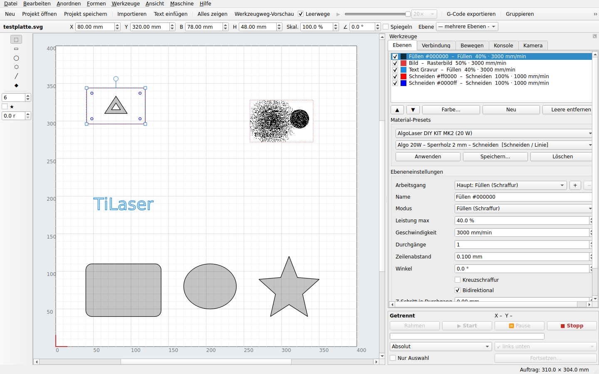
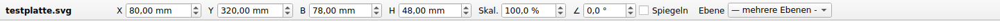
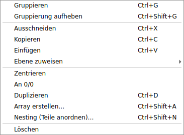
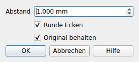
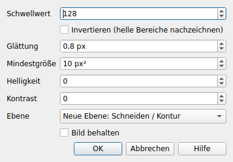
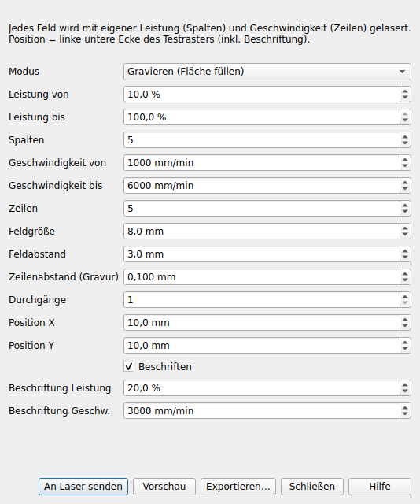
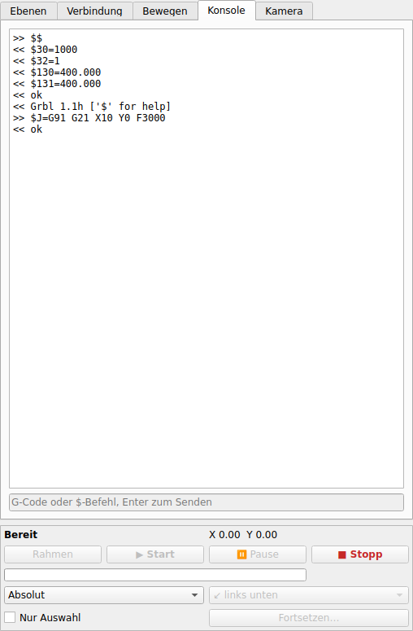
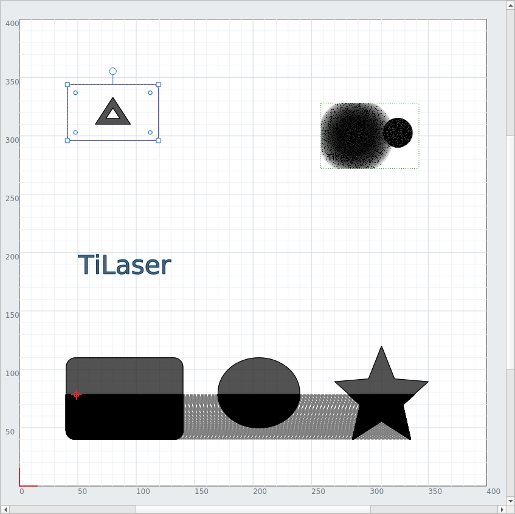
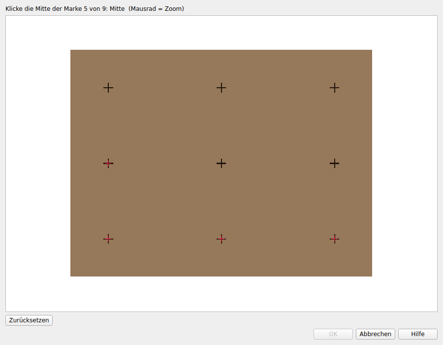

# TiLaser – Bedienungsanleitung

TiLaser ist ein Programm zum Laserschneiden und -gravieren mit G-Code-gesteuerten Lasern
(GRBL/FluidNC, Marlin, Smoothieware). Diese Anleitung beschreibt alle Funktionen der Reihe nach –
vom ersten Start bis zum fertigen Werkstück.

> Die Screenshots werden automatisch aus dem aktuellen Programmstand erzeugt
> (`tools/make_screenshots.py`, GitHub-Workflow „Screenshots“).

---

## Inhalt

1. [Sicherheit](#1-sicherheit)
2. [Installation](#2-installation)
3. [Schnellstart: das erste Werkstück](#3-schnellstart-das-erste-werkstück)
4. [Die Oberfläche](#4-die-oberfläche)
5. [Dateien öffnen, importieren und exportieren](#5-dateien-öffnen-importieren-und-exportieren)
6. [Objekte bearbeiten](#6-objekte-bearbeiten)
7. [Zeichnen, Formen und Text](#7-zeichnen-formen-und-text)
8. [Nesting – Teile automatisch anordnen](#8-nesting--teile-automatisch-anordnen)
9. [Ebenen und Laserparameter](#9-ebenen-und-laserparameter)
10. [Material-Presets und Materialtest](#10-material-presets-und-materialtest)
11. [Maschine einrichten und verbinden](#11-maschine-einrichten-und-verbinden)
12. [Lasern: Rahmen, Start, Pause, Stopp, Fortsetzen](#12-lasern-rahmen-start-pause-stopp-fortsetzen)
13. [Vorschau und Simulation](#13-vorschau-und-simulation)
14. [Kamera](#14-kamera)
15. [Rotationsachse](#15-rotationsachse)
16. [Einrichtung AlgoLaser DIY KIT MK2 (20 W)](#16-einrichtung-algolaser-diy-kit-mk2-20-w)
17. [Tastenkürzel](#17-tastenkürzel)
18. [Fehlerbehebung](#18-fehlerbehebung)
19. [Speicherorte und portable Version](#19-speicherorte-und-portable-version)

---

## 1. Sicherheit

Laser der Klasse 4 – dazu gehören praktisch alle Diodenlaser ab etwa 5 W – können Augen dauerhaft
schädigen und Brände auslösen.

- **Schutzbrille** passend zur Wellenlänge (bei Diodenlasern meist 445–455 nm, OD 5+) tragen – auch für
  alle Personen im Raum.
- **Nie unbeaufsichtigt** lasern. Ein Feuerlöscher (CO₂ oder Pulver) und eine feuerfeste Unterlage gehören dazu.
- **Absaugung** einschalten. Rauch von Holz, Leder und Kunststoffen ist gesundheitsschädlich.
- **Kein PVC, Vinyl, Kunstleder** oder andere chlorhaltige Materialien lasern (Salzsäure- und Chlorgasbildung).
- **Stopp** (in der Auftragsleiste) hält die Maschine sofort an. Bei GRBL wird dafür ein Soft-Reset gesendet;
  der Laser schaltet sofort ab.
- Bei GRBL muss der **Lasermodus aktiv** sein (`$32=1`), sonst brennt der Laser auch bei Leerfahrten weiter.
  TiLaser warnt beim Verbinden, wenn das nicht der Fall ist.

---

## 2. Installation

### Windows

| Variante | Vorgehen |
|---|---|
| **Installer** `TiLaser-<Version>-Setup.exe` | Ausführen und dem Assistenten folgen. Wahlweise für alle Benutzer (mit Admin-Rechten) oder nur für den aktuellen Benutzer. Optional: Desktop-Symbol und Verknüpfung von `.tlp`-Projektdateien mit TiLaser. |
| **Portabel** `TiLaser-<Version>-portable-win64.zip` | Entpacken (z. B. auf einen USB-Stick) und `TiLaser.exe` starten. Einstellungen und Presets liegen im Unterordner `daten` – nichts wird im Benutzerprofil oder in der Registry gespeichert. |

Beim ersten Start meldet Windows SmartScreen eventuell „Unbekannter Herausgeber“. Über
*Weitere Informationen → Trotzdem ausführen* lässt sich das Programm starten.

### Linux

| Variante | Vorgehen |
|---|---|
| **AppImage** (x86_64 oder aarch64) | `chmod +x TiLaser-*.AppImage` und starten. Läuft ohne Installation. |
| **deb-Paket** (amd64 oder arm64) | `sudo apt install ./tilaser_<Version>_<arch>.deb`. Danach im Startmenü unter *Grafik*. |

Für den Zugriff auf den Laser über USB muss der Benutzer in der Gruppe `dialout` sein:

```bash
sudo usermod -aG dialout $USER     # danach ab- und wieder anmelden
```

Systemvoraussetzungen: x86_64 mit glibc ≥ 2.35 (z. B. Ubuntu 22.04, Debian 12), ARM64 mit glibc ≥ 2.39
(z. B. Raspberry Pi OS Trixie, Ubuntu 24.04).

### Optionale Zusatzprogramme

| Programm | Wofür |
|---|---|
| [Ghostscript](https://ghostscript.com/releases/gsdnld.html) oder [Inkscape](https://inkscape.org) | Import von EPS/PostScript und alten Illustrator-Dateien |

### Aus dem Quellcode

```bash
pip install -r requirements.txt
python main.py
```

---

## 3. Schnellstart: das erste Werkstück

1. **Maschine einrichten:** *Maschine → Maschineneinstellungen*. Unter *Maschinenvorlage* eine passende
   Vorlage wählen (z. B. „AlgoLaser DIY KIT MK2 (20 W)“) und *Übernehmen* klicken – oder die Werte von Hand
   eintragen (siehe [Kapitel 11](#11-maschine-einrichten-und-verbinden)).
2. **Verbinden:** In der Seitenleiste den Tab **Verbindung** öffnen, den Port wählen (Windows: `COM3` o. Ä.,
   Linux: `/dev/ttyUSB0` bzw. `/dev/ttyACM0`), Baudrate 115200, *Verbinden*. TiLaser erkennt die Firmware.
3. **Datei importieren:** *Datei → Importieren* (Strg+I) oder die Datei ins Fenster ziehen.
4. **Ebenen einstellen:** Jede Farbe der Zeichnung wird zu einer Ebene. Im Tab **Ebenen** für jede Ebene den
   Modus (Schneiden / Füllen / Rasterbild) und Leistung, Geschwindigkeit, Durchgänge wählen – am einfachsten
   über ein **Material-Preset**.
5. **Positionieren:** Objekte mit der Maus verschieben oder Werte in der Objektleiste eingeben.
6. **Vorschau prüfen:** *Ansicht → Werkzeugweg-Vorschau* (Strg+P) zeigt, was der Laser fährt, und schätzt die Dauer.
7. **Rahmen fahren:** In der Auftragsleiste *Rahmen* – der Laserkopf fährt den Umriss des Auftrags ab.
   So lässt sich das Material ausrichten.
8. **Starten:** *▶ Start*. Die Sicherheitsabfrage bestätigen. Fortschritt und Laufzeit stehen in der Auftragsleiste.

---

## 4. Die Oberfläche



| Bereich | Inhalt |
|---|---|
| **Menüleiste** | Datei, Bearbeiten, Anordnen, Formen, Werkzeuge, Ansicht, Maschine, Hilfe |
| **Werkzeugleiste** (oben) | Neu, Öffnen, Speichern, Importieren, Text, Alles zeigen, Vorschau, Simulation, Export, Gruppieren und Anordnen |
| **Objektleiste** (darunter) | Eigenschaften des ausgewählten Objekts |
| **Zeichenwerkzeuge** (links) | Auswählen, Rechteck, Ellipse, Polygon/Stern, Linie, Knoten |
| **Arbeitsfläche** (Mitte) | Bett mit 10-mm-Raster, Nullpunkt links unten (rote Ecke) |
| **Seitenleiste** (rechts) | Tabs *Ebenen*, *Verbindung*, *Bewegen*, *Konsole* |
| **Auftragsleiste** (rechts unten) | Status, Position, Rahmen, Start, Pause, Stopp, Ursprung, Nur Auswahl, Fortsetzen |
| **Statusleiste** (unten) | Mausposition in mm, Auftragsgröße, geschätzte Dauer, Zeilenzahl |




### Maus und Tastatur auf der Arbeitsfläche

| Aktion | Bedienung |
|---|---|
| Zoomen | Mausrad (zur Mausposition hin) |
| Ansicht verschieben | Mittlere Maustaste oder rechte Maustaste **ziehen** |
| Kontextmenü | Rechte Maustaste **klicken** |
| Auswählen | Klicken; mehrere mit Strg+Klick oder Rahmen aufziehen |
| Verschieben | Ziehen, oder Pfeiltasten (1 mm, mit Shift 10 mm) |
| Alles zeigen | Strg+0 |
| Löschen | Entf |

Dateien können direkt aus dem Explorer bzw. Dateimanager auf die Arbeitsfläche gezogen werden.

---

## 5. Dateien öffnen, importieren und exportieren

### Projekte

*Datei → Projekt speichern* (Strg+S) legt eine `.tlp`-Datei an. Sie enthält alle Objekte, Ebenen mit
Parametern und eingebettete Bilder. Kurven bleiben als echte Kurven gespeichert.

### Import

| Format | Hinweise |
|---|---|
| **SVG** | Pfade, Rechtecke (auch abgerundet), Kreise, Ellipsen, Linien, Polygone, Gruppen, `use`, Transformationen. Maße in mm, cm, in, pt oder px (96 dpi). Je Kontur- bzw. Füllfarbe entsteht eine Ebene; gefüllte Flächen ohne Kontur werden Füll-Ebenen. **Text** muss im Grafikprogramm in Pfade umgewandelt werden (Inkscape: *Pfad → Objekt in Pfad*). |
| **DXF** (ASCII) | LINE, LWPOLYLINE/POLYLINE (inkl. Bögen), CIRCLE, ARC, ELLIPSE, SPLINE, Blöcke. Einheit aus `$INSUNITS`. Je DXF-Layer eine Ebene. TEXT, MTEXT, HATCH und Bemaßungen werden übersprungen. |
| **PDF / Illustrator (AI)** | Vektorpfade und Farben; **Text wird in Konturen umgewandelt** (eingebettete TrueType-/CFF-Schrift, sonst Ersatzschrift). Bei mehreren Seiten wird die erste importiert. Eingebettete Bilder werden übersprungen. |
| **EPS / PS** | Wird über Ghostscript oder Inkscape in PDF umgewandelt (muss installiert sein). |
| **Bilder** (PNG, JPG, BMP, GIF, TIFF, WebP) | Für Rastergravur. Größe aus der DPI-Angabe der Datei, sonst 0,1 mm je Pixel (max. 100 mm breit). Transparenz wird weiß. |

Liegt ein importiertes Objekt außerhalb des Arbeitsbereichs, wird es in die Mitte gesetzt.

### Export

| Menüpunkt | Ergebnis |
|---|---|
| *Datei → G-Code exportieren* (Strg+E) | `.gcode`-Datei für SD-Karte oder andere Sender. Berücksichtigt *Ursprung* und *Nur Auswahl*. |
| *Datei → Als SVG exportieren* | Alle Objekte in mm, Ebenen als Inkscape-Ebenen, Bilder eingebettet |
| *Datei → Als DXF exportieren* | Konturen als LWPOLYLINE, je Ebene ein DXF-Layer (ohne Bilder) |
| *Ansicht → G-Code anzeigen* | Zeigt den erzeugten G-Code |

---

## 6. Objekte bearbeiten

### Auswahl, Anfasser und Objektleiste


Um die Auswahl erscheint ein gestrichelter Rahmen mit Anfassern:

- **Ecken ziehen:** proportional skalieren (die gegenüberliegende Ecke bleibt stehen).
- **Runder Anfasser oben ziehen:** drehen um die Mitte der Auswahl; mit **Shift** in 15°-Schritten.

In der **Objektleiste** lassen sich Werte exakt eingeben: X/Y (Mittelpunkt), Breite, Höhe (proportional),
Skalierung in %, Drehung, Spiegeln und die Ebene.

### Rückgängig, Kopieren, Einfügen

| Funktion | Kürzel |
|---|---|
| Rückgängig / Wiederholen | Strg+Z / Strg+Y (oder Strg+Shift+Z) |
| Ausschneiden / Kopieren / Einfügen | Strg+X / Strg+C / Strg+V (um 10 mm versetzt) |
| An Originalposition einfügen | Strg+Shift+V |
| Duplizieren | Strg+D |

Im Menü *Bearbeiten* steht jeweils, was rückgängig gemacht wird. Es werden bis zu 60 Schritte gespeichert.

### Anordnen

Menü **Anordnen**:

| Funktion | Beschreibung |
|---|---|
| Ausrichten | Links, horizontal mittig, rechts, oben, vertikal mittig, unten – bezogen auf die Gesamtauswahl (mind. 2 Objekte) |
| Verteilen | Horizontal oder vertikal mit gleichen Abständen zwischen den Objekten (mind. 3 Objekte) |
| Spiegeln | Horizontal oder vertikal um die Mitte der Auswahl |
| 90° drehen | Strg+L (links) / Strg+R (rechts) |
| Array erstellen | Strg+Shift+A, siehe unten |
| Nesting | Strg+Shift+N, siehe [Kapitel 8](#8-nesting--teile-automatisch-anordnen) |
| Zentrieren / An 0/0 | Auswahl in die Mitte des Arbeitsbereichs bzw. an den Nullpunkt schieben |

**Am Raster fangen:** *Ansicht → Am Raster fangen* (Strg+Shift+F). Beim Verschieben rastet die linke untere
Objektecke auf das Raster ein. Rastermaß unter *Ansicht → Rastermaß* (0,5 / 1 / 5 / 10 mm).
Beim Zeichnen rasten auch die Punkte ein.

### Array


- **Raster:** Spalten × Zeilen mit Abstand X/Y. *Abstand zwischen den Objekten* = Lücke, *Rastermaß* =
  Mitte-zu-Mitte-Abstand. Zeilen werden nach unten angelegt.
- **Kreis:** Anzahl (inklusive Original), Mittelpunkt, Gesamtwinkel (360° = voller Kreis) und ob die Kopien
  mitgedreht werden.

### Gruppieren und Ebene zuweisen



- **Gruppieren** (Strg+G): Mehrere Vektorobjekte werden zu einem Objekt.
- **Gruppierung aufheben** (Strg+Shift+G): Ein Objekt zerfällt in seine Teile. Eine Außenkontur bleibt dabei
  mit ihren Löchern zusammen (ein „O“ oder eine Platte mit Bohrungen). Nochmals aufheben zerlegt so ein Teil
  in einzelne Konturen.
- **Ebene zuweisen** (Rechtsklick oder *Bearbeiten*): ordnet die Auswahl einer anderen Ebene zu – auch einer
  **neuen Ebene** mit frei wählbarer Farbe. So lassen sich einzelne Teile z. B. gravieren statt schneiden.

---

## 7. Zeichnen, Formen und Text

### Zeichenwerkzeuge


| Werkzeug | Taste | Bedienung |
|---|---|---|
| Auswählen | V | Standard |
| Rechteck | R | Aufziehen. Shift = Quadrat, Strg = vom Mittelpunkt aus. Eckenradius im Feld unter den Werkzeugen. |
| Ellipse | E | Aufziehen. Shift = Kreis, Strg = vom Mittelpunkt aus. |
| Polygon/Stern | P | Aufziehen. Eckenzahl im Feld darunter, ★ = Stern. |
| Linie/Polylinie | L | Punkte anklicken. Doppelklick oder Enter beendet, Klick auf den Startpunkt schließt die Form, Esc bricht ab. |
| Knoten | N | Knotenbearbeitung, siehe unten |

Neue Formen landen auf der gerade im Tab *Ebenen* gewählten Ebene. Mit **Esc** geht es zurück zum Auswahlwerkzeug.

### Knotenbearbeitung


Mit dem Knotenwerkzeug (N) ein Objekt anklicken. Die Knoten erscheinen als Quadrate, der ausgewählte rot.
Am ausgewählten Knoten erscheinen die **Kurven-Anfasser** (Kreise).

| Aktion | Bedienung |
|---|---|
| Knoten verschieben | Ziehen |
| Kurve formen | Anfasser ziehen. Glatte Knoten bleiben glatt; mit **Alt** wird nur ein Anfasser bewegt (Ecke). |
| Knoten einfügen | Doppelklick auf die Kontur |
| Knoten löschen | Entf |
| Segment in Kurve umwandeln | C (Segment nach dem ausgewählten Knoten) |
| Segment in Linie umwandeln | L |
| Knoten glätten | S |
| Pfad auftrennen | B (geschlossene Kontur öffnen bzw. offene Linie teilen) |

Kurven aus SVG, PDF, DXF, Schriften und den Zeichenwerkzeugen bleiben echte Bézierkurven mit wenigen Knoten.

### Formen kombinieren

Menü **Formen** (mindestens zwei geschlossene Vektorobjekte auswählen):

| Funktion | Ergebnis |
|---|---|
| Vereinigen (Strg+Shift+U) | Gemeinsamer Umriss aller Formen |
| Abziehen (Strg+Shift+D) | Größte Form minus alle anderen (z. B. Platte minus Ausschnitte) |
| Schnittmenge (Strg+Shift+I) | Nur der überlappende Bereich |
| Ausschluss (XOR) | Alles außer den Überlappungen |
| Offset (Alt+O) | Konturen um einen Abstand nach außen (+) oder innen (−) versetzen, eckig oder rund |
| Pfade verbinden / schließen (Alt+J) | Offene Linien mit gemeinsamen Endpunkten verbinden und schließen – nützlich nach DXF-Importen |



### Text


*Datei → Text einfügen* (Strg+T): Text (mehrzeilig), Schrift (alle installierten TrueType-/OpenType-Schriften
oder eine Datei über „…“), Größe in mm, Zeilen- und Zeichenabstand, Ausrichtung und Ebene. Neue Ebenen für
Text sind standardmäßig **Füllen** (Gravur) oder **Schneiden/Kontur**.

### Text auf Pfad


Kontur auswählen (Kreis, Bogen, Wellenlinie …) → *Werkzeuge → Text auf Pfad* oder Rechtsklick.
Bei geschlossenen Konturen steht der Text außen und ist oben mittig lesbar; mit **Umdrehen** innen und unten.
*Abstand* = Abstand der Schrift von der Kontur, *Versatz* = Verschiebung entlang der Kontur.

### Bild nachzeichnen



Ein Bild auswählen → *Werkzeuge → Bild nachzeichnen* (Alt+T). Aus dunklen Bereichen werden geschlossene
Konturen, z. B. um ein Logo zu schneiden.

| Einstellung | Wirkung |
|---|---|
| Schwellwert | Pixel dunkler als dieser Wert werden zur Fläche |
| Invertieren | Helle Bereiche nachzeichnen |
| Glättung | Größer = weniger Punkte, glattere Kanten |
| Mindestgröße | Kleinere Flecken werden ignoriert |
| Helligkeit / Kontrast | Bild vorher anpassen |
| Bild behalten | Sonst wird das Bild durch die Konturen ersetzt |

---

## 8. Nesting – Teile automatisch anordnen

Nesting ordnet die ausgewählten Teile platzsparend auf einer rechteckigen Grundfläche an und hält dabei
einen **Mindestabstand** ein. Das spart Material, z. B. beim Ausschneiden vieler Gehäuseteile aus einer
Sperrholzplatte.

1. Die Teile auswählen (Strg+A für alle).
2. *Anordnen → Nesting* (Strg+Shift+N).
3. Einstellungen wählen und mit OK starten.


| Einstellung | Beschreibung |
|---|---|
| **Grundfläche** | *Arbeitsbereich* (ganzes Bett), *Eigene Maße* (X/Y der linken unteren Ecke, Breite, Höhe) oder *Größtes ausgewähltes Objekt* – dann dient z. B. ein gezeichnetes Rechteck in Plattengröße als Grundfläche und wird selbst nicht verschoben |
| **Mindestabstand** | Kleinster Abstand zwischen zwei Teilen in mm. Mindestens die Schnittbreite plus etwas Reserve, für Sperrholz z. B. 2–3 mm |
| **Randabstand** | Abstand zum Rand der Grundfläche |
| **Drehungen** | Keine, 0°/180°, 90°-Schritte, 45°-Schritte, 15°-Schritte. Bei sichtbarer Holzmaserung „Keine“ oder „0°/180°“ wählen |
| **Kopien je Objekt** | Legt Kopien an, so viele auf die Fläche passen (bis zur angegebenen Anzahl) |
| **In Löcher setzen** | Kleine Teile dürfen in Ausschnitte größerer Teile gelegt werden |
| **Gründlich** | Probiert 9 Kombinationen aus Sortierung und Platzierungsregel und nimmt die beste – langsamer, meist dichter |
| **Rahmen einzeichnen** | Zeichnet die Grundfläche als graues Rechteck auf einer Ebene ohne Ausgabe ein |


Nach dem Anordnen meldet TiLaser, wie viele Teile platziert wurden und wie viel der Fläche belegt ist.
**Teile, die nicht passen**, bleiben an ihrem Platz und sind danach ausgewählt. Mit Strg+Z wird das
Nesting vollständig rückgängig gemacht.

**Genauigkeit:** Die Teile werden für die Berechnung in ein feines Raster (etwa 0,25–1 mm, abhängig von der
Größe der Grundfläche) umgerechnet. Das Raster ist bewusst großzügig: Der Mindestabstand wird immer
eingehalten, die Teile liegen dafür eventuell einen Bruchteil eines Millimeters weiter auseinander als nötig.

---

## 9. Ebenen und Laserparameter


Jede Ebene ist ein Arbeitsgang mit eigenen Parametern. Die **Reihenfolge** in der Liste ist die
Bearbeitungsreihenfolge (▲/▼). Gravuren werden automatisch vor Schnitte gesetzt – **Schneiden gehört nach
unten**, damit Teile erst herausfallen, wenn alles darauf fertig ist.

Das **Häkchen** vor einer Ebene bestimmt, ob sie ausgegeben wird. Ausgeschaltete Ebenen werden blass
dargestellt.

### Modi

| Modus | Wirkung |
|---|---|
| **Schneiden / Linie** | Der Laser fährt die Konturen ab (Schneiden oder Ritzen) |
| **Füllen (Schraffur)** | Geschlossene Flächen werden zeilenweise graviert (Löcher bleiben frei) |
| **Rasterbild** | Bilder werden pixelweise graviert |

### Parameter

| Parameter | Modi | Beschreibung |
|---|---|---|
| Leistung max | alle | Laserleistung in % |
| Leistung min | Raster (Graustufen) | Leistung für helle Bildbereiche |
| Geschwindigkeit | alle | mm/min |
| Durchgänge | alle | Wie oft der Arbeitsgang wiederholt wird |
| Zeilenabstand | Füllen, Raster | 0,1 mm ≈ 254 DPI; kleiner = dichter und langsamer |
| Winkel, Kreuzschraffur | Füllen | Richtung der Schraffur; zweite Schraffur um 90° gedreht |
| Bildmodus | Raster | Floyd-Steinberg, Jarvis, Stucki, Atkinson (Dithering), Schwellwert, Graustufen |
| Schwellwert, Invertieren | Raster | |
| Helligkeit, Kontrast, Gamma | Raster | Bild vor dem Gravieren anpassen |
| Overscan | Raster | Anlaufweg vor/nach jeder Zeile gegen dunkle Ränder |
| Bidirektional | Füllen, Raster | Hin und zurück gravieren (schneller) |
| Innen vor außen | Schneiden | Löcher vor der Außenkontur schneiden, damit sich Teile nicht vorher lösen |
| **Kerf-Ausgleich** | Schneiden | Schnittbreite in mm. Außenkonturen werden um die Hälfte nach außen, Löcher nach innen versetzt – die Teile werden maßhaltig. Wichtig für Steck- und Presspassungen. |
| **Haltestege** | Schneiden | Anzahl Stege je Kontur und Stegbreite. Die Teile bleiben im Material hängen und fallen nicht durch den Wabentisch. Optional nur an Außenkonturen. |
| Z-Schritt je Durchgang | alle | Fokus nach jedem Durchgang absenken (nur mit motorisierter Z-Achse) |
| Air Assist | alle | Sendet M8/M9 (Druckluft ein/aus) |


Die Vorschau eines Bildes auf der Arbeitsfläche zeigt bereits das Ergebnis des gewählten Bildmodus.

### Unterebenen

Mit **+** neben *Arbeitsgang* erhält eine Ebene weitere Arbeitsgänge auf **derselben Geometrie**, jeweils mit
eigenen Parametern – z. B. erst die Fläche gravieren, dann die Kontur ausschneiden. Über die Auswahl
*Arbeitsgang* wird zwischen Haupt- und Unterebenen gewechselt; **−** entfernt die gewählte Unterebene.

### Kerf ermitteln

1. Ein Quadrat von genau 20 × 20 mm zeichnen und mit Kerf 0 ausschneiden.
2. Das Teil mit dem Messschieber messen, z. B. 19,82 mm.
3. Kerf = 20 − 19,82 = **0,18 mm** in die Schneid-Ebene eintragen.

---

## 10. Material-Presets und Materialtest

### Presets

Im Tab *Ebenen* unter **Material-Presets**:

- **Filter** (oben): zeigt Presets für eine bestimmte Maschine. Er folgt automatisch dem aktiven Maschinenprofil.
- **Anwenden:** überträgt die Werte auf die gewählte Ebene bzw. Unterebene.
- **Speichern…:** speichert die aktuellen Einstellungen als eigenes Preset (Name und Material).
- **Löschen:** entfernt ein Preset.

Der Tooltip eines Presets zeigt Material und Herkunft der Werte. Eigene Presets bleiben bei Updates erhalten.

### Materialtest



*Werkzeuge → Materialtest* lasert ein beschriftetes Raster: in den **Spalten** steigt die Leistung, in den
**Zeilen** die Geschwindigkeit. So findet man in einem Durchgang die passenden Werte für ein neues Material.

| Einstellung | Beschreibung |
|---|---|
| Modus | Gravieren (Felder füllen) oder Schneiden (Feldkonturen) |
| Leistung von/bis, Spalten | Leistungsbereich und Anzahl Stufen |
| Geschwindigkeit von/bis, Zeilen | Geschwindigkeitsbereich und Anzahl Stufen (oben die schnellste) |
| Feldgröße, Feldabstand, Zeilenabstand, Durchgänge | |
| Position X/Y | Linke untere Ecke des Testrasters |
| Beschriften | Werte mit eigener (geringer) Leistung daneben schreiben |

Schaltflächen: **Vorschau** (Werkzeugweg auf der Arbeitsfläche), **Exportieren…** (G-Code-Datei) und
**An Laser senden**.

---

## 11. Maschine einrichten und verbinden

### Maschineneinstellungen


*Maschine → Maschineneinstellungen*:

| Einstellung | Beschreibung |
|---|---|
| Maschinenvorlage | Fertige Profile, z. B. „AlgoLaser DIY KIT MK2 (20 W)“ |
| Firmware / Dialekt | GRBL 1.1/FluidNC, Marlin, Smoothieware, Generisch. *Standardwerte übernehmen* setzt die passenden Werte |
| S-Wert bei 100 % | GRBL: Wert von `$30` (meist 1000), Marlin: 255, Smoothieware: 1 |
| Laser-Ein-Befehl | M4 (dynamische Leistung, GRBL, empfohlen) oder M3 (konstant) |
| Inline-Leistung | S-Wert direkt in jeder G1-Zeile (GRBL, Smoothieware) |
| G0 mit Vorschub | Für Marlin |
| Eilgang | Geschwindigkeit der Leerfahrten |
| Arbeitsbereich | Breite und Tiefe in mm (GRBL: `$130`/`$131`) |
| Rahmen: Leistung / Geschwindigkeit | 0 % = Laser beim Rahmen aus; bis 20 % für einen sichtbaren Punkt |
| Rotationsachse | siehe [Kapitel 15](#15-rotationsachse) |
| Air Assist an/aus | Standard M8/M9 |
| G-Code Anfang/Ende | Wird jedem Auftrag voran- bzw. nachgestellt |

### Verbindung


| Art | Einstellungen |
|---|---|
| **USB / Seriell** | Port (↻ aktualisiert die Liste), Baudrate (meist 115200) |
| **Netzwerk (TCP/Telnet)** | IP-Adresse und Port (meist 23) – für ESP32-Steuerungen mit FluidNC oder grblHAL |

Beim Verbinden wartet TiLaser kurz auf die Begrüßung der Steuerung und erkennt **GRBL/FluidNC, Marlin und
Smoothieware** selbst. Weicht die erkannte Firmware vom Profil ab, fragt TiLaser, ob umgestellt werden soll.
Bei GRBL liest TiLaser `$30` (Maximalleistung) aus und warnt bei `$32=0` (Lasermodus aus).

Im Tab *Verbindung* liegen außerdem:

| Schaltfläche | GRBL | Marlin u. a. |
|---|---|---|
| Referenzfahrt | `$H` | `G28 X Y` |
| Entsperren (nach Alarm) | `$X` | `M999` |
| Nullpunkt hier | `G10 L20 P1 X0 Y0` | `G92 X0 Y0` |
| Zu 0/0 fahren | `G0 X0 Y0` | `G0 X0 Y0` |

### Bewegen


- **Relativ:** acht Richtungstasten und ⌂ (Referenzfahrt), Schrittweite 0,1–100 mm, Vorschub.
- **Absolut:** X/Y in Werkstückkoordinaten eingeben und *Fahren* klicken (oder Enter). *Aktuelle Position
  übernehmen* füllt die Felder mit der momentanen Kopfposition. Bei Zielen außerhalb des Arbeitsbereichs
  fragt TiLaser nach. Der Laser ist beim Fahren aus.

### Konsole



Zeigt alle Meldungen der Steuerung (`<<`) und gesendeten Befehle (`>>`). Unten können eigene Befehle
eingegeben werden, z. B. `$$` (GRBL-Einstellungen anzeigen), `$I` (Version) oder `?` (Status).

---

## 12. Lasern: Rahmen, Start, Pause, Stopp, Fortsetzen

Die **Auftragsleiste** rechts unten ist in jedem Tab sichtbar.

| Element | Funktion |
|---|---|
| Status / Position | Zustand der Maschine (Bereit, Läuft, Pausiert, Alarm …) und Kopfposition |
| **Rahmen** | Fährt den Umriss des Auftrags ab (mit der Rahmen-Leistung aus den Maschineneinstellungen) |
| **▶ Start** | Erzeugt den G-Code und startet nach einer Sicherheitsabfrage (mit geschätzter Dauer und Hinweisen) |
| **⏸ Pause / Fortsetzen** | Hält an bzw. setzt fort (GRBL: Feed-Hold `!` / `~`) |
| **■ Stopp** | Sofortiger Abbruch (GRBL: Soft-Reset); danach ggf. *Entsperren* |
| **Ursprung** | *Absolut*: Koordinaten wie auf der Arbeitsfläche. *Aktuelle Position*: der gewählte **Ankerpunkt** (z. B. links unten) des Auftrags liegt dort, wo der Laserkopf gerade steht – praktisch zum Positionieren per Jog |
| **Nur Auswahl** | Nur die ausgewählten Objekte lasern bzw. umrahmen |
| **Fortsetzen…** | Nach Stopp, Alarm oder Verbindungsabbruch ab einer wählbaren Zeile weitermachen |

**Fortsetzen:** TiLaser merkt sich, bis zu welcher Zeile die Steuerung den Auftrag bestätigt hat. Weil die
Steuerung einige Befehle im Voraus puffert, wird standardmäßig etwa 15 Zeilen früher begonnen – kurze Stücke
werden dabei doppelt gelasert. Position, Vorschub, Leistung und Air Assist werden wiederhergestellt.
**Das Werkstück darf dazwischen nicht verschoben worden sein.**

---

## 13. Vorschau und Simulation


*Ansicht → Werkzeugweg-Vorschau* (Strg+P) erzeugt den G-Code und zeigt:

- **Brennwege** in der Farbe der Ebene,
- **Leerfahrten** gestrichelt grau (abschaltbar über *Leerwege* in der Werkzeugleiste).

Die Statusleiste zeigt die **geschätzte Dauer** und die Zeilenzahl. Die Schätzung berücksichtigt keine
Beschleunigung; reale Aufträge dauern meist etwas länger.



**Simulation:** Bei eingeschalteter Vorschau mit ▶ abspielen oder den Schieberegler ziehen. Ein roter Kreis
zeigt den Laserkopf, bereits gelaserte Wege erscheinen kräftig. Die Abspielgeschwindigkeit (1× bis 500×) ist
daneben wählbar.

---

## 14. Kamera

Eine fest über dem Bett montierte Kamera zeigt das Werkstück direkt unter den Objekten – so lassen sich
Gravuren genau auf vorhandene Teile setzen.

1. *Maschine → Kamera → Kamera wählen*: USB-Kamera oder **„Bild aus Datei“** (z. B. ein Handyfoto, das immer
   von derselben Stelle aufgenommen wird).
2. *Passmarken lasern*: **9 Marken** (3 × 3, mit Linsenkorrektur – empfohlen) oder 4 Marken. Die Kreuze werden
   mit 10 % Leistung 30 mm vom Bettrand gelasert – ein Stück Pappe unterlegen.
3. *Kamera ausrichten*: Bild aufnehmen und die Kreuze **in der angezeigten Reihenfolge** anklicken
   (Mausrad zoomt). Bei 9 Marken wird auch die Objektivverzeichnung berechnet; die Restabweichung in mm
   wird angezeigt.



4. *Kamerabild aktualisieren* (F5) legt das entzerrte Bild unter die Arbeitsfläche.
   *Kamerabild anzeigen* blendet es ein oder aus.

Wird die Kamera bewegt, muss sie neu ausgerichtet werden.

---

## 15. Rotationsachse

Für zylindrische Werkstücke mit einer **Rollen-Rotationsachse**, die anstelle der Y-Achse angeschlossen wird:

1. *Maschine → Maschineneinstellungen*: **Y-Weg je Rollenumdrehung** und **Rollendurchmesser** eintragen.
   Den Y-Weg ermittelt man so: eine Markierung auf die Antriebsrolle machen, in der Konsole z. B.
   `G91 G0 Y40` senden und prüfen, ob sich die Rolle genau einmal dreht – sonst den Wert anpassen.
2. *Maschine → Rotationsachse aktiv* einschalten. Die Y-Koordinaten werden dann automatisch umgerechnet;
   die Zeichnung entspricht der abgewickelten Oberfläche des Werkstücks.
3. Nach dem Lasern die Rotationsachse wieder ausschalten.

---

## 16. Einrichtung AlgoLaser DIY KIT MK2 (20 W)

1. *Maschine → Maschineneinstellungen → Maschinenvorlage* „AlgoLaser DIY KIT MK2 (20 W)“ → *Übernehmen* → OK.
   Damit sind GRBL, M4, S 1000, 400 × 400 mm, Eilgang 6000 mm/min und Rahmen mit 1 % gesetzt.
2. Per USB-C verbinden (115200 Baud). In der **Konsole** `$$` senden und prüfen:
   `$32=1` (sonst `$32=1` senden); `$130`/`$131` = Verfahrweg X/Y → ggf. als Arbeitsbereich eintragen.
3. Im Tab *Ebenen* sind die Presets automatisch auf den MK2 gefiltert. Sie stammen aus der
   AlgoLaser-Parametertabelle für den DIY KIT 20 W. **Sperrholz 2 mm**, *Linie ritzen* und die Foto-Presets
   sind Startwerte (im Tooltip gekennzeichnet) – vorher testen, z. B. mit dem Materialtest.
4. Air Assist ist in den Presets aus. Wird die Pumpe über `M8`/`M9` geschaltet, das Häkchen pro Ebene setzen.
5. Während TiLaser verbunden ist, keinen Auftrag gleichzeitig über Touchscreen oder App starten.

---

## 17. Tastenkürzel

| Kürzel | Funktion | | Kürzel | Funktion |
|---|---|---|---|---|
| Strg+N | Neues Projekt | | Strg+Z / Strg+Y | Rückgängig / Wiederholen |
| Strg+O | Projekt öffnen | | Strg+X / C / V | Ausschneiden / Kopieren / Einfügen |
| Strg+S | Projekt speichern | | Strg+Shift+V | An Originalposition einfügen |
| Strg+Shift+S | Speichern unter | | Strg+D | Duplizieren |
| Strg+I | Importieren | | Strg+A | Alles auswählen |
| Strg+T | Text einfügen | | Entf | Löschen |
| Strg+E | G-Code exportieren | | Pfeiltasten | 1 mm verschieben (Shift: 10 mm) |
| Strg+P | Werkzeugweg-Vorschau | | Strg+G / Strg+Shift+G | Gruppieren / aufheben |
| Strg+0 | Alles zeigen | | Strg+L / Strg+R | 90° links / rechts drehen |
| Strg+Shift+F | Am Raster fangen | | Strg+Shift+A | Array |
| F5 | Kamerabild aktualisieren | | Strg+Shift+N | Nesting |
| V R E P L N | Zeichenwerkzeuge | | Strg+Shift+←/→/↑/↓ | Links/rechts/oben/unten ausrichten |
| Esc | Zurück zum Auswählen | | Strg+Shift+U / D / I | Vereinigen / Abziehen / Schnittmenge |
| Alt+T | Bild nachzeichnen | | Alt+O / Alt+J | Offset / Pfade verbinden |

Im Knotenmodus: Entf, C, L, S, B (siehe [Knotenbearbeitung](#knotenbearbeitung)).

---

## 18. Fehlerbehebung

| Problem | Lösung |
|---|---|
| Kein Port in der Liste | USB-Kabel prüfen (manche Kabel sind nur zum Laden); ↻ klicken. Windows: ggf. CH340-Treiber installieren. Linux: Benutzer in Gruppe `dialout`. |
| „Firmware: nicht erkannt“ | Baudrate prüfen (115200, bei manchen Marlin-Boards 250000). Danach Firmware in den Maschineneinstellungen von Hand wählen. |
| Laser brennt bei Leerfahrten / Linien an den Ecken zu dunkel | GRBL: `$32=1` setzen. Laser-Ein-Befehl M4 verwenden. |
| Leistung stimmt nicht (z. B. 10 % brennt wie 100 %) | S-Wert bei 100 % muss zu `$30` passen (GRBL). TiLaser übernimmt `$30` beim Verbinden automatisch. |
| ALARM nach Stopp | Normal nach einem Soft-Reset während der Fahrt: *Entsperren* klicken. |
| Teile sind zu klein / Passungen zu locker | Kerf-Ausgleich einstellen (siehe [Kerf ermitteln](#kerf-ermitteln)). |
| Teile fallen durch den Wabentisch | Haltestege verwenden. |
| Rasterbild ruckelt, Laser stockt | Geschwindigkeit verringern oder Zeilenabstand vergrößern – bei feinem Dithering kommt die USB-Verbindung sonst nicht hinterher. |
| SVG-Text fehlt | Text im Grafikprogramm in Pfade umwandeln oder den Text in TiLaser einfügen. |
| EPS-Import meldet fehlendes Programm | Ghostscript oder Inkscape installieren, oder die Datei als PDF/SVG speichern. |
| Boolesche Operationen melden „pyclipper benötigt“ | Nur bei Start aus dem Quellcode: `pip install pyclipper`. In den fertigen Paketen enthalten. |
| Nesting platziert nicht alle Teile | Grundfläche vergrößern, Mindest- oder Randabstand verringern, mehr Drehungen erlauben, *Gründlich* einschalten. |
| Kamerabild verschoben | Kamera wurde bewegt: neu ausrichten. |

---

## 19. Speicherorte und portable Version

| Inhalt | Ort |
|---|---|
| Maschinenprofil, eigene Presets | Windows: `%USERPROFILE%\.tilaser`, Linux/macOS: `~/.tilaser` |
| Portable Version | Unterordner `daten` neben `TiLaser.exe` (aktiv, solange `portable.txt` existiert) |
| Eigener Ordner | Umgebungsvariable `TILASER_HOME` |
| Projekte | Beliebig, Dateiendung `.tlp` |
