# TiLaser – User Manual

TiLaser is a program for laser cutting and engraving with G-code controlled lasers
(GRBL/FluidNC, Marlin, Smoothieware). This manual describes all functions in order –
from the first start to the finished workpiece.

> The screenshots are generated automatically from the current program version
> (`tools/make_screenshots.py`, GitHub workflow “Dokumentation”).

---

## Contents

1. [Safety](#1-safety)
2. [Installation](#2-installation)
3. [Quick start: the first workpiece](#3-quick-start-the-first-workpiece)
4. [The user interface](#4-the-user-interface)
5. [Opening, importing and exporting files](#5-opening-importing-and-exporting-files)
6. [Editing objects](#6-editing-objects)
7. [Drawing, shapes and text](#7-drawing-shapes-and-text)
8. [Nesting – arranging parts automatically](#8-nesting--arranging-parts-automatically)
9. [Layers and laser parameters](#9-layers-and-laser-parameters)
10. [Material presets and material test](#10-material-presets-and-material-test)
11. [Setting up and connecting the machine](#11-setting-up-and-connecting-the-machine)
12. [Lasering: frame, start, pause, stop, resume](#12-lasering-frame-start-pause-stop-resume)
13. [Preview and simulation](#13-preview-and-simulation)
14. [Camera](#14-camera)
15. [Rotary axis](#15-rotary-axis)
16. [Setting up the AlgoLaser DIY KIT MK2 (20 W)](#16-setting-up-the-algolaser-diy-kit-mk2-20-w)
17. [Keyboard shortcuts](#17-keyboard-shortcuts)
18. [Troubleshooting](#18-troubleshooting)
19. [Storage locations and portable version](#19-storage-locations-and-portable-version)
20. [License and trademark notice](#20-license-and-trademark-notice)
21. [Language and translations](#21-language-and-translations)
22. [Reference: all menus, windows and controls](#22-reference-all-menus-windows-and-controls)

---

<!-- hilfe: sicherheit -->
## 1. Safety

Class 4 lasers – practically all diode lasers from about 5 W – can permanently damage eyes and start
fires.

- Wear **safety glasses** matching the wavelength (for diode lasers usually 445–455 nm, OD 5+) – also for
  everyone else in the room.
- **Never leave the laser unattended.** A fire extinguisher (CO₂ or powder) and a fireproof base are a must.
  The [flame guard](#flame-guard) can warn you in addition, but it does not replace supervision.
- Turn on the **extraction**. Smoke from wood, leather and plastics is harmful to health.
- **Do not laser PVC, vinyl, faux leather** or other materials containing chlorine (hydrochloric acid and
  chlorine gas are produced).
- **Stop** (in the job bar) halts the machine immediately. With GRBL a soft reset is sent; the laser turns
  off at once.
- With GRBL, **laser mode must be active** (`$32=1`), otherwise the laser keeps burning during travel moves.
  TiLaser warns you when connecting if this is not the case, and then does not start any job that switches
  the laser on. In addition, with GRBL TiLaser explicitly sets the power to `S0` before every travel move.
- If the controller reports an error during a job (`error:…`), the job is **paused** instead of continuing
  with the next line. The console shows at which line; then *Resume* or *Stop*.

---

<!-- hilfe: installation -->
## 2. Installation

### Windows

| Variant | How to |
|---|---|
| **Installer** `TiLaser-<version>-Setup.exe` | Run it and follow the wizard. Either for all users (with admin rights) or only for the current user. Optional: desktop icon and association of `.tlp` project files with TiLaser. |
| **Portable** `TiLaser-<version>-portable-win64.zip` | Unzip (e.g. to a USB stick) and start `TiLaser.exe`. Settings and presets are stored in the subfolder `daten` – nothing is written to the user profile or the registry. |

On first start, Windows SmartScreen may report “Unknown publisher”. Choose
*More info → Run anyway* to start the program.

### Linux

| Variant | How to |
|---|---|
| **AppImage** (x86_64 or aarch64) | `chmod +x TiLaser-*.AppImage` and start it. Runs without installation. |
| **deb package** (amd64 or arm64) | `sudo apt install ./tilaser_<version>_<arch>.deb`. Afterwards it is in the start menu under *Graphics*. |

To access the laser via USB, the user must be in the `dialout` group:

```bash
sudo usermod -aG dialout $USER     # then log out and back in
```

System requirements: x86_64 with glibc ≥ 2.35 (e.g. Ubuntu 22.04, Debian 12), ARM64 with glibc ≥ 2.39
(e.g. Raspberry Pi OS Trixie, Ubuntu 24.04).

### Optional additional programs

| Program | Used for |
|---|---|
| [Ghostscript](https://ghostscript.com/releases/gsdnld.html) or [Inkscape](https://inkscape.org) | Importing EPS/PostScript and old Illustrator files |

### From source

```bash
pip install -r requirements.txt
python main.py
```

The language of the user interface is chosen under *View → Sprache / Language* (see
[chapter 21](#21-language-and-translations)). On first start, TiLaser uses the system language
(German for German systems, otherwise English).

---

<!-- hilfe: schnellstart -->
## 3. Quick start: the first workpiece

1. **Set up the machine:** *Machine → Machine settings*. Under *Machine template* choose a suitable
   template (e.g. “AlgoLaser DIY KIT MK2 (20 W)”) and click *Apply* – or enter the values by hand
   (see [chapter 11](#11-setting-up-and-connecting-the-machine)).
2. **Connect:** open the **Connection** tab in the side bar, choose the port (Windows: `COM3` or similar,
   Linux: `/dev/ttyUSB0` or `/dev/ttyACM0`), baud rate 115200, *Connect*. TiLaser detects the firmware.
3. **Import a file:** *File → Import* (Ctrl+I) or drag the file into the window.
4. **Set up the layers:** each color of the drawing becomes a layer. In the **Layers** tab choose the mode
   (cut / fill / raster image) and power, speed and passes for each layer – most easily with a
   **material preset**.
5. **Position:** move the objects with the mouse or enter values in the object bar.
6. **Check the preview:** *View → Toolpath preview* (Ctrl+P) shows what the laser will do and estimates the time.
7. **Run the frame:** *Frame* in the job bar – the laser head traces the outline of the job.
   This lets you align the material.
8. **Start:** *▶ Start*. Confirm the safety prompt. Progress, elapsed time, expected total time and remaining
   time are shown in the job bar.

---

<!-- hilfe: oberflaeche -->
## 4. The user interface

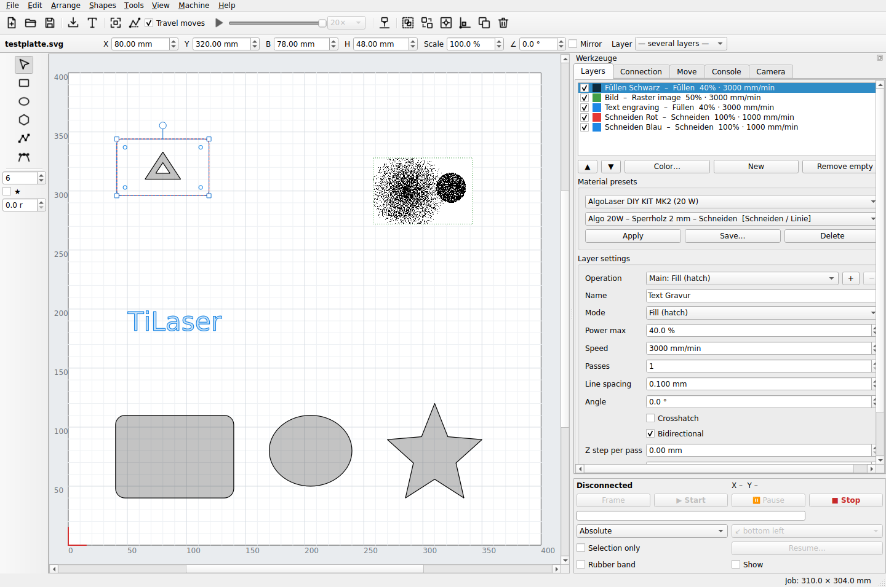

| Area | Content |
|---|---|
| **Menu bar** | File, Edit, Arrange, Shapes, Tools, View, Machine, Help |
| **Toolbar** (top) | New, Open, Save, Import, Text, Show all, Preview, Simulation, Export, Group and Arrange |
| **Object bar** (below) | Properties of the selected object |
| **Drawing tools** (left) | Select, Rectangle, Ellipse, Polygon/Star, Line, Nodes |
| **Work area** (center) | Bed with 10 mm grid, origin at the bottom left (red corner) |
| **Side bar** (right) | Tabs *Layers*, *Connection*, *Move*, *Console*, *Camera* |
| **Job bar** (bottom right) | Status, position, Frame, Start, Pause, Stop, Origin, Selection only, Resume, Rubber band |
| **Status bar** (bottom) | Mouse position in mm, job size, estimated time, number of lines |

**Help:** *Help → User manual* or **F1** opens this manual in the program – F1 jumps straight to the section that matches the menu item, window or control you are using ([Help in the program](#help-in-the-program)). Chapter 22 describes every control individually.

The toolbars show icons. Hovering over them shows the name and shortcut; the menus use the same icons.


#### Toolbar at the top

From left to right:

| Icon | Function | Description | Key |
|:------:|------------------|------------------------------------------------------------|--------------|
|  | **New** | Create an empty project | Ctrl+N |
|  | **Open** | Open a project (TiLaser `.tlp` or LightBurn `.lbrn2`) | Ctrl+O |
|  | **Save** | Save the project | Ctrl+S |
|  | **Import** | Add SVG, DXF, PDF/AI, EPS, LightBurn or an image | Ctrl+I |
|  | **Text** | Insert text from a font | Ctrl+T |
|  | **Show all** | Zoom so that all objects and the bed are visible | Ctrl+0 |
|  | **Preview** | Toolpath preview on/off: burn moves in the layer color, travel moves dashed (next to it *Travel moves* to hide them) | Ctrl+P |
|  | **Simulation** | Play the job as an animation (in the preview). Next to it: slider for the point in time and playback speed 1×–500×. While playing, the icon turns into pause |  |
|  | **Export G-code** | Save the job as a `.gcode` file | Ctrl+E |
|  | **Group** | Combine the selected objects into one object | Ctrl+G |
|  | **Ungroup** | Split a group or an imported file into its parts | Ctrl+Shift+G |
|  | **Center** | Put the selection in the middle of the work area |  |
|  | **To 0/0** | Put the bottom left corner of the selection at the origin |  |
|  | **Duplicate** | Copy of the selection, offset by 10 mm | Ctrl+D |
|  | **Delete** | Delete the selected objects | Del |

#### Drawing tools on the left

| Icon | Function | Description | Key |
|:------:|------------------|------------------------------------------------------------|--------------|
|  | **Select** | Click objects, select with a rubber band, move; handles for scaling and rotating | V |
|  | **Rectangle** | Drag a rectangle. Shift: square, Ctrl: from the center. Corner radius in the *r* field below | R |
|  | **Ellipse** | Drag an ellipse. Shift: circle, Ctrl: from the center | E |
|  | **Polygon/star** | Drag a polygon; number of corners in the field below, ★ makes a star | P |
|  | **Line/polyline** | Click points; double-click or Enter finishes, clicking the start point closes the shape; hold Shift for horizontal or vertical only | L |
|  | **Edit nodes** | Drag points and curve handles; double-click on a line inserts a point, Del deletes it | N |

Esc always switches back to *Select*.


<!-- hilfe: maus -->
### Mouse and keyboard on the work area

| Action | How |
|---|---|
| Zoom | Mouse wheel (towards the mouse position) |
| Pan the view | **Drag** with the middle or right mouse button, scroll bars |
| Scroll sideways | Shift+mouse wheel or swipe sideways on the touchpad |
| Scroll up/down | Ctrl+mouse wheel |
| Context menu | **Click** the right mouse button |
| Select | Click; several with Ctrl+click or by dragging a rubber band: dragged **to the right** (from top left) only objects lying completely inside the frame are selected, dragged **to the left** (from bottom right) all objects the frame touches. With Ctrl or Shift the frame selection is added to the existing selection |
| Move | Drag, or arrow keys (1 mm, with Shift 10 mm, with Ctrl 0.1 mm – adjustable under *View → Arrow key step sizes…*) |
| Show all | Ctrl+0 |
| Delete | Del |

Files can be dragged directly from Explorer or the file manager onto the work area.

---

<!-- hilfe: dateien -->
## 5. Opening, importing and exporting files

<!-- hilfe: projekte -->
### Projects

*File → Save project* (Ctrl+S) creates a `.tlp` file. It contains all objects, layers with parameters and
embedded images. Curves are saved as real curves.
*File → Save selection as project…* (also in the right-click menu) saves only the selected objects with
their layers as a separate `.tlp` file, in the same position.

<!-- hilfe: lightburn -->
### LightBurn projects

TiLaser reads and writes LightBurn files (`.lbrn2`, and reads the older `.lbrn` too).

- **Open:** *File → Open project* and choose the file type *LightBurn project*. The file becomes a new
  project; *Save* then asks for a name for the `.tlp` file.
- **Add:** *File → Import* adds the layers and objects of a LightBurn file to the current project.
- **Save:** *File → Save as LightBurn file* writes an `.lbrn2`.

| Carried over | Notes |
|---|---|
| Layers | Name, mode (*Cut* → cut, *Scan* → fill, *Scan+Cut* → fill with a cut sub-layer, *Image* → raster image), speed (mm/s ↔ mm/min), power, passes, line interval, angle, crosshatch, bidirectional, output, order, Z step, dithering. The LightBurn color is mapped to the closest of the 32 layer colors. |
| Shapes | Paths with Bézier curves, rectangles (with corner radius), ellipses, polygons, nested groups with rotation/mirroring, images. Position and size are kept. |
| Text | Via the outlines LightBurn stores along with it; it can no longer be edited as text afterwards. |
| Not carried over | Offset fill (becomes normal fill), variable text, tabs, optimization settings. Unknown shapes are skipped with a note. |

When saving, each layer gets the LightBurn color closest to its color; more than 30 layers do not fit.
Sub-layers (except *fill + cut*) are lost in LightBurn.

<!-- hilfe: import -->
### Import

| Format | Notes |
|---|---|
| **SVG** | Paths, rectangles (also rounded), circles, ellipses, lines, polygons, groups, `use`, transformations. Units mm, cm, in, pt or px (96 dpi). One layer per stroke or fill color; filled areas without stroke become fill layers. **Text** must be converted to paths in the graphics program (Inkscape: *Path → Object to Path*). |
| **DXF** (ASCII) | LINE, LWPOLYLINE/POLYLINE (incl. arcs), CIRCLE, ARC, ELLIPSE, SPLINE, blocks. Unit from `$INSUNITS`. One layer per DXF layer. TEXT, MTEXT, HATCH and dimensions are skipped. |
| **PDF / Illustrator (AI)** | Vector paths and colors; **text is converted to outlines** (embedded TrueType/CFF font, otherwise a substitute font). With several pages, the first one is imported. Embedded images are skipped. |
| **EPS / PS** | Converted to PDF via Ghostscript or Inkscape (must be installed). |
| **Images** (PNG, JPG, BMP, GIF, TIFF, WebP) | For raster engraving. Size from the file's DPI, otherwise 0.1 mm per pixel (max. 100 mm wide). Transparency becomes white. |

If an imported object lies outside the work area, it is placed in the center.

<!-- hilfe: export -->
### Export

| Menu item | Result |
|---|---|
| *File → Export G-code* (Ctrl+E) | `.gcode` file for an SD card or other senders. Takes *Origin* and *Selection only* into account. |
| *File → Export as SVG* | All objects in mm, layers as Inkscape layers, images embedded |
| *File → Export as DXF* | Contours as LWPOLYLINE, one DXF layer per layer (without images) |
| *File → Save as LightBurn file* | `.lbrn2` with layers and parameters, curves and images (see *LightBurn projects*) |
| *View → Show G-code* | Shows the generated G-code |

---

<!-- hilfe: objekte -->
## 6. Editing objects

<!-- hilfe: auswahl -->
### Selection, handles and object bar

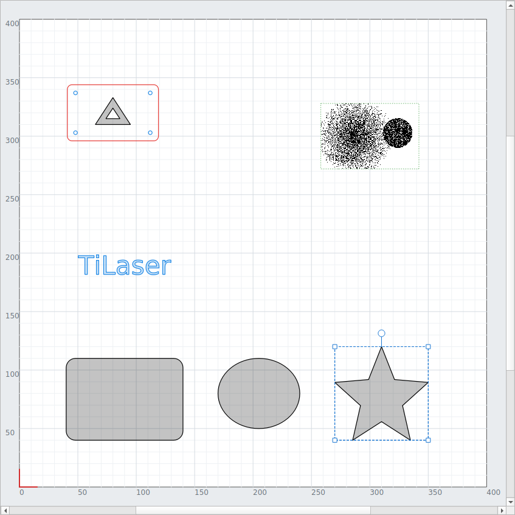

A dashed frame with handles appears around the selection:

- **Drag the corners:** scale proportionally (the opposite corner stays in place).
- **Drag the round handle at the top:** rotate around the center of the selection; with **Shift** in 15° steps.

The **object bar** lets you enter exact values: X/Y (center), width, height (proportional), scaling in %,
rotation, mirroring and the layer.

<!-- hilfe: rueckgaengig -->
### Undo, copy, paste

| Function | Shortcut |
|---|---|
| Undo / redo | Ctrl+Z / Ctrl+Y (or Ctrl+Shift+Z) |
| Cut / copy / paste | Ctrl+X / Ctrl+C / Ctrl+V (offset by 10 mm) |
| Paste in place | Ctrl+Shift+V |
| Duplicate | Ctrl+D |

The *Edit* menu always shows what will be undone. Up to 60 steps are kept.

<!-- hilfe: anordnen -->
### Arrange

**Arrange** menu:

| Function | Description |
|---|---|
| Align | Left, center horizontally, right, top, center vertically, bottom – relative to the whole selection (at least 2 objects) |
| Distribute | Horizontally or vertically with equal gaps between the objects (at least 3 objects) |
| Mirror | Horizontally or vertically around the center of the selection |
| Rotate 90° | Ctrl+L (left) / Ctrl+R (right) |
| Create array | Ctrl+Shift+A, see below |
| Nesting | Ctrl+Shift+N, see [chapter 8](#8-nesting--arranging-parts-automatically) |
| Center / To 0/0 | Move the selection to the middle of the work area or to the origin |
| Cut order | *Cut first / earlier / later / last* (Ctrl+Shift+PgUp, Ctrl+PgUp, Ctrl+PgDown, Ctrl+Shift+PgDown) moves the selection within the project order. *Show order* shows the numbers on the work area (display only). Takes effect when *Cut order: object by object* is chosen in the machine settings |

**Cut order:** the default is *Optimized* – TiLaser looks for the shortest path over all contours per layer
(inside before outside). With *Object by object* (machine settings), one object after the other is finished
in the order of the project; within an object it stays inside before outside with short paths.
The layer order still comes first in both cases.

**Snap to grid:** *View → Snap to grid* (Ctrl+Shift+F). When moving, the bottom left object corner snaps to
the grid. Grid size under *View → Grid size* (0.5 / 1 / 5 / 10 mm). Points snap while drawing, too.

**Snap to nodes:** *View → Snap to nodes* (on by default). **Grab a part at a node** (corner or anchor point –
the mouse pointer must be close to it) and drag: when this node comes close to a node of another part, it
**snaps exactly onto it** – a small orange square shows the snap point. This lets you place parts corner to
corner. If several parts are selected, they all move along. If you do not grab the part at a node, the grid
applies as before (if switched on). Hold **Alt** to drag without snapping. To place whole edges together, use
[Placing edges together](#placing-edges-together).

<!-- hilfe: kanten-anlegen -->
### Placing edges together

Places a part with one of its straight edges flush against the edge of another part – rotated to fit, without
overlap. Handy before [joining with fingers](#finger-joint-on-edge) or to put parts together without a gap.

1. *Arrange → Place edges together* (Alt+K). The status bar shows what to do.
2. Move the mouse over an edge of the part that is to be **moved** – the edge is highlighted in orange – and
   click. It stays marked in blue.
3. Click the **target edge** on the other part. The first part is rotated and moved so that the two edges lie
   exactly on top of each other and the parts lie side by side.

| On the second click | Alignment along the edge |
|---|---|
| no key | centers flush |
| with Shift | left or bottom flush |
| with Ctrl | right or top flush |

The whole straight piece counts as the edge, even if it consists of several points. For curves only the small
piece under the mouse is used. Esc cancels, Ctrl+Z undoes the placement.

<!-- hilfe: array -->
### Array

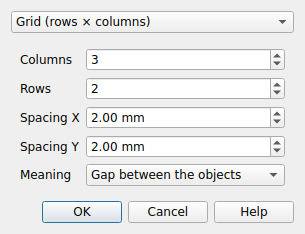

- **Grid:** columns × rows with spacing X/Y. *Gap between the objects* = gap, *grid pitch* =
  center-to-center distance. Rows are added downwards.
- **Circle:** count (including the original), center, total angle (360° = full circle) and whether the
  copies are rotated.

<!-- hilfe: gruppieren -->
### Grouping and assigning layers

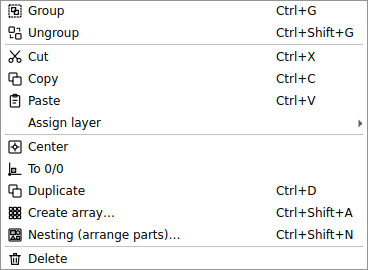

- **Group** (Ctrl+G): several vector objects become one object.
- **Ungroup** (Ctrl+Shift+G): an object splits into its parts. An outer contour stays together with its
  holes (an “O” or a plate with holes). Ungrouping again splits such a part into single contours.
- **Assign layer** (right click or *Edit*): moves the selection to another layer – also to a **new layer**
  with a color of your choice. This way single parts can be engraved instead of cut, for example.

---

<!-- hilfe: zeichnen -->
## 7. Drawing, shapes and text

<!-- hilfe: zeichenwerkzeuge -->
### Drawing tools

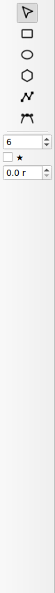

| Tool | Key | How |
|---|---|---|
| Select | V | Default. Drag the frame to the right = only fully enclosed objects, to the left = all touched objects |
| Rectangle | R | Drag. Shift = square, Ctrl = from the center. Corner radius in the field below the tools. |
| Ellipse | E | Drag. Shift = circle, Ctrl = from the center. |
| Polygon/star | P | Drag. Number of corners in the field below, ★ = star. |
| Line/polyline | L | Click points. Double-click or Enter finishes, clicking the start point closes the shape, Esc cancels. Holding Shift makes the next segment strictly horizontal or vertical – whichever direction the mouse is further away from the last point. |
| Nodes | N | Node editing, see below |

New shapes go to the layer currently selected in the *Layers* tab. **Esc** returns to the select tool.

<!-- hilfe: knoten -->
### Node editing

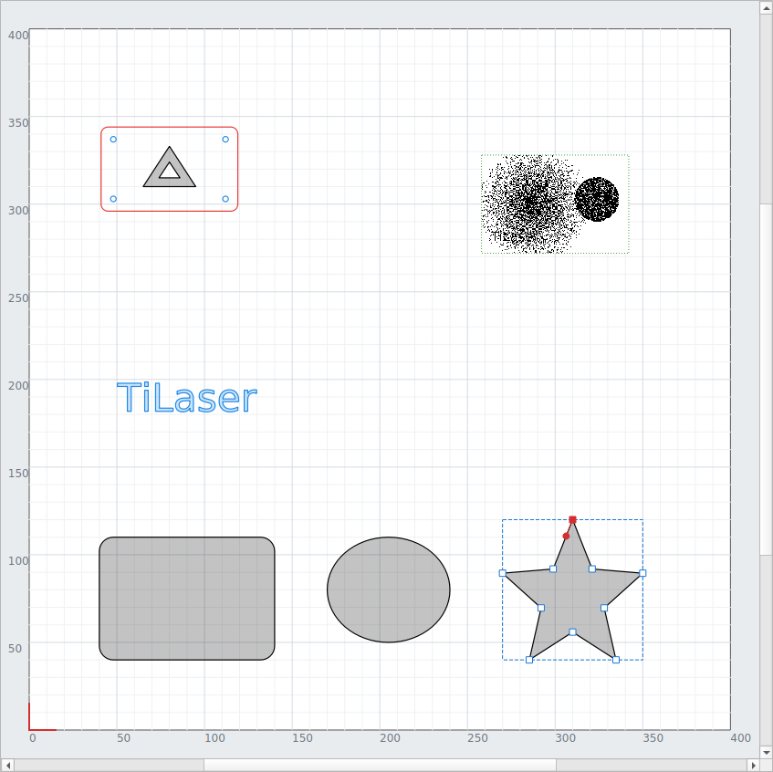

Click an object with the node tool (N). The nodes appear as squares, the selected one in red.
The **curve handles** (circles) appear at the selected node.

| Action | How |
|---|---|
| Move node | Drag |
| Shape curve | Drag a handle. Smooth nodes stay smooth; with **Alt** only one handle moves (corner). |
| Insert node | Double-click on the contour |
| Delete node | Del |
| Convert segment to curve | C (segment after the selected node) |
| Convert segment to line | L |
| Smooth node | S |
| Break path | B (open a closed contour or split an open line) |
| **Set start point** | A (or *Machine → Set start point on selected node*): the cut of this contour starts at the selected node; TiLaser no longer chooses the start point itself. For open lines this works at one of the two ends. With kerf compensation or tabs, TiLaser still chooses the start point itself |

Curves from SVG, PDF, DXF, fonts and the drawing tools stay real Bézier curves with few nodes.

<!-- hilfe: formen -->
### Combining shapes

**Shapes** menu (select at least two closed vector objects):

| Function | Result |
|---|---|
| Union (Ctrl+Shift+U) | Common outline of all shapes |
| Subtract (Ctrl+Shift+D) | Largest shape minus all others (e.g. plate minus cut-outs) |
| Intersection (Ctrl+Shift+I) | Only the overlapping area |
| Exclusion (XOR) | Everything except the overlaps |
| Offset (Alt+O) | Shift contours outwards (+) or inwards (−) by a distance, with sharp or round corners |
| Join / close paths (Alt+J) | Join open lines with shared end points and close them – useful after DXF imports |

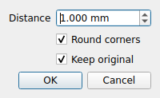

<!-- hilfe: text -->
### Text

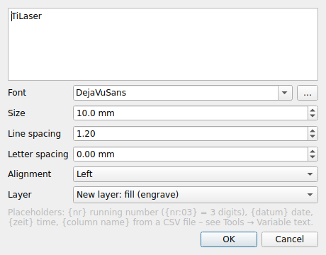

*File → Insert text* (Ctrl+T): text (several lines), font (all installed TrueType/OpenType fonts or a file
via “…”), size in mm, line and letter spacing, alignment and layer. New layers for text are **fill**
(engraving) or **cut/line** by default. You can change the content of an inserted text later with right
click → *Edit content…*.

<!-- hilfe: variabler-text -->
### Variable text, QR code and barcode

Texts and code contents may contain **placeholders** that are filled in before every job:

| Placeholder | Result |
|---|---|
| `{nr}` | running number, e.g. `17`; `{nr:03}` with leading zeros: `017` |
| `{datum}` / `{zeit}` | today's date `18.11.2026` / time `14:05`; also `{jahr}` (year), `{monat}` (month), `{tag}` (day) |
| `{column name}` | value from the current row of a CSV file, e.g. `{Name}` |

*Tools → Variable text…* sets the start number and step, chooses a CSV file (first row = column names,
separator `;` or `,`) and the current row. With *Count up after every job or G-code export*, TiLaser
increases the number and moves to the next CSV row as soon as a job is finished – for serial numbers,
name tags or labels. The preview always shows the next values.

*Tools → Insert QR code / barcode…* (Ctrl+Shift+Q) creates a **QR code** (edge length, error correction
L/M/Q/H, also umlauts and web addresses) or a **Code 128 barcode** (width, height; characters ASCII 32–126)
as an engraving on a fill layer. The content may contain placeholders, e.g.
`https://example.com/part/{nr:05}`. For reliable scanning, use a small line interval (at most a quarter of
the module width) and leave a light margin around the code; test with a phone before a series.

<!-- hilfe: text-auf-pfad -->
### Text on path

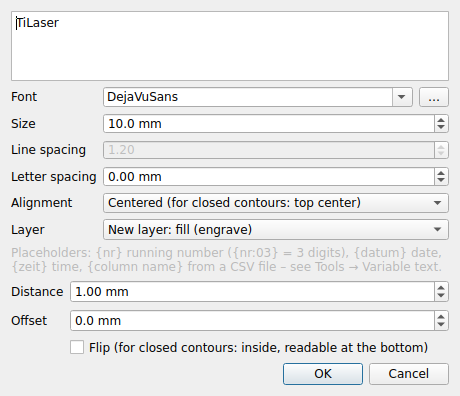

Select a contour (circle, arc, wavy line …) → *Tools → Text on path* or right click.
With closed contours the text is on the outside and readable at the top center; with **Flip** it is on
the inside and at the bottom. *Distance* = distance of the text from the contour, *Offset* = shift along
the contour.

<!-- hilfe: nachzeichnen -->
### Trace image

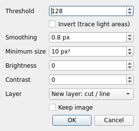

Select an image → *Tools → Trace image* (Alt+T). Dark areas become closed contours, e.g. to cut out a logo.

| Setting | Effect |
|---|---|
| Threshold | Pixels darker than this value become filled areas |
| Invert | Trace light areas |
| Smoothing | Larger = fewer points, smoother edges |
| Minimum size | Smaller specks are ignored |
| Brightness / contrast | Adjust the image beforehand |
| Keep image | Otherwise the image is replaced by the contours |

<!-- hilfe: box -->
### Box generator

*Tools → Generators → Box generator…* (Ctrl+Shift+B) creates a box with finger joints: bottom, four walls
and optionally a lid. The parts are plugged together and glued if needed.

| Setting | Effect |
|---|---|
| Dimensions | *Inside dimensions* (the content has to fit, e.g. a circuit board) or *outside dimensions* |
| Width, depth, height | Size in X, Y and Z |
| Material thickness | Measure it with calipers first. “3 mm” plywood is often 2.7 or 3.2 mm thick, and even 0.2 mm difference makes the fingers too loose or too tight |
| Finger width | Desired width; the program distributes an odd number of equally wide fingers along each edge |
| Kerf | Entered as the kerf of the new layer “Box”. Larger = tighter. For a press fit about 0.02–0.05 mm above the measured kerf (see [Determining the kerf](#determining-the-kerf)) |
| With lid | Without the check mark, an open tray is created |
| Power, speed, passes | Values for the “Box” layer; easiest is to apply a preset in the Layers tab afterwards |
| Label the parts | Engraves “Bottom”, “Front” etc. with low power on the parts (layer “Box labels”) |

*Preview* shows the toolpath, *Add to project* creates the parts as separate objects. Afterwards they can be
moved, arranged with [nesting](#8-nesting--arranging-parts-automatically) to save space, or extended with
holes, vent slots and engravings (e.g. with *Shapes → Subtract*). The fingers stay unchanged.

Tip: first cut a small test box (e.g. 40 × 30 × 20 mm) and check the fit, then adjust the kerf.

<!-- hilfe: muster -->
### Patterns in an area

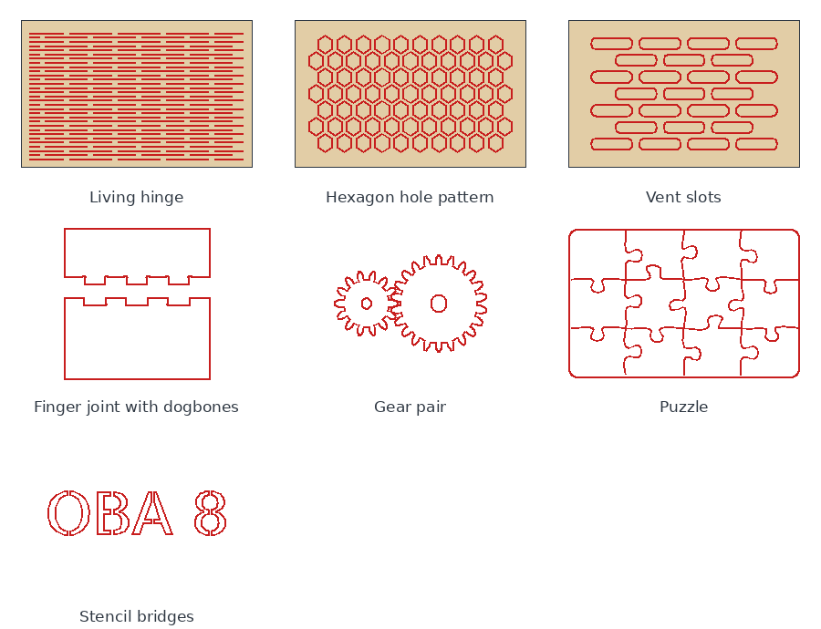

Under *Tools → Patterns in area*, TiLaser fills a **selected closed contour** (e.g. a rectangle or the
outline of a part, also with holes). The result is a new object; the contour itself stays unchanged and is
cut out as usual.

**Living hinge** – offset cut lines that let plywood bend.

| Setting | Effect |
|---|---|
| Type | *Normal* (straight slits), *Triple offset* (softer) or *Wave slits* (softer, decorative), see below |
| Slit length, bridge | Length of the cuts and of the bridges left between them |
| Row spacing | Smaller = more flexible, but more fragile. 3 mm plywood: about 1.5 mm |
| Distance to the edge | Distance of the slits from the edge (see below) |
| Direction of the slits | 0° = horizontal; the bending axis is parallel to the slits |

The pattern is symmetric: the rows are centred in the area, and each row is built the same on the left
and right. The two outer rows and every second row in between keep the *distance to the edge*. The rows
in between are offset by half a pitch: their bridges sit exactly in the middle of the slits of the
neighbouring rows, and they run through to the edge. The slit length is adjusted slightly so that every
row works out evenly. In round or slanted areas, each row follows its own width.

How soft the hinge becomes depends on the wood strips between the rows: when bending, they twist between
the bridges. The longer the free length and the narrower the strip, the softer.

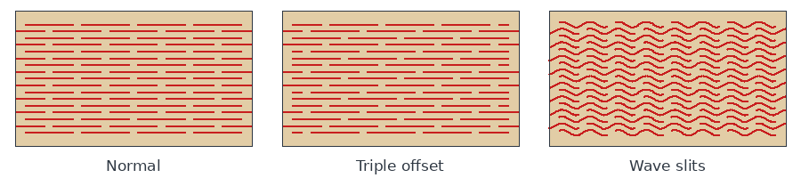

- **Normal** – straight slits, each row offset by half a pitch (as described above). Every row is mirror
  symmetric.
- **Triple offset** – each row is offset by a third of a pitch against the previous one. The bridges of
  neighbouring rows are therefore further apart, and the strips can twist over a longer distance:
  noticeably softer, but still stable – good for box lids and round corners. Here too the outer rows and
  every second row keep the edge distance. Because a third of a pitch cannot be mirrored, the pattern is
  point symmetric about the centre (it looks the same rotated by 180°).
- **Wave slits** – built like *Normal*, but the slits are waves (height 40 % of the row spacing, two waves
  per pitch). All waves run parallel, so the distance between the rows is kept. The longer strips spread
  the stress better and the wood breaks less often; lasering takes a little longer. Also point symmetric.

**Hole pattern / vent grille** – circles, hexagons, squares or slots, as a grid or offset (honeycomb).
Only whole holes are placed that lie completely inside the area including the edge margin – ideal for
vent grilles in enclosure walls.

**Engraving pattern** – area patterns on a fill layer:

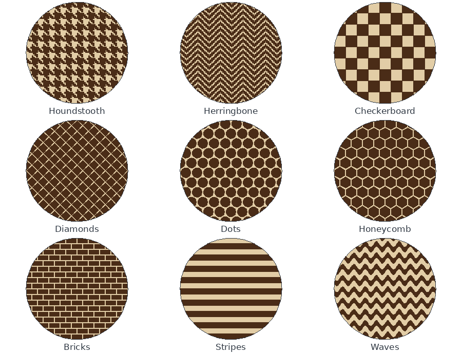

*Size* is the repeat, *gap* the distance between the elements (diamonds, dots, honeycomb, bricks, waves),
*rotation* rotates the pattern. Houndstooth and herringbone are built from small squares, like in fabric.

<!-- hilfe: biegezone -->
### Living hinge between two edges

*Tools → Living hinge between two edges…* joins two parts via a **bending zone** into one part – e.g. bottom
and wall of a housing with a round corner. TiLaser calculates the length of the bending zone from **radius
and angle**.

1. Start the tool and click the **edge of the first part** – this part is rotated and moved (the edge is
   highlighted orange when hovering, the first chosen one blue).
2. Click the **edge of the second part** the bending zone should connect to.
3. In the dialog, enter radius, angle and material thickness, plus the settings of the cut pattern.

TiLaser places the first part so that its edge faces the other one at the distance of the bending length
(centres aligned), fills the strip in between and merges everything into **one part**. The strip gets the
[living hinge pattern](#patterns-in-an-area); the slits run parallel to the edges. Holes and engravings of
both parts are kept. *Edit → Undo* restores the two parts.

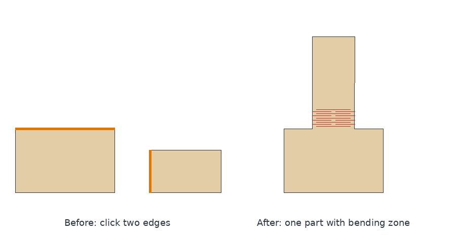

| Setting | Effect |
|---|---|
| Bending radius (inside) | Inner radius of the bend |
| Bending angle | How many degrees the part is bent (90° = right-angled corner, 180° = U-turn) |
| Material thickness | Bending length = angle × (radius + half the material thickness), measured in the middle of the material – e.g. 90° at 10 mm radius and 3 mm material: 18.1 mm |
| Type, slit length, bridge, row spacing | As with the [living hinge](#patterns-in-an-area) in an area |
| Distance to the edge | Distance of the closed rows of slits from the ends of the bending zone |

The bending zone is as wide as the two edges overlap after aligning. If the edges have different lengths,
the longer part protrudes at the side.

<!-- hilfe: fingerzinken -->
### Finger joint on edge

Joins any two parts with finger joints – e.g. a self-drawn back panel with a bottom: one part gets fingers,
the other exactly matching cut-outs. This is how:

1. Place the two parts so that the **edges to be joined lie on top of each other** (same line,
   overlapping). Easiest with [Placing edges together](#placing-edges-together) (Alt+K).
2. Select both parts → *Tools → Finger joint on edge…*
3. Under **Fingers on**, choose which part gets the fingers; the list names both parts with their position
   (e.g. “Bottom (bottom)”).

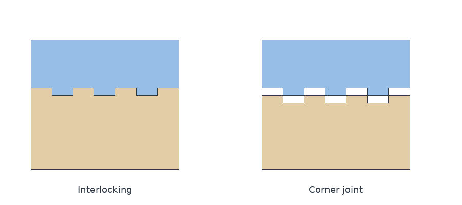

| Setting | Effect |
|---|---|
| Type | **Interlocking: one part with fingers, the other with cut-outs** (default): the fingers protrude beyond the edge by the material thickness, the mating part gets equally deep cut-outs at the same places. As the parts lie, the fingers fill the cut-outs without gaps (left picture); the shared line is cut only once. For a 90° corner, draw the part with the fingers shorter by the material thickness. **Corner joint: both parts with offset cut-outs, outside dimensions stay**: like the box generator – both parts keep their outside dimensions and get alternating cut-outs (right picture). Lying flat side by side there are gaps; they only interlock when turned by 90° |
| Fingers on | Part that gets the fingers (for *corner joint*: the part whose outer fingers stay) |
| Material thickness | Depth of the fingers/cut-outs |
| Finger width | Desired width; an odd number of equally wide fingers is distributed along the edge |
| Dogbone diameter | Relieves every **inner corner** with a small circle (“dogbone”) so that square fingers go in completely – important for thick material, a strongly tapered beam or milling. 0 = off |
| Tolerance | How far apart the edges may be and still count as “touching” |
| All shared edges | Otherwise only the longest shared edge is processed |

Curves of the parts are converted into fine polylines. Use the kerf compensation of the layer for the fit
([Determining the kerf](#determining-the-kerf)).

<!-- hilfe: puzzle-verbindung -->
### Puzzle joint on edge

Connects two parts lying **flat edge to edge** with round knobs like jigsaw pieces – e.g. to assemble a
panel larger than the work area from two parts, or for signs and games. The neck of each knob is narrower
than its head, so the parts cannot be pulled apart in the plane.

1. Place the two parts so that the **edges to be joined lie on top of each other** – easiest with
   [Placing edges together](#placing-edges-together) (Alt+K).
2. Select both parts → *Tools → Puzzle joint on edge…*
3. Under **Knobs on**, choose which part gets the knobs; the other gets exactly matching cut-outs.

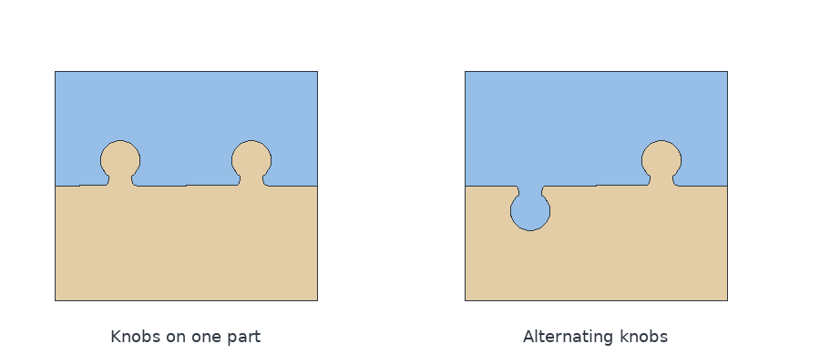

| Setting | Effect |
|---|---|
| Knobs on | Part that gets the knobs (with *alternating*: the part with the first knob) |
| Knob size (head diameter) | Diameter of the round head. The neck is 60 % as wide, the knob protrudes about 1.15 × head diameter beyond the edge – the other part must be at least that deep |
| Number per edge | 0 = automatic: about one knob every 2.5 head diameters, evenly distributed |
| Alternate knobs on both parts | The knobs sit alternately on one and the other part (right picture) – holds equally well when pulled in both directions across the edge |
| Clearance | Gap between knob and cut-out (half on each part). Positive = looser, negative = tighter. The laser itself already removes some material (kerf); for plywood 0 or a slightly negative value usually fits, see [Determining the kerf](#determining-the-kerf) |
| Tolerance | How far apart the edges may be and still count as “touching” |
| All shared edges | Otherwise only the longest shared edge is processed |

If a part is too narrow at the edge for the knobs or the requested number of knobs does not fit on the edge,
TiLaser reports this and changes nothing. Curves of the parts are converted into fine polylines. For the pieces
of a whole jigsaw picture there is the [puzzle generator](#gear-puzzle-and-stencil-bridges).

<!-- hilfe: snap-lock -->
### Snap lock on edge

Plug-in joint **at a right angle without glue or screws**: one part gets tabs made of two springy prongs with
small hooks, the other matching rectangular slots. When pushing through, the prongs are squeezed together;
on the back the hooks snap in. To release, squeeze the prongs together with your fingers. Typical for
housings, boxes and brackets.

1. Place the two parts so that the **edges to be joined lie on top of each other** – easiest with
   [Placing edges together](#placing-edges-together) (Alt+K). The edge of one part is later plugged into the
   face of the other.
2. Select both parts → *Tools → Snap lock on edge…*
3. Under **Tabs on**, choose which part gets the tabs.

TiLaser places the tabs on the edge, cuts the slots into the other part and then moves the part with the
tabs away a little so that nothing overlaps (the status bar shows the distance).

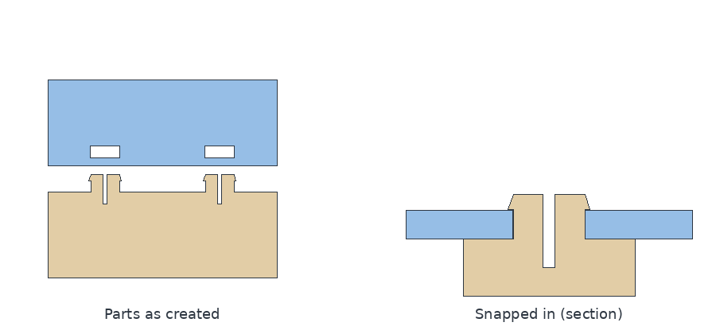

| Setting | Effect |
|---|---|
| Tabs on | Part that gets the tabs; the other gets the slots |
| Material thickness | Thickness of the material (both parts). The hooks sit just above it, the slots are that wide |
| Tab width | Width of one tab (both prongs and the spring slit together) |
| Number per edge | 0 = automatic: about one tab per 4 tab widths, evenly distributed |
| Hook (sideways overhang) | How far each hook protrudes sideways. More = holds tighter, harder to plug in. Together they must be smaller than spring slit + clearance, otherwise the prongs do not get through |
| Spring slit | Width of the slit between the two prongs. It reaches a little into the part so that the prongs are longer and spring more softly |
| Clearance | Play in the slot and under the hooks |
| Distance of the slots from the edge | How far the slots are from the edge of the other part – the part with the tabs will stand exactly there |
| Tolerance | How far apart the edges may be and still count as “touching” |
| All shared edges | Otherwise only the longest shared edge is processed |

**Tips:** The spring effect depends strongly on the material – test plywood and acrylic (brittle!) with a
sample first. For acrylic choose small hooks (0.3–0.5 mm) and a wider spring slit. If the slots do not fit
into the other part (too narrow or too close to the edge), TiLaser reports this and changes nothing.

<!-- hilfe: hammerverbindung -->
### Hammer joint on edge

Tenon joint **at a right angle without screws or glue** after the “Hammer Joint” drawing by Jiskar Schmitz
(Lasersheets, free to use): one part gets tenons with a tapering slot, the other matching mortises. The
**wedge is cut directly inside the slot** and only hangs on two short bridges; it sticks out beyond the tenon.

**Assembly:** push the tenon through the hole and drive the wedge in with a hammer. The bridges break, the
wedge slides into the narrow part of the slot and pushes the two halves of the tenon apart inside the hole –
the joint clamps. Afterwards the wedge is flush with the tenon, which itself protrudes slightly (*tenon
protrusion*) and can be sanded flush. The joint cannot be taken apart again without damage.

1. Place the two parts so that the **edges to be joined lie on top of each other** – easiest with
   [Placing edges together](#placing-edges-together) (Alt+K).
2. Select both parts → *Tools → Hammer joint on edge…*
3. Under **Tenons on**, choose which part gets the tenons.

TiLaser places the tenons including the wedges on the edge, cuts the mortises into the other part and moves
the part with the tenons away a little so that nothing overlaps.

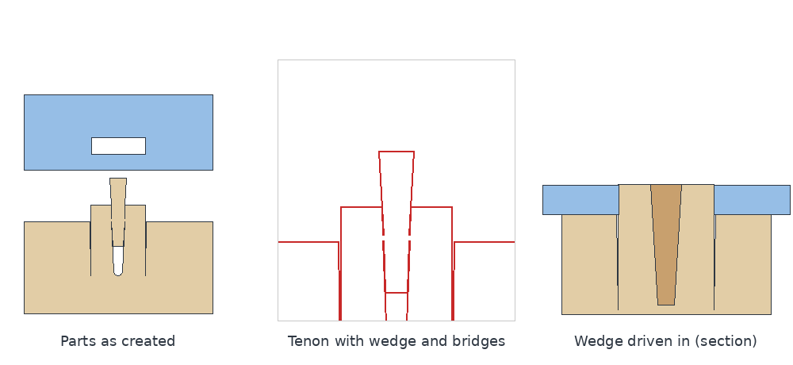

| Setting | Effect |
|---|---|
| Tenons on | Part that gets the tenons; the other gets the mortises |
| Material thickness | Thickness of the material (both parts); the mortise is that wide plus *clearance*, the tenon that long plus *protrusion* |
| Tenon width | Length of the mortise (proven: 20 mm). The tenon itself is wider by the *oversize* |
| Number per edge | 0 = automatic: about one tenon per 3 tenon widths, evenly distributed |
| Tenon protrusion | How far the tenon protrudes beyond the mating part (for sanding flush) |
| Wedge protrusion before driving in | How far the wedge sticks out beyond the tenon – this is also the distance it slides into the slot when driven in. The original drawing uses 10 mm for all thicknesses |
| Spread by the wedge | The wedge is this much wider at the top than the slot at the tip of the tenon (in total). More = tighter, but a higher risk of breaking |
| Length of the holding bridges | The two bridges left and right on which the wedge hangs (5 mm below the tip of the tenon). Too long = hard to drive in, too short = the wedge falls out while lasering |
| Slot depth into the part | How deep the wedge slot and the relief slits reach below the edge (original: 20 mm) |
| Relief slits | Wedge-shaped slits left and right of the tenon (this wide at the top, pointed at the bottom). They make the tenon halves flexible. 0 = none |
| Tenon oversize (width) | The tenon is this much wider than the mortise is long (original: 0.15 mm) – clamps additionally across |
| Clearance in the mortise | The mortise is this much wider than the material is thick (original: 0.075 mm) |
| Distance of the mortises from the edge | How far the mortises are from the edge of the other part – the part with the tenons will stand there |
| Tolerance, All shared edges | As with the other joints |

The defaults correspond to the original drawing (built the same for 3 to 12 mm; only the tenon length and
the mortise width grow with the material thickness). **Tips:** birch plywood and solid wood from 6 mm work
best, MDF works too. Brittle or very smooth materials (acrylic, bamboo across the grain, POM) are unsuitable.
The clamping force depends strongly on material, kerf and beam taper – always test with a sample first. Lay
the joint flat on the table when hammering so that the tenon does not tilt.

<!-- hilfe: zahnrad-puzzle -->
### Gear, puzzle and stencil bridges

**Gear** (*Tools → Generators*) – spur gear with involute teeth. The **module** is important:
pitch circle = module × number of teeth; only gears with the same module mesh. *Create mating gear*
creates two meshing gears at the right center distance (module × (z1 + z2) / 2, shown in the status bar
afterwards). *Backlash* makes the teeth a little narrower so that the gears do not jam.
Below about 17 teeth the tooth roots are not undercut – such gears run a little rougher.

**Puzzle** – frame and cut lines with random tabs. Set width, height, columns and rows;
*tab size* and *irregularity* determine the look. The *random number* is shown in the status bar
afterwards – the same number produces the same puzzle again. Tip: engrave a photo on the area first,
then cut out the puzzle.

**Stencil bridges** (*Tools → Stencil bridges…*) – for stencils where letters are cut out of a sheet:
inner parts as in O, A, B or 8 would fall out. Select a text or shape; TiLaser lays a bridge (vertical or
horizontal) of the set width through each inner part.

<!-- hilfe: knoechelscharnier -->
### Knuckle hinge on edge

*Tools → Knuckle hinge on edge…* builds a **hinge made only of laser-cut parts** between two parts of a box –
typically the **back wall of the box and the back wall of the lid**. The knuckles are discs of the material
that stand perpendicular on the outside of the walls, alternately on both parts. Each knuckle sits with **two
small finger tabs** in slots of its wall. The eye with the hole sits exactly above the shared edge; towards
the end the knuckle is **bevelled**. The **pin** goes through all eyes; the lid rotates around it.

1. Place the two back walls as they meet when the box is closed: **edge to edge** (easiest with
   [Placing edges together](#placing-edges-together), Alt+K).
2. Select both → *Tools → Knuckle hinge on edge…*

TiLaser cuts the slots into both back walls and places the knuckles (and the pins) to the right of the parts.
Knuckles 1, 3, 5 … of each hinge belong to the part selected first, 2, 4 … to the other – the status bar
names the assignment.

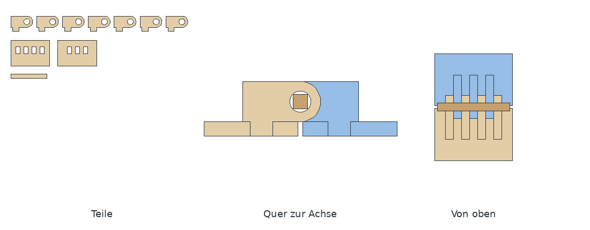

**Assembly:** put the knuckles into the slots (glue them if you like), place box and lid together so that the
knuckles alternate and the eyes line up, then push the pin through. The laser-cut square pin protrudes by
one material thickness on both sides and is held in the square holes of the outer knuckles; the knuckles
are placed next to the parts separately for each part (*Knuckles* + part name).

| Setting | Effect |
|---|---|
| Material thickness | Thickness of the material – width of each knuckle, depth of the finger tabs |
| Number of hinges | 1 = one hinge in the middle of the edge. From 2 on, the outer ones sit near the ends and the others evenly in between – for wide parts |
| Distance of the outer hinges from the end of the edge | From two hinges on: how far the outer ones are from the ends of the edge |
| Knuckles per hinge | A hinge is *knuckles × material thickness* long. With an odd number, both outer knuckles belong to the first part |
| Knuckle length | How far the knuckle lies on the wall from the edge |
| Height at the bevelled end | The knuckle slopes down from the eye to this height |
| Length of the finger tabs | Length of the two tabs (and slots) along the wall; one sits right behind the eye, one shortly before the end |
| Pin diameter | 0 = a **square pin** is cut as well (edge length = material thickness). The **two outer knuckles** of each hinge have a square hole (material thickness + half the clearance) in which the pin sits firmly – so it cannot slide out and needs no glue. In all other knuckles it turns in the round hole, whose diameter matches the diagonal. With an even number of knuckles the first and last knuckle of the first part have a square hole (the two outer ones then belong to different parts). Otherwise the diameter of a round rod or wire – then all knuckles have round holes |
| Wall thickness around the hole | Material between the hole and the outer edge of the eye |
| Clearance | Play in the hole around the pin and in the slots around the tabs |
| Tolerance | How far apart the edges may be and still count as “touching” |

<!-- hilfe: federverschluss -->
### Spring latch on edge

*Tools → Spring latch on edge…* builds a **snap latch made only from the material** – e.g. for the lid of a
box with a [knuckle hinge](#knuckle-hinge-on-edge), on the side opposite the hinge. It is meant for two parts
that meet **in one plane** when the lid is closed, typically the **front wall of the box and the front wall of
the lid**.

One part gets a **window** near the edge. In it, a **tongue** hangs on a **meander spring** (S shape: a narrow
bar in tight loops) and reaches through an opening across the edge into a **recess** in the other part. Its
hook snaps in behind a shoulder there. When closing, the bevel of the hook pushes the tongue aside, the spring
bends and snaps back. To **open**, push the button in the window aside with a finger or a pen. Because the
bending is spread over several legs with round turns, the spring gets a lot of travel in a small space
without the wood breaking at one spot. The button is wider than the opening: if you pull on the closed lid,
it rests on the bar – the force does not go through the spring.

1. Lay both parts as they meet with the lid closed: **edge to edge** (easiest with
   [Placing edges together](#placing-edges-together), Alt+K).
2. Select both → *Tools → Spring latch on edge…*, choose which part gets the spring and tongue.

If the lid rests on top of the wall instead, use the [Spring bolt with hooks](#spring-bolt-with-hooks).

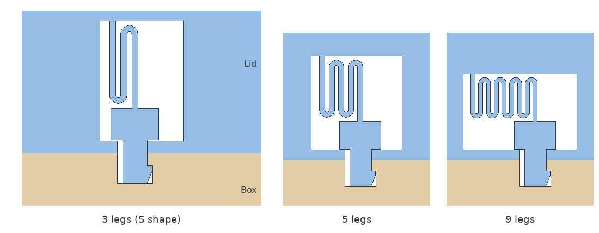

| Setting | Effect |
|---|---|
| Spring and tongue on | Part with window, spring and tongue; the other one gets the recess |
| Number of latches | 1 = centred on the edge; from 2 on, the outer ones sit near the ends, the others evenly in between |
| Distance of the outer latches from the end of the edge | From two latches on: distance of the window from the end of the edge |
| Spring legs | Odd number: 1 = simple leaf spring, 3 = S shape, 5, 7 … = meander. More legs = softer, more travel |
| Leg length | Length of the straight pieces of the spring; longer = softer |
| Spring bar width | Width of the spring bar; narrower = softer but more fragile. For 3 mm plywood about 1.2–2 mm |
| Slot between the legs | Distance between the legs (at least a little more than the kerf) |
| Tongue width | Width of the tongue in the opening |
| Hook overhang | How far the hook sticks out sideways – the spring has to give way this much when snapping in |
| Shoulder above the hook | Material of the other part above the hook; carries the load when pulling |
| Button length | Part of the tongue in the window you push to open |
| Room for pushing | Free space next to the button for a finger or pen |
| Bar between window and edge | Bar of material at the edge on which the button rests |
| Clearance | Play in the opening, in the recess and under the shoulder |
| Tolerance | How far apart the edges may be and still count as "touching" |

<!-- hilfe: federriegel -->
### Spring bolt with hooks

*Tools → Spring bolt with hooks…* is the second kind of spring latch – for a **lid that rests on top of the
front wall** (e.g. a box with a living hinge). A **bolt** sits on the inside **behind the front wall**: a
narrow plate whose **hooks** reach up through slots in the lid. Two **T-shaped holders** go through the bolt
and into slots in the wall. One sits in an **eye at the end of a long meander spring**, the other in an
**elongated hole** – so the bolt can slide sideways and the spring pushes it back.

When closing, the edges of the slots in the lid push the bevels of the hooks aside; the bolt gives way, snaps
back, and the noses of the hooks rest on the lid. **To open**, push the hook heads that stick out of the lid
aside and lift the lid.

1. Lay the lid and the front wall so that the **front edge of the lid touches the top edge of the wall** –
   edge to edge (easiest with [Placing edges together](#placing-edges-together), Alt+K).
2. Select both → *Tools → Spring bolt with hooks…*, choose which part is the lid.

TiLaser cuts the hook slots into the lid (one wall thickness behind its edge) and the slots for the holders
into the wall. The bolt (*Bolt* + name of the wall) and the two holders are placed to the right of the parts.

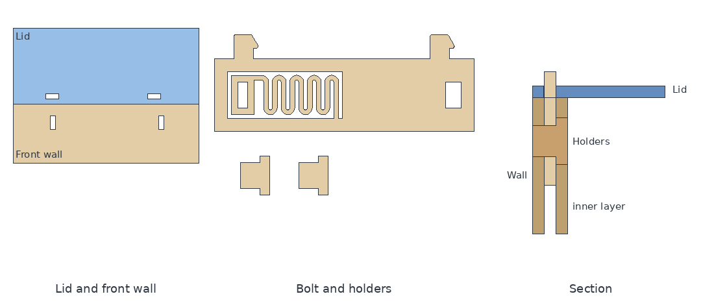

**Assembly:** Place the bolt on the inside of the front wall, top edge flush with the wall, with the noses of the
hooks pointing to the short side of the lid slots. Push the holders from the inside through the eye and the
elongated hole into the wall slots (head on the inside) and glue them in the wall – do not glue the bolt.

**With a second layer** (as in many templates): the bolt lies between the front wall and an **inner layer** of the
same size – guided on both sides, nothing needs gluing. The inner layer gets longer slots for the wider head of
the holders, in which it sits flush (head length = thickness of the inner layer). Either select the inner layer
as a third part, or tick *Create inner layer as a copy of the wall* – TiLaser then places a copy of the wall
(*name* + "inner") with the head slots below the parts.

| Setting | Effect |
|---|---|
| Lid is | Which of the two parts is the lid; the other is the front wall |
| Material thickness | Thickness of the bolt and the holders (width of the slots) |
| Lid thickness | The hook shank is lid thickness + clearance long, so the nose rests on the lid |
| Wall thickness | The hook slots lie this far behind the lid edge (the bolt sits directly behind the wall) |
| Length of the bolt | The bolt is centred on the edge |
| Number of hooks | Evenly spread on the bolt |
| Hook shank width | Width of the hooks in the lid slot |
| Hook overhang | How far the nose reaches over the lid – and how far the bolt has to give way when snapping in |
| Hook head above the lid | Minimum height of the head above the lid; push it to open. With a steep bevel it becomes taller |
| Bevel angle at the nose | Angle of the bevel to the lid surface (default 60°). Steeper = the slot edge pushes the hook aside more easily when the lid is put on; the nose tip and the head are rounded. The bevel always reaches past the shank so the edge reliably lands on it |
| Spring legs | Odd number; more legs = softer spring, longer bolt needed |
| Spring bar width / slot | Width of the spring bar and distance between the legs |
| Holder height | Height of the holders and thus of the eye and the bolt |
| Inner layer | Bolt between the wall and an inner layer; the inner layer gets longer slots for the heads of the holders. If a third part is selected, it is the inner layer (same size as the wall, measured from the top left), otherwise a copy of the wall is created |
| Inner layer thickness | Length of the holder head |
| Bolt margin | Material around the window and the elongated hole |
| Clearance | Play in the slots, in the eye and the elongated hole |
| Tolerance | How far apart the edges may be and still count as "touching" |

<!-- hilfe: nummerieren -->
### Numbering parts

*Tools → Number parts…* numbers the selected parts – without a selection all parts – and **engraves the
number**. **Identical parts get the same number**, even if they are rotated; this makes kits with many
identical parts easy to sort and assemble.

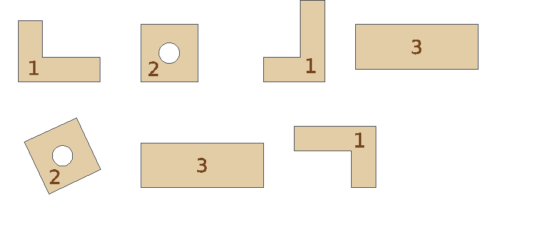

- **Order:** as when reading – rows from top to bottom, within them from left to right. The part at the top
  left gets the first number, every new part shape the next number.
- **Space:** the number is placed where there is the most free material (among several equally good spots,
  the most central one) and is reduced so that it fits completely into the part with the *distance to the
  edge* – also in L shapes and next to holes. If not even the *minimum height* fits, the part stays without a
  number; the status bar names these parts.
- **Layer:** by default the numbers go to a new fill layer *Numbers* (engraving). They belong to their part
  and move with it.
- **Numbering again:** with *Replace existing numbers on this layer* the old numbers are removed first –
  this deletes **all** paths of this layer in the chosen parts, so only use it with the numbers layer.

| Setting | Effect |
|---|---|
| Prefix | Text before the number, e.g. “T” for T1, T2 … (empty = just the number) |
| First number | Counting starts with this number |
| Identical parts get the same number | Off: every part gets its own number |
| Mirrored parts count as identical | For parts that can be turned over. Off: left and right variants get different numbers |
| Comparison tolerance | How far the contours of two “identical” parts may deviate |
| Text height (maximum / minimum) | Largest text height; it only gets smaller if there is not enough room – but never below the minimum height |
| Distance to the edge | Free distance between the number and the edges of the part |
| Layer | Layer for the numbers (fill) |

---

<!-- hilfe: nesting -->
## 8. Nesting – arranging parts automatically

Nesting arranges the selected parts on a rectangular sheet to save space while keeping a **minimum gap**.
This saves material, e.g. when cutting many enclosure parts from one plywood sheet.

1. Select the parts (Ctrl+A for all).
2. *Arrange → Nesting* (Ctrl+Shift+N).
3. Choose the settings and start with OK.

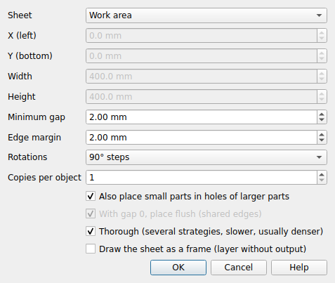

| Setting | Description |
|---|---|
| **Sheet** | *Work area* (whole bed), *custom size* (X/Y of the bottom left corner, width, height) or *largest selected object* – then e.g. a drawn rectangle the size of the sheet serves as the sheet and is not moved itself |
| **Minimum gap** | Smallest gap between two parts in mm. At least the kerf plus some reserve, e.g. 2–3 mm for plywood |
| **Edge margin** | Distance to the edge of the sheet |
| **Rotations** | None, 0°/180°, 90° steps, 45° steps, 15° steps. Choose “None” or “0°/180°” for visible wood grain |
| **Copies per object** | Creates as many copies as fit on the sheet (up to the given number) |
| **Place in holes** | Small parts may be placed in cut-outs of larger parts. Only a closed inner contour on an output *cut* layer counts as a cut-out – i.e. a piece that really falls out. Engravings, lines on hidden layers and everything else inside a part count as material |
| **With gap 0, place flush** | Only with minimum gap 0: after arranging, the parts are pushed to the left and down until they touch. Straight edges then lie exactly on top of each other and are cut only once (see *Double lines* in the machine settings). Saves material and time; the parts become smaller by half the kerf |
| **Thorough** | Tries 9 combinations of sorting and placement rule and takes the best – slower, usually denser |
| **Draw the frame** | Draws the sheet as a gray rectangle on a layer without output |

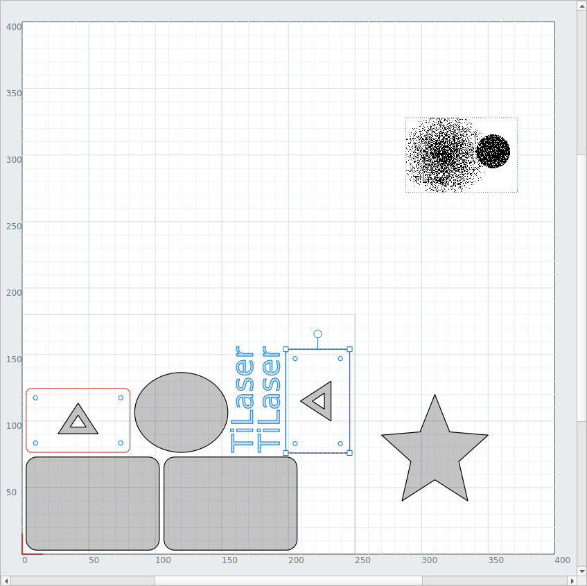

After arranging, TiLaser reports how many parts were placed and how much of the area is used.
**Parts that do not fit** stay where they are and are selected afterwards. Ctrl+Z undoes the whole nesting.

**Several sheets one after the other:** if not all parts fit, the result window offers:

- **Save placed parts…** – save the arranged parts (with their layers and the sheet, if drawn) as a
  separate `.tlp` file, e.g. `sheet1.tlp`. The project stays as it is.
- **Save and remove…** – as above, then the saved parts are removed from the current project. The parts
  that did not fit remain; they are selected and can be arranged again right away (Ctrl+Shift+N). This way
  you get sheet after sheet (`sheet2.tlp`, …) until everything is distributed. Removing can be undone with
  Ctrl+Z; the saved file stays.

Open each sheet later with *File → Open project* and laser it as usual.

**Accuracy:** for the calculation, the parts are converted into a fine grid (about 0.25–1 mm, depending on
the size of the sheet). The grid is deliberately generous: the minimum gap is always kept, but the parts may
be a fraction of a millimeter further apart than necessary. Outlines made of single lines (e.g. DXF
drawings) are recognized as closed parts if the line ends touch.

---

<!-- hilfe: ebenen -->
## 9. Layers and laser parameters

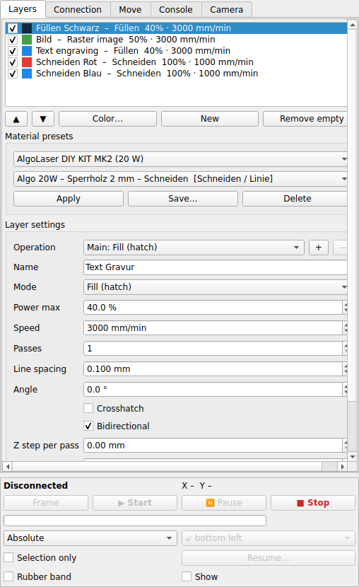

Each layer is an operation with its own parameters. The **order** in the list is the processing order
(▲/▼). Engravings are automatically placed before cuts – **cutting belongs at the bottom**, so that parts only
fall out when everything on them is done.

The **check mark** in front of a layer determines whether it is output. Layers that are turned off are shown
faded.

**Layer colors:** there are 32 fixed colors, chosen with *Color…* from a color grid (8 × 4). A dot marks
colors that another layer already uses; the tooltip shows the number, name and layer. On import, the colors
of the file are mapped to the closest of the 32 colors – pure primary colors (e.g. red `#ff0000`, blue
`#0000ff`) to the one with the same name. Very similar colors therefore end up on the same layer.

<!-- hilfe: modi -->
### Modes

| Mode | Effect |
|---|---|
| **Cut / line** | The laser traces the contours (cutting or scoring) |
| **Fill (hatch)** | Closed areas are engraved line by line (holes stay free) |
| **Offset fill (contours)** | Closed areas are filled with contour lines at the line interval from outside to inside – less back and forth than hatching, good for lettering and narrow shapes |
| **Raster image** | Images are engraved pixel by pixel |

<!-- hilfe: parameter -->
### Parameters

| Parameter | Modes | Description |
|---|---|---|
| Power max | all | Laser power in % |
| Power min | raster (grayscale) | Power for light image areas |
| Speed | all | mm/min |
| Passes | all | How often the operation is repeated |
| Line interval | fill, offset fill, raster | 0.1 mm ≈ 254 DPI; smaller = denser and slower |
| Angle, crosshatch | fill | Direction of the hatching; second hatching rotated by 90° |
| Merge overlapping objects | fill | Off (default): if two objects of the same layer overlap, the overlap stays empty – like holes (even-odd rule). On: overlapping objects are merged into one area. Holes inside an object (e.g. in letters) remain holes in both cases |
| Image mode | raster | Floyd-Steinberg, Jarvis, Stucki, Atkinson (dithering), threshold, grayscale |
| Threshold, invert | raster | |
| Brightness, contrast, gamma | raster | Adjust the image before engraving |
| Overscan | raster | Run-up before/after each line against dark edges |
| Bidirectional | fill, raster | Engrave back and forth (faster) |
| Inside before outside | cut | Cut holes before the outer contour so that parts do not come loose too early |
| **Kerf compensation** | cut | Kerf in mm. Outer contours are offset outwards by half of it, holes inwards – the parts keep their size. Important for plug-in and press fits. Holes smaller than the kerf disappear; TiLaser reports this as a note when starting. |
| **Tabs** | cut | Number of tabs per contour and tab width. The parts stay attached to the material and do not fall through the honeycomb table. Optionally only on outer contours. |
| Z step per pass | all | Lower the focus after each pass (only with a motorized Z axis) |
| Z offset | all | Before this layer, Z moves by the value (+ = higher), and back afterwards – e.g. to engrave slightly defocused (only with a motorized Z axis) |
| Air assist | all | Sends M8/M9 (compressed air on/off) |

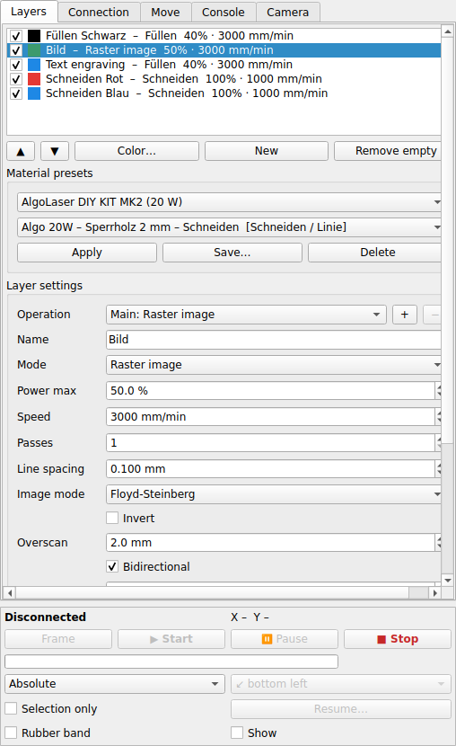

The preview of an image on the work area already shows the result of the chosen image mode.

<!-- hilfe: unterebenen -->
### Sub-layers

With **+** next to *Operation*, a layer gets further operations on **the same geometry**, each with its own
parameters – e.g. engrave the area first, then cut out the contour. The *Operation* selection switches between
the main layer and sub-layers; **−** removes the selected sub-layer.

<!-- hilfe: kerf -->
### Determining the kerf

1. Draw a square of exactly 20 × 20 mm and cut it out with kerf 0.
2. Measure the part with calipers, e.g. 19.82 mm.
3. Enter kerf = 20 − 19.82 = **0.18 mm** in the cut layer.

---

<!-- hilfe: presets-kapitel -->
## 10. Material presets and material test

<!-- hilfe: presets -->
### Presets

In the *Layers* tab under **Material presets**:

- **Filter** (top): shows presets for a particular machine. It automatically follows the active machine profile.
- **Apply:** copies the values to the selected layer or sub-layer.
- **Save…:** saves the current settings as your own preset (name and material).
- **Delete:** removes a preset.

The tooltip of a preset shows the material and the origin of the values. Your own presets are kept during updates.

<!-- hilfe: materialtest -->
### Material test

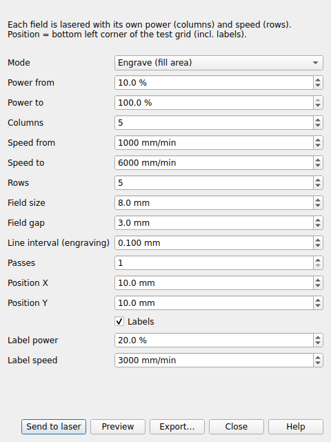

*Tools → Laser tests → Material test…* lasers a labeled grid: the power increases in the **columns**, the speed in the
**rows**. This way you find suitable values for a new material in one go.

| Setting | Description |
|---|---|
| Mode | Engrave (fill fields) or cut (field outlines) |
| Power from/to, columns | Power range and number of steps |
| Speed from/to, rows | Speed range and number of steps (fastest at the top) |
| Field size, field gap, line interval, passes | |
| Position X/Y | Bottom left corner of the test grid |
| Labels | Write the values next to it with their own (low) power |

Buttons: **Preview** (toolpath on the work area), **Export…** (G-code file) and **Send to laser**.

<!-- hilfe: fokustest -->
### Focus test

*Tools → Laser tests → Focus test…* finds the best distance between laser and material:

- **Without Z axis – ramp** (for the AlgoLaser and most diode lasers): TiLaser lasers a long line with a
  scale. Place a board at an angle so that one end is about 10 mm higher, and focus on the middle. After
  lasering, find the **thinnest spot** of the line and read it off the scale; that is where the distance is
  right. Then set the focus to that height.
- **With Z axis:** several labeled lines, each with a different Z offset (e.g. −2 to +2 mm). The sharpest
  line shows the best offset.

<!-- hilfe: zeilenabstandstest -->
### Line interval test

*Tools → Laser tests → Line interval test…* engraves filled squares with increasing line interval (e.g. 0.05–0.30 mm) and
writes the value underneath. The field in which the lines just merge into an even area is the right line
interval for this material and this focus – smaller only costs more time.

Like the material test, both tests offer **Preview**, **Export…** and **Send to laser**, plus
**Add to project** (insert the test as normal objects, e.g. to move it).

---

<!-- hilfe: maschine -->
## 11. Setting up and connecting the machine

<!-- hilfe: maschineneinstellungen -->
### Machine settings

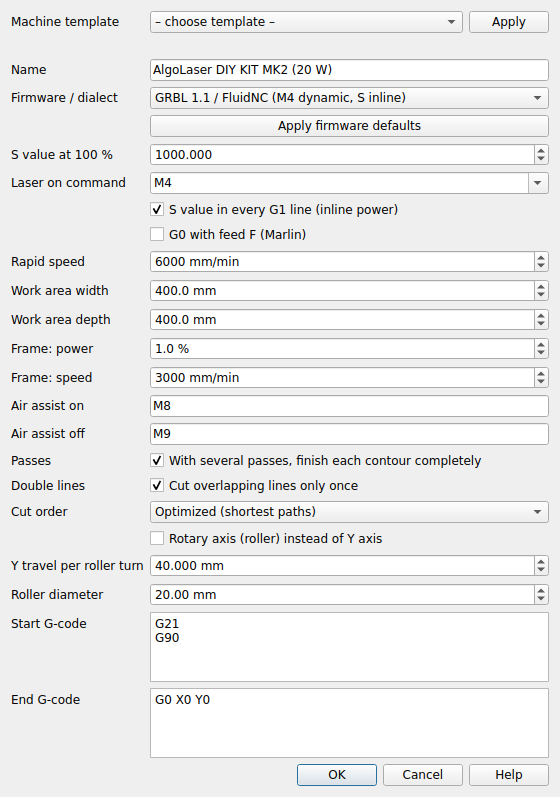

*Machine → Machine settings*:

| Setting | Description |
|---|---|
| Machine template | Ready-made profiles, e.g. “AlgoLaser DIY KIT MK2 (20 W)” |
| Firmware / dialect | GRBL 1.1/FluidNC, Marlin, Smoothieware, generic. *Apply firmware defaults* sets suitable values |
| S value at 100 % | GRBL: value of `$30` (usually 1000), Marlin: 255, Smoothieware: 1 |
| Laser on command | M4 (dynamic power, GRBL, recommended) or M3 (constant) |
| Inline power | S value directly in every G1 line (GRBL, Smoothieware) |
| G0 with feed | For Marlin |
| Rapid speed | Speed of travel moves |
| Work area | Width and depth in mm (GRBL: `$130`/`$131`) |
| Frame: power / speed | 0 % = laser off while framing; up to 20 % for a visible dot |
| Passes | *With several passes, finish each contour completely* – on (default): each contour gets all passes before moving to the next; open lines alternately forwards and backwards. Off: pass 1 over all contours, then pass 2 and so on; the material cools down in between, but the laser travels back and forth more often. Applies to cut layers |
| Double lines | *Cut overlapping lines only once* (default on): if lines of a layer lie exactly on top of each other – such as the shared edge of two flush parts – the piece is cut only once; the G-code then contains a comment with the length saved. This only affects the output: the parts in the project stay complete, so if you move them apart again or rearrange them with a gap, all lines are back. With kerf compensation set, the edges no longer lie on top of each other and are cut normally |
| Cut order | *Optimized (shortest paths)* or *Object by object (order in the project)*, see [Arrange](#arrange) |
| Rotary axis | see [chapter 15](#15-rotary-axis) |
| Air assist on/off | Default M8/M9 |
| Start/end G-code | Added before or after every job |

<!-- hilfe: verbindung -->
### Connection

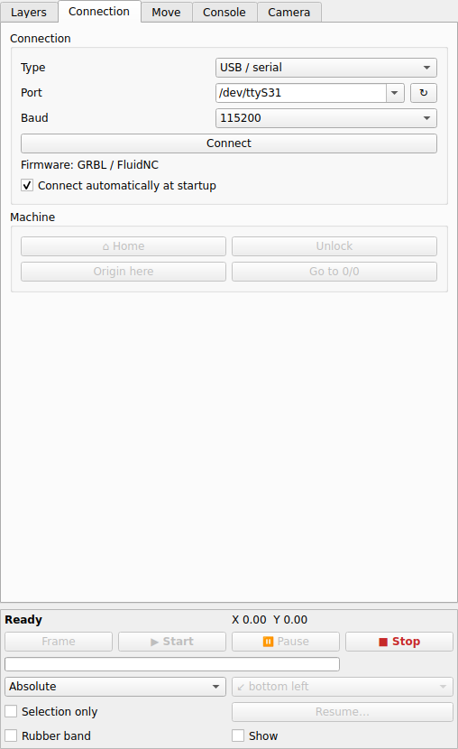

| Type | Settings |
|---|---|
| **USB / serial** | Port (↻ refreshes the list), baud rate (usually 115200) |
| **Network (TCP/Telnet)** | IP address and port (usually 23) – for ESP32 controllers with FluidNC or grblHAL |

When connecting, TiLaser waits briefly for the controller's greeting and detects **GRBL/FluidNC, Marlin and
Smoothieware** by itself. If the detected firmware differs from the profile, TiLaser asks whether to switch.
With GRBL, TiLaser reads `$30` (maximum power) and warns about `$32=0` (laser mode off).

**Connecting automatically:** TiLaser remembers the last successfully used connection (type, port and baud rate
or address and TCP port). If **Connect automatically at startup** is checked (default), TiLaser connects to it
by itself when the program starts – but only if the port exists or the laser can be reached on the network.
If the laser is off or not plugged in, no error window appears, only a note in the console; just press
*Connect* later. The network search runs in the background and does not hold up the program.

The *Connection* tab also contains:

| Button | GRBL | Marlin etc. |
|---|---|---|
| Home | `$H` | `G28 X Y` |
| Unlock (after an alarm) | `$X` | `M999` |
| Origin here | `G10 L20 P1 X0 Y0` | `G92 X0 Y0` |
| Go to 0/0 | `G0 X0 Y0` | `G0 X0 Y0` |

<!-- hilfe: bewegen -->
### Move

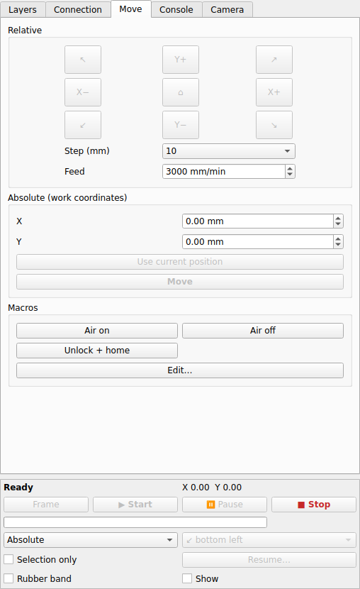

- **Relative:** eight direction buttons and ⌂ (homing), step 0.1–100 mm, feed.
- **Absolute:** enter X/Y in work coordinates and click *Move* (or Enter). *Use current position* fills the
  fields with the current head position. For targets outside the work area, TiLaser asks first. The laser is
  off while moving.
- **By click:** right click on the work area → *Move laser here* moves the head exactly to this spot. With
  objects selected there is *Move laser to selection* → center or one of the four corners (also under
  *Machine*). Handy to check where a part will end up on the workpiece.
- **Macros:** your own G-code buttons, e.g. *Air on* (`M8`), *Air off* (`M9`) or *Unlock + home*.
  *Edit…* (also *Machine → Edit macros…*) creates macros: name, G-code (several lines possible) and a
  shortcut that works in the whole window. Macros are locked while a job is running.

<!-- hilfe: konsole -->
### Console

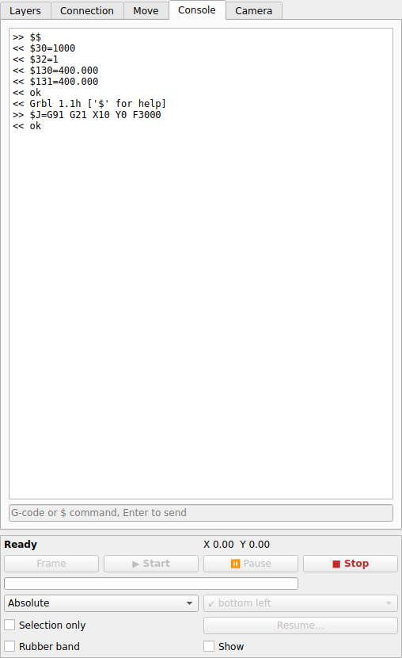

Shows all messages from the controller (`<<`) and sent commands (`>>`). Your own commands can be entered
at the bottom, e.g. `$$` (show GRBL settings), `$I` (version) or `?` (status).

<!-- hilfe: grbl -->
### GRBL settings

*Machine → GRBL settings (\$\$)…* reads all settings of the controller and shows them with their meaning,
e.g. `$30` maximum S value, `$32` laser mode, `$110/$111` maximum speed, `$120/$121` acceleration,
`$130/$131` travel. Change values in the *Value* column and press *Write changes*; TiLaser shows the changes
once more beforehand and reads them back afterwards to check. *Export…* backs up all values as a text file –
you should do that before every change.

---

<!-- hilfe: lasern -->
## 12. Lasering: frame, start, pause, stop, resume

The **job bar** at the bottom right is visible in every tab.

| Element | Function |
|---|---|
| Status / position | State of the machine (ready, running, paused, alarm …) and head position |
| **Frame** | Traces the outline of the job (with the frame power from the machine settings) |
| **Rubber band** | Check box below *Selection only*: the frame follows the parts tightly (convex hull) instead of the enclosing rectangle – like a rubber band stretched around all parts. With round or slanted parts you see more precisely where the laser will work, and the head does not travel over empty corners. The traced line is shown dashed in orange on the work area for a few seconds. With the **Show** check box next to it (or *View → Show rubber band frame*) it stays visible and follows the parts when they are moved – with *Selection only* only the selected ones. The line is for display only and is never lasered. Both settings are saved |
| **▶ Start** | Generates the G-code and starts after a safety prompt (with estimated time and notes) |
| **⏸ Pause / Resume** | Pauses or resumes (GRBL: feed hold `!` / `~`). With Marlin/Smoothie TiLaser sends `M5` immediately – the controller still finishes the moves already buffered, but the laser does not keep burning while standing still; on resume it is switched on again |
| **■ Stop** | Immediate abort (GRBL: soft reset); then *Unlock* if needed. With Marlin/Smoothie immediately `M410` (quick stop), `M5` and the *air off* command |
| Progress and time | While lasering: bar with percent and **remaining time** (“~4:12 left”), next to it **elapsed time / expected total time** (e.g. “3:05 / ~7:17”, minutes:seconds, from one hour hours:minutes:seconds). The first estimate comes from the distance and feed of each G-code line; as soon as part of the job is done, it is adjusted to the actual speed of the machine (acceleration, slower corners). Pauses do not count. After the end, the actual duration is shown, in the console together with the original estimate. TiLaser reports *Done* only when the machine has really stopped: with GRBL as soon as it reports *Idle* after the last line, with Marlin/Smoothie via an appended `M400` (waits until all moves are finished) |
| **Origin** | *Absolute*: coordinates as on the work area. *Current position*: the chosen **anchor point** (e.g. bottom left) of the job is placed where the laser head is right now – handy for positioning by jogging |
| **Selection only** | Only laser or frame the selected objects |
| **Resume…** | Continue from a chosen line after a stop, alarm or lost connection |

**Resume:** TiLaser remembers up to which line the controller has acknowledged the job. Because the controller
buffers some commands in advance, it restarts about 15 lines earlier by default – short pieces are lasered
twice. Position, feed, power and air assist are restored, as is a focus offset of the Z axis (layer Z offset,
lowering per pass). If the job moves Z, TiLaser asks whether the head is still at the height of the abort or
the focus was set back to the starting height.
**The workpiece must not have been moved in between.**

<!-- hilfe: weboberflaeche -->
### Web interface (phone, tablet, PC)

Under *Machine → Web interface…* TiLaser can be watched and controlled from the browser of another device on
the same network – e.g. from a phone when TiLaser runs on the Raspberry Pi at the laser, or from the PC in the
next room. TiLaser itself has to be running.

| Setting | Effect |
|---|---|
| Turn on web interface | Starts the web server (stays on after restarting TiLaser) |
| Port | Default 8080 |
| PIN | Asked in the browser. The login lasts up to 24 hours, but ends when TiLaser restarts or this dialog is closed with OK. After 10 wrong entries the login is locked for 5 minutes. The PIN is mandatory and must have at least 4 characters; if it is empty or shorter, TiLaser creates a new one. Requests via foreign host names (instead of the IP address or the own computer name) are rejected – this protects against web pages that redirect the browser to TiLaser |
| Allow starting jobs remotely | Shows a *Start job* button that starts the currently open project with the settings of the job bar. Off by default |

The dialog shows the address (e.g. `http://192.168.1.20:8080/`) and a QR code you can scan with the phone
camera. The page shows:

- state, position, progress as a “burning” wood strip, elapsed and remaining time
- the live camera image (about one picture per second when the camera is running in TiLaser)
- **Pause/Resume** and **Stop** buttons (with confirmation), optionally *Start job*
- the last lines of the console
- a red message with sound and vibration when the [flame guard](#flame-guard) triggers

On a phone everything is stacked; on a PC (from about 900 pixels width) the camera image is large on the left
and the controls are on the right; there, **Space** = pause/resume and **Esc** = stop as well. The page uses
the language set in TiLaser.

> Only use it on your own network and **do not set up port forwarding in the router**. On Windows the
> firewall asks on first start whether TiLaser may be reachable on the private network – confirm with
> *Allow*. The web interface does not change the rule: never leave the laser unattended.

<!-- hilfe: auftragsprotokoll -->
### Job log

*Machine → Job log…* shows all jobs: start, duration, result (done, stopped, alarm …), type (job or test
pattern), project file, layers with power and speed, whether it was started from the web interface, a flame
alarm and the cost. The totals are shown below.

For the **cost** enter three values (0 = do not calculate):

- *Hourly rate* – e.g. wear of the laser diode and machine or your own working time
- *Power consumption* – laser, extraction and air pump together in watts
- *Electricity price* per kWh

Cost = run time × hourly rate + run time × power consumption × electricity price (pauses do not count).
The log is the file `auftraege.csv` in the settings folder (see chapter 19), separated by semicolons so that
Excel and LibreOffice open it directly. *Save as CSV…* saves a copy, *Clear log…* deletes all entries.
Frame runs are not logged; logging can be turned off in the same dialog.

---

<!-- hilfe: vorschau -->
## 13. Preview and simulation

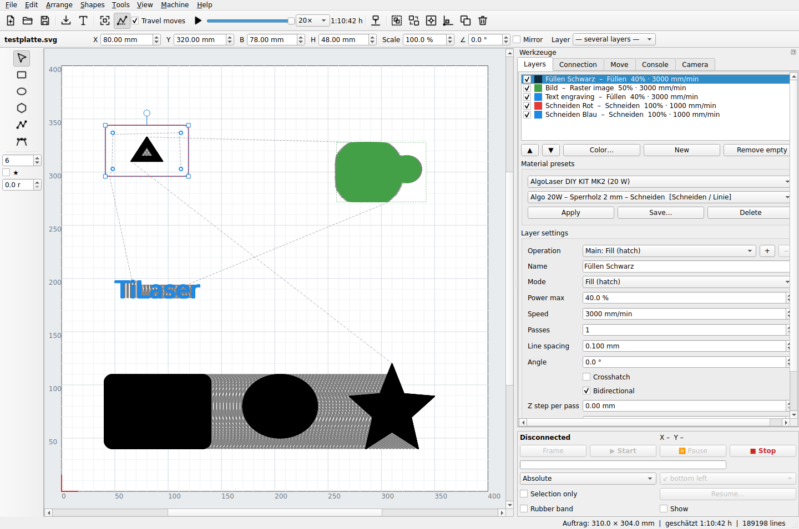

*View → Toolpath preview* (Ctrl+P) generates the G-code and shows:

- **burn moves** in the color of the layer,
- **travel moves** dashed in gray (can be turned off with *Travel moves* in the toolbar).

The status bar shows the **estimated time** and the number of lines. The estimate does not take acceleration
into account; real jobs usually take a little longer.

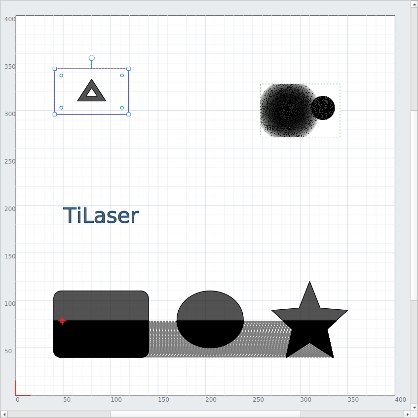

**Simulation:** with the preview on, play it with ▶ or drag the slider. A red circle shows the laser head,
paths already lasered appear bold. The playback speed (1× to 500×) can be chosen next to it.

---

<!-- hilfe: kamera -->
## 14. Camera

A webcam above the bed has two jobs in TiLaser: it shows **live** what the laser is doing right now (section
*Live camera*), and – once aligned – it places an undistorted image of the workpiece under the work area so
that engravings can be placed exactly on existing parts (section *Alignment*). Both use the same camera.

<!-- hilfe: live-kamera -->
### Live camera

The **Camera** tab in the side bar (or *Machine → Camera → Live camera*, Ctrl+Shift+K) shows the live image.

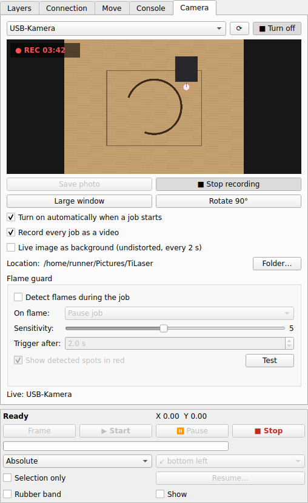

| Element | Function |
|---|---|
| Camera list, ⟳ | Choose the webcam; ⟳ searches for newly connected cameras |
| ▶ Turn on / ■ Turn off | Start or stop the live image |
| Save photo | Save the current image as JPG |
| ● Record video | Start a video (MP4); “● REC” with the recording time runs at the top left of the image |
| Large window | Live image in a separate window, e.g. on a second screen. Also by double-clicking the image. In the window, F11 or a double click switches to full screen, Esc ends full screen |
| Rotate 90° | Only rotates the display (for cameras mounted upright or upside down) |
| Turn on automatically when a job starts | The camera turns on when a job starts, and the *Camera* tab is shown |
| Record every job as a video | When a job starts, a recording `Auftrag_<date>_<time>.mp4` begins; it ends 3 s after the end of the job (also after a stop or alarm) |
| Live image as background | Places the undistorted live image under the work area every 2 s, so you can see the progress directly on the objects. Only possible after alignment |
| Location, Folder… | Folder for photos and videos (default: `Pictures/TiLaser`) |

All settings are saved in the machine profile.

> **Tip:** the live camera does not replace supervision at the machine. The laser must never run unattended –
> the image helps when watching from a meter away or through the protective cover, not from the next room.

While the live image is running, *Align camera* and *Update camera image* use the current image directly
instead of opening the camera a second time.

<!-- hilfe: flammenwaechter -->
### Flame guard

The flame guard analyzes the live image during a job and raises an alarm when a flame stays somewhere.
It is **off by default** and is turned on in the *Camera* tab under **Flame guard**.

| Setting | Effect |
|---|---|
| Detect flames during the job | On/off. The camera is then turned on automatically when a job starts |
| On flame | *Warn only* (alarm sound and message), *Pause job* (default) or *Stop job* |
| Sensitivity | 1–10. Higher = smaller flames already trigger, but more false alarms |
| Trigger after | How many seconds a spot has to burn (default 2 s) |
| Show detected spots in red | Marks in the live image what the guard considers a flame – helpful when adjusting |
| Test | Run the guard without a job, e.g. with a lighter under the camera. Only shows a message |

**How it works:** it looks for bright, yellow-orange spots that are clearly brighter than in the image at the
start of the job. The glowing laser spot keeps moving and therefore does not trigger; a flame stays in one
place. Fixed light sources such as an orange status LED or a cross laser are part of the initial image and do
not interfere.

When the guard triggers, TiLaser beeps, saves a photo in the camera location (`Flamme_…jpg`), writes a line to
the console and shows a message with three options:

- **Stop job**
- **Keep watching** – after checking; let a paused job continue with *Resume*
- **Guard off for this job** – for false alarms, e.g. caused by sunlight

If the guard is on but no camera is available, a warning appears in the console. The job runs anyway.

> **Important:** the flame guard is an additional safeguard and **no substitute for supervision**. It only
> sees what the camera sees and can miss a flame under the workpiece or in the smoke. With GRBL in laser mode
> (`$32=1`) the laser turns off during *Pause*; air assist keeps running. With Marlin and Smoothieware the
> guard **stops** the job even if *Pause* is set, because these controllers still execute buffered moves
> after a pause.

Tip for adjusting: watch a typical job with *Show detected spots in red*. If red spots already appear,
lower the sensitivity or increase the time.

<!-- hilfe: kamera-ausrichten -->
### Alignment

1. *Machine → Camera → Choose camera*: USB camera or **“Image from file”** (e.g. a phone photo that is always
   taken from the same spot).
2. *Laser registration marks*: **9 marks** (3 × 3, with lens correction – recommended) or 4 marks. The crosses
   are lasered with 10 % power 30 mm from the edge of the bed – put a piece of cardboard underneath.
3. *Align camera*: capture an image and click the crosses **in the order shown** (the mouse wheel zooms).
   With 9 marks the lens distortion is calculated too; the residual error in mm is shown.

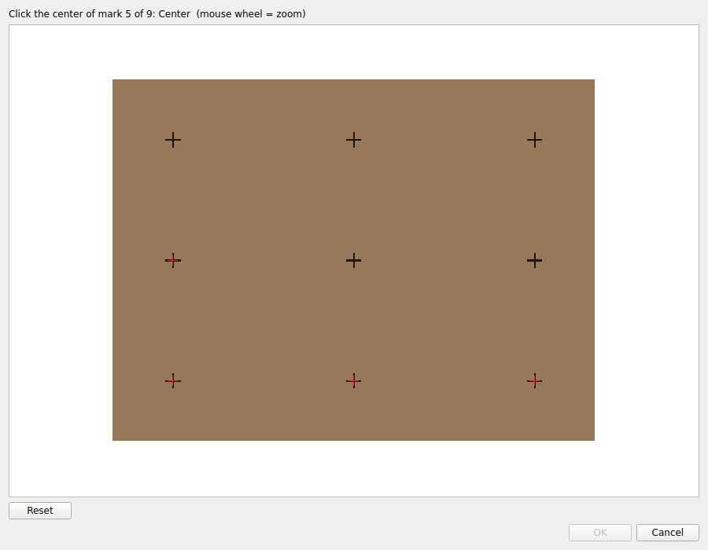

4. *Update camera image* (F5) places the undistorted image under the work area.
   *Show camera image* shows or hides it.

If the camera is moved, it has to be aligned again.

---

<!-- hilfe: rotation -->
## 15. Rotary axis

For cylindrical workpieces with a **roller rotary axis** that is connected instead of the Y axis:

1. *Machine → Machine settings*: enter **Y travel per roller turn** and **roller diameter**.
   To find the Y travel: put a mark on the drive roller, send e.g. `G91 G0 Y40` in the console and check
   whether the roller turns exactly once – otherwise adjust the value.
2. Turn on *Machine → Rotary axis active*. The Y coordinates are then converted automatically;
   the drawing corresponds to the unrolled surface of the workpiece.
3. Turn the rotary axis off again after lasering.

---

<!-- hilfe: algolaser -->
## 16. Setting up the AlgoLaser DIY KIT MK2 (20 W)

1. *Machine → Machine settings → Machine template* “AlgoLaser DIY KIT MK2 (20 W)” → *Apply* → OK.
   This sets GRBL, M4, S 1000, 400 × 400 mm, rapid speed 6000 mm/min and framing with 1 %.
2. Connect via USB-C (115200 baud). Send `$$` in the **console** and check:
   `$32=1` (otherwise send `$32=1`); `$130`/`$131` = travel X/Y → enter as the work area if needed.
3. In the *Layers* tab the presets are automatically filtered to the MK2. They come from the AlgoLaser
   parameter table for the DIY KIT 20 W. **Plywood 2 mm**, *score line* and the photo presets are starting
   values (marked in the tooltip) – test them first, e.g. with the material test.
4. Air assist is off in the presets. If the pump is switched via `M8`/`M9`, set the check mark per layer.
5. While TiLaser is connected, do not start a job via the touchscreen or app at the same time.

---

<!-- hilfe: tasten -->
## 17. Keyboard shortcuts

| Shortcut | Function | | Shortcut | Function |
|---|---|---|---|---|
| Ctrl+N | New project | | Ctrl+Z / Ctrl+Y | Undo / redo |
| Ctrl+O | Open project | | Ctrl+X / C / V | Cut / copy / paste |
| Ctrl+S | Save project | | Ctrl+Shift+V | Paste in place |
| Ctrl+Shift+S | Save as | | Ctrl+D | Duplicate |
| Ctrl+I | Import | | Ctrl+A | Select all |
| Ctrl+T | Insert text | | Del | Delete |
| Ctrl+E | Export G-code | | Arrow keys | Move 1 mm (Shift: 10 mm, Ctrl: 0.1 mm) |
| Ctrl+P | Toolpath preview | | Ctrl+G / Ctrl+Shift+G | Group / ungroup |
| Ctrl+0 | Show all | | Ctrl+L / Ctrl+R | Rotate 90° left / right |
| Ctrl+Shift+F | Snap to grid | | Ctrl+Shift+A | Array |
| F5 | Update camera image | | Ctrl+Shift+N | Nesting |
| Ctrl+Shift+K | Live camera | | Ctrl+Shift+Q | Insert QR code / barcode |
| Ctrl+PgUp / Ctrl+PgDown | Cut earlier / later | | Ctrl+Shift+PgUp / PgDown | Cut first / last |
| V R E P L N | Drawing tools | | Ctrl+Shift+←/→/↑/↓ | Align left/right/top/bottom |
| Esc | Back to select | | Ctrl+Shift+U / D / I | Union / subtract / intersection |
| Alt+T | Trace image | | Alt+O / Alt+J | Offset / join paths |
| Ctrl+Shift+B | Box generator | | Alt+K | Place edges together |

In node mode: Del, C, L, S, B, A (see [Node editing](#node-editing)). Macros can get their own shortcuts.

---

<!-- hilfe: fehler -->
## 18. Troubleshooting

| Problem | Solution |
|---|---|
| No port in the list | Check the USB cable (some cables are for charging only); click ↻. Windows: install the CH340 driver if needed. Linux: user in the `dialout` group. |
| “Firmware: not detected” | Check the baud rate (115200, 250000 for some Marlin boards). Then choose the firmware by hand in the machine settings. |
| Laser burns during travel moves / lines too dark at corners | GRBL: set `$32=1`. Use M4 as the laser on command. |
| Power is wrong (e.g. 10 % burns like 100 %) | The S value at 100 % must match `$30` (GRBL). TiLaser takes over `$30` automatically when connecting. |
| ALARM after stop | Normal after a soft reset while moving: click *Unlock*. |
| Parts are too small / fits too loose | Set the kerf compensation (see [Determining the kerf](#determining-the-kerf)). |
| Parts fall through the honeycomb table | Use tabs. |
| Raster image stutters, laser hesitates | Lower the speed or increase the line interval – with fine dithering the USB connection cannot keep up otherwise. |
| SVG text is missing | Convert the text to paths in the graphics program or insert the text in TiLaser. |
| EPS import reports a missing program | Install Ghostscript or Inkscape, or save the file as PDF/SVG. |
| Exclusion (XOR) reports “pyclipper required” | Only when starting from source: `pip install pyclipper`. Included in the ready-made packages. Union, subtract and intersection also work without it. |
| Nesting does not place all parts | Enlarge the sheet, reduce the minimum gap or edge margin, allow more rotations, turn on *Thorough*. |
| Camera image is shifted | The camera was moved: align it again. |
| Live camera: “No camera found” | Connect the webcam and click ⟳. Linux: user in the `video` group. Windows: under *Privacy → Camera*, allow access for desktop apps. A camera can only be used by one program at a time – close other video programs. |
| Live camera: video recording fails | Is the location writable? When starting from source with a Qt version before 6.5, Linux additionally needs the GStreamer plugins. |
| Some texts are still German | Not every text has a translation yet. TiLaser collects them in `lang/fehlend_<code>.json` – see [chapter 21](#21-language-and-translations). |

---

<!-- hilfe: speicherorte -->
## 19. Storage locations and portable version

| Content | Location |
|---|---|
| Machine profile, own presets | Windows: `%USERPROFILE%\.tilaser`, Linux/macOS: `~/.tilaser` |
| Portable version | Subfolder `daten` next to `TiLaser.exe` (active as long as `portable.txt` exists) |
| Job log | `auftraege.csv` in the same folder as the machine profile |
| Own language files | Subfolder `lang` in the same folder |
| Custom folder | Environment variable `TILASER_HOME` |
| Projects | Anywhere, file extension `.tlp` |

---

<!-- hilfe: lizenz -->
## 20. License and trademark notice

TiLaser is free software under the GNU General Public License version 3. The libraries used and their licenses
are listed under *Help → Licenses…*.

LightBurn is a trademark of LightBurn Software LLC. TiLaser is an independent project and is not affiliated
with, endorsed or reviewed by LightBurn Software. Support for `.lbrn2` and `.lbrn` files serves data exchange
only; TiLaser contains no code from LightBurn. All other product names mentioned (e.g. AlgoLaser, GRBL,
Inkscape) are trademarks of their respective owners.

---

<!-- hilfe: sprache -->
## 21. Language and translations

The user interface is available in **German** and **English**. Change the language under
*View → Sprache / Language*; it takes effect after restarting TiLaser. On first start the system language is
used. For a single start, the environment variable `TILASER_LANG` (e.g. `TILASER_LANG=en`) overrides the
setting.

**Adding another language** only takes a text editor:

1. *View → Sprache / Language → Create / edit own translation…* and enter a language code, e.g. `fr`.
2. TiLaser creates the file `lang/fr.json` in the settings folder (see [chapter 19](#19-storage-locations-and-portable-version))
   and opens the folder. Each line contains the German text on the left and the translation on the right,
   pre-filled with English:

   ```json
   "Projekt speichern": "Save project",
   "{0} Objekte ausgewählt": "{0} objects selected",
   ```

3. Translate the right-hand texts. Keep placeholders such as `{0}` (they stand for numbers or names), keep
   `&` in menu names (it marks the underlined letter) and keep `\n` (line break). `_name` is the name shown in
   the language menu.
4. Choose the language in the menu and restart TiLaser.

Texts that are not translated yet appear in English (or, if they are missing there too, in German). When
quitting, TiLaser writes all texts it came across without a translation to `lang/fehlend_<code>.json` – copy
them into your language file and translate them. Your own files take precedence over the included ones, so you
can also correct individual English texts this way.

Translations are welcome: send the file as an issue on GitHub or as a pull request to
`tilaser/data/lang/<code>.json`. Developers can collect all texts with `python tools/i18n_extract.py`
(`--missing en` lists missing translations, `--update` adds new texts to all language files).

---

<!-- hilfe: referenz -->
## 22. Reference: all menus, windows and controls

This chapter lists every menu, button, field and window of TiLaser with its meaning. Detailed explanations with
examples are in the previous chapters; the links lead there. In TiLaser, **F1** opens exactly the matching
section (see [Help in the program](#help-in-the-program)).

<!-- hilfe: menu-datei -->
### File menu

| Menu item | Key | Function |
|---|---|---|
| New | Ctrl+N | Create an empty project. You are asked about unsaved changes first |
| Open project… | Ctrl+O | Open a TiLaser project (`.tlp`) or LightBurn file (`.lbrn2`, `.lbrn`); replaces the current project |
| Save project | Ctrl+S | Save under the current name (the first time like *Save as*) |
| Save project as… | Ctrl+Shift+S | Save under a new name as `.tlp` |
| Save selection as project… | | Save only the selected objects with their layers as a separate `.tlp` file |
| Import… | Ctrl+I | Add SVG, DXF, PDF/AI, EPS, LightBurn or an image to the project ([chapter 5](#5-opening-importing-and-exporting-files)) |
| Insert text… | Ctrl+T | Insert text from a font ([Text](#text)) |
| Export G-code… | Ctrl+E | Save the job as a `.gcode` file; takes *Origin* and *Selection only* into account |
| Export as SVG… | | All objects as SVG (mm, layers as groups) |
| Export as DXF… | | Contours as DXF, one DXF layer per layer (without images) |
| Save as LightBurn file… | | Save the project as `.lbrn2` ([LightBurn projects](#lightburn-projects)) |
| Quit | Ctrl+Q | Close TiLaser. If a job is running, you are asked first (the laser is then stopped) |

<!-- hilfe: menu-bearbeiten -->
### Edit menu

| Menu item | Key | Function |
|---|---|---|
| Undo | Ctrl+Z | Undo the last step; the menu text names the step |
| Redo | Ctrl+Y | Redo an undone step |
| Cut | Ctrl+X | Move the selection to the clipboard |
| Copy | Ctrl+C | Copy the selection to the clipboard |
| Paste | Ctrl+V | Paste from the clipboard, offset by 10 mm |
| Paste in place | Ctrl+Shift+V | Paste at the original position |
| Duplicate | Ctrl+D | Copy of the selection, offset by 10 mm |
| Delete | Del | Delete the selected objects |
| Select all | Ctrl+A | Select all objects |
| Group | Ctrl+G | Combine the selected vector objects into one object |
| Ungroup | Ctrl+Shift+G | Split into parts; an outer contour stays together with its holes |
| Center | | Put the selection in the middle of the work area |
| To 0/0 | | Put the bottom left corner of the selection at the origin |
| Assign layer | | Submenu: move the selection to an existing or a new layer |

<!-- hilfe: menu-anordnen -->
### Arrange menu

| Menu item | Key | Function |
|---|---|---|
| Align left | Ctrl+Shift+← | Left edges to the left edge of the whole selection |
| Center horizontally | | Centers on one vertical line |
| Align right | Ctrl+Shift+→ | Right edges flush |
| Align top | Ctrl+Shift+↑ | Top edges flush |
| Center vertically | | Centers on one horizontal line |
| Align bottom | Ctrl+Shift+↓ | Bottom edges flush |
| Distribute horizontally (equal gaps) | | At least 3 objects side by side with equal gaps |
| Place edges together | Alt+K | First click the edge of the part to be moved, then the target edge – the part is rotated and placed flush ([Placing edges together](#placing-edges-together)) |
| Distribute vertically (equal gaps) | | At least 3 objects above each other with equal gaps |
| Mirror horizontally | | Mirror at the vertical center line of the selection |
| Mirror vertically | | Mirror at the horizontal center line |
| Rotate 90° left | Ctrl+L | Counterclockwise around the center of the selection |
| Rotate 90° right | Ctrl+R | Clockwise |
| Create array… | Ctrl+Shift+A | Copies as a grid or in a circle ([Array](#array)) |
| Nesting (arrange parts)… | Ctrl+Shift+N | Arrange parts to save space ([chapter 8](#8-nesting--arranging-parts-automatically)) |
| Center, To 0/0 | | as in the *Edit* menu |
| Cut order → Cut first | Ctrl+Shift+PgUp | Move the selection to the start of the project order |
| Cut order → Cut earlier | Ctrl+PgUp | One place forward |
| Cut order → Cut later | Ctrl+PgDown | One place back |
| Cut order → Cut last | Ctrl+Shift+PgDown | To the end |
| Cut order → Show order | | Show/hide the numbers of the objects on the work area |

The cut order takes effect when *Object by object* is chosen in the machine settings ([Arrange](#arrange)).

<!-- hilfe: menu-formen -->
### Shapes menu

| Menu item | Key | Function |
|---|---|---|
| Union | Ctrl+Shift+U | Merge the selected closed shapes into one area |
| Subtract (largest shape minus the others) | Ctrl+Shift+D | Subtract all other shapes from the largest one |
| Intersection | Ctrl+Shift+I | Keep only the shared area |
| Exclusion (XOR) | | Everything except the overlaps (requires pyclipper) |
| Offset… | Alt+O | Offset contours ([Offset window](#offset-shift-outline-window)) |
| Join / close paths… | Alt+J | Join open lines with shared end points; asks for the largest allowed distance of the end points |

<!-- hilfe: menu-werkzeuge -->
### Tools menu

| Menu item | Key | Function |
|---|---|---|
| Trace image… | Alt+T | Convert an image into vector contours ([Trace image](#trace-image)) |
| Laser tests → Material test… | | Test grid power × speed ([Material test](#material-test)) |
| Laser tests → Focus test… | | Find the best focus distance ([Focus test](#focus-test)) |
| Laser tests → Line interval test… | | Find the best line interval ([Line interval test](#line-interval-test)) |
| Text on path… | | Text along a contour ([Text on path](#text-on-path)) |
| Insert QR code / barcode… | Ctrl+Shift+Q | QR code or Code 128 as an engraving ([Variable text, QR code and barcode](#variable-text-qr-code-and-barcode)) |
| Variable text… | | Start number and CSV file for placeholders |
| Generators → Box generator… | Ctrl+Shift+B | Box with finger joints ([Box generator](#box-generator)) |
| Generators → Gear… | | Involute gear, optionally with a mating gear |
| Generators → Puzzle… | | Puzzle with frame |
| Patterns in area → Living hinge… | | Cut pattern for bending ([Patterns in an area](#patterns-in-an-area)) |
| Patterns in area → Hole pattern / vent grille… | | Distribute holes or slots |
| Patterns in area → Engraving pattern… | | Houndstooth, herringbone, honeycomb … as engraving |
| Living hinge between two edges… | | Join two parts into one via a bending zone from radius and angle ([Living hinge between two edges](#living-hinge-between-two-edges)) |
| Finger joint on edge… | | Fingers on the shared edge of two parts ([Finger joint on edge](#finger-joint-on-edge)) |
| Puzzle joint on edge… | | Puzzle knobs on the shared edge of two parts ([Puzzle joint on edge](#puzzle-joint-on-edge)) |
| Snap lock on edge… | | Springy snap tabs on one part, slots in the other ([Snap lock on edge](#snap-lock-on-edge)) |
| Hammer joint on edge… | | Tenons with a wedge cut in place, mortises in the other part ([Hammer joint on edge](#hammer-joint-on-edge)) |
| Knuckle hinge on edge… | | Hinge between two box parts: knuckles with finger tabs, slots, pin ([Knuckle hinge on edge](#knuckle-hinge-on-edge)) |
| Spring latch on edge… | | Snap latch for a lid: tongue on a meander spring, recess with shoulder ([Spring latch on edge](#spring-latch-on-edge)) |
| Spring bolt with hooks… | | Bolt behind the front wall, hooks through the lid, meander spring ([Spring bolt with hooks](#spring-bolt-with-hooks)) |
| Number parts… | | Number the parts and engrave the number, identical parts same number ([Numbering parts](#numbering-parts)) |
| Stencil bridges… | | Bridges for inner parts of letters |

<!-- hilfe: menu-ansicht -->
### View menu

| Menu item | Key | Function |
|---|---|---|
| Sprache / Language | | Choose the language of the user interface; *Create / edit own translation…* creates a language file ([chapter 21](#21-language-and-translations)) |
| Show all | Ctrl+0 | Zoom to all objects and the bed |
| Toolpath preview | Ctrl+P | Show burn and travel moves ([chapter 13](#13-preview-and-simulation)) |
| Show G-code… | | Window with the generated G-code (very long files are shown shortened; the export is complete) |
| Snap to grid | Ctrl+Shift+F | Snap to the grid when moving and drawing |
| Arrow key step sizes… | | How far the arrow keys move: small (Ctrl), medium, large (Shift); saved |
| Snap to nodes | | Snap the grabbed node to nodes of other parts while dragging (Alt = without snapping) |
| Show rubber band frame | | Always show the rubber band frame line (it is not lasered) |
| Grid size | | Submenu: grid size 0.5 / 1 / 5 / 10 mm |

<!-- hilfe: menu-maschine -->
### Machine menu

| Menu item | Key | Function |
|---|---|---|
| Machine settings… | | Firmware, work area, frame, rotary axis etc. ([Machine settings window](#machine-settings-window)) |
| GRBL settings (\$\$)… | | Show and change the `$` values of the controller ([GRBL settings](#grbl-settings)) |
| Edit macros… | | Your own G-code buttons ([Edit macros window](#edit-macros-window)) |
| Job log… | | List of all jobs with cost ([Job log](#job-log)) |
| Web interface… | | Remote control on the network ([Web interface](#web-interface-phone-tablet-pc)) |
| Rotary axis active | | Convert Y values for the roller rotary axis ([chapter 15](#15-rotary-axis)) |
| Move laser to selection | | Submenu: move the head to the center or a corner of the selection (laser off) |
| Set start point on selected node | | In the node tool: the cut of this contour starts at the marked node (key A) |
| Camera → Choose camera… | | Choose a USB camera or “Image from file” for alignment |
| Camera → Laser registration marks | | Laser 9 or 4 crosses with 10 % power ([Alignment](#alignment)) |
| Camera → Align camera… | | Capture an image and click the registration marks |
| Camera → Update camera image | F5 | Place a new undistorted image under the work area |
| Camera → Show camera image | | Show/hide the camera image |
| Camera → Live camera | Ctrl+Shift+K | Show the *Camera* tab and turn on the live image |
| Camera → Large camera window | | Live image in a separate window |

<!-- hilfe: menu-hilfe -->
### Help menu

| Menu item | Key | Function |
|---|---|---|
| User manual | F1 | Open this manual in the help window; F1 anywhere in the program opens the matching section |
| User manual as PDF | | Open the PDF version with the default program |
| Licenses… | | License overview of TiLaser and the included libraries |
| About TiLaser | | Version, license and trademark notice |

<!-- hilfe: kontextmenue -->
### Context menu of the work area

A right click on the work area opens a menu. With a selection it contains: *Edit content…* (for texts and
codes), *Group*, *Ungroup*, *Cut*, *Copy*, *Paste*, *Assign layer*, *Center*, *To 0/0*, *Duplicate*,
*Create array…*, *Nesting (arrange parts)…*, *Save selection as project…*, for a contour *Text on path…*, for an
image *Trace image…* and *Delete*. Without a selection: *Paste*, *Import…*, *Insert text…*, *Select all* and
*Show all*. Always included is **Move laser here (X… Y…)** – moves the head exactly to the clicked spot – and,
with a selection, **Move laser to selection** (center, bottom left, top left, top right, bottom right).

<!-- hilfe: objektleiste -->
### Object bar

The bar above the work area shows the selected objects (“No object selected”, a name or “n objects selected”)
and their values. Entries take effect immediately:

| Field | Meaning |
|---|---|
| X, Y | Center of the selection in mm |
| B, H | Width and height; the aspect ratio is kept when changing them |
| Skal. | Scaling in % |
| ∠ | Rotation in degrees |
| Mirror | Mirror horizontally |
| Layer | Layer of the selection (“— several layers —” for a mixed selection) |

<!-- hilfe: arbeitsflaeche -->
### Work area and drawing bar

The work area shows the bed with a 10 mm grid and the origin at the bottom left (red corner). Mouse and keyboard:
[Mouse and keyboard on the work area](#mouse-and-keyboard-on-the-work-area). On the left are the drawing tools
([Drawing tools](#drawing-tools)); below them the fields **corners** (corners for polygon/star), **★** (star
instead of polygon) and **r** (corner radius for rectangles in mm). At the top right of the toolbar are
**Travel moves** (show travel moves in the preview), **▶** (play simulation), the slider (simulation: point in
time in the job) and the playback speed.

<!-- hilfe: tab-ebenen -->
### Layers tab

| Control | Function |
|---|---|
| Layer list | All layers with color, name, mode and values. Check mark = layer is output. A click selects the layer for editing and as the target for new shapes |
| ▲ / ▼ | Run layer earlier or later (cutting should come last) |
| Color… | Choose the layer color from the palette with 32 colors ([Layer color window](#layer-color-window)) |
| New | Create a new layer (submenu: raster image, cut / line, fill) |
| Remove empty | Delete layers without objects |
| **Material presets** | |
| Machine filter | Filter presets by machine (“All machines”) |
| Preset list | Saved material values; the tooltip names the material and source |
| Apply | Copy the values of the preset to the selected layer or sub-layer |
| Save… | Save the current values as your own preset (name and material / note) |
| Delete | Delete the selected preset |
| **Layer settings** | |
| Operation, **+**, **−** | Choose the main operation or a sub-layer, add or remove a sub-layer ([Sub-layers](#sub-layers)) |
| Name, Mode | Name of the layer; mode *Cut / line*, *Fill (hatch)*, *Offset fill (contours)*, *Raster image* |
| Power max, Power min | Laser power in %; *min* only in grayscale image mode |
| Speed, Passes | mm/min and number of repetitions |
| Line interval, Angle, Crosshatch | Spacing and direction of the fill/image lines; second hatching rotated by 90° |
| Merge overlapping objects | Fill: overlapping objects as one area instead of leaving the overlap empty |
| Image mode, Threshold, Invert | Raster image: Floyd-Steinberg, Jarvis, Stucki, Atkinson, threshold, grayscale |
| Overscan | Run-up before/after each image line |
| Bidirectional | Engrave back and forth |
| Inside before outside | Cut holes before the outer contour |
| Kerf compensation | Kerf in mm ([Determining the kerf](#determining-the-kerf)) |
| Tabs, Tab width, Tabs on outer contours only | Number and width of the tabs per contour |
| Brightness, Contrast, Gamma | Image correction before engraving |
| Z step per pass, Z offset | Focus changes (only with a motorized Z axis) |
| Air assist (M8/M9) | Air assist for this layer |
| Output | like the check mark in the list |

Details: [chapter 9](#9-layers-and-laser-parameters) and [chapter 10](#10-material-presets-and-material-test).

<!-- hilfe: tab-verbindung -->
### Connection tab

| Control | Function |
|---|---|
| Type | *USB / serial* or *Network (TCP/Telnet)* |
| Port, ↻, Baud | Serial port, refresh the port list, baud rate |
| Address, TCP port | IP address and port for a network connection |
| Connect / Disconnect | Establish or end the connection |
| Firmware | Detected firmware |
| Connect automatically at startup | Connect with the last successful connection when the program starts |
| **Machine** | |
| ⌂ Home | Homing (`$H` or `G28`) |
| Unlock | Clear an alarm (`$X` or `M999`) |
| Origin here | Set the current head position as work origin |
| Go to 0/0 | Move the head to the origin |

Details: [Connection](#connection).

<!-- hilfe: tab-bewegen -->
### Move tab

| Control | Function |
|---|---|
| **Relative** | Eight direction buttons and ⌂ (homing), *Step (mm)* and *Feed* |
| **Absolute (work coordinates)** | Enter X/Y, *Move* moves there with the laser off |
| Use current position | Fill the fields with the current head position |
| **Macros** | Your own G-code buttons; *Edit…* opens [Edit macros](#edit-macros-window) |

Details: [Move](#move).

<!-- hilfe: tab-konsole -->
### Console tab

Shows all messages from the controller (`<<`) and sent commands (`>>`), plus notes from TiLaser (`--`) and
warnings (`!!`). At the bottom an input field: enter a G-code or `$` command, Enter sends it.

<!-- hilfe: tab-kamera -->
### Camera tab

| Control | Function |
|---|---|
| Camera list, ⟳ | Choose the webcam, refresh the list |
| ▶ Turn on / ■ Turn off | Start or stop the live image |
| Save photo, ● Record video | Save a photo (JPG) or video (MP4) in the location |
| Large window | Live image in a separate window |
| Rotate 90° | Only rotate the display |
| Turn on automatically when a job starts | The camera starts with every job |
| Record every job as a video | One video per job |
| Live image as background (undistorted, every 2 s) | Live image under the work area (only after alignment) |
| Location, Folder… | Folder for photos and videos |
| **Flame guard** | Detect flames during the job, On flame, Sensitivity, Trigger after, Show detected spots in red, Test – see [Flame guard](#flame-guard) |

Details: [Live camera](#live-camera).

<!-- hilfe: auftragsleiste -->
### Job bar

| Control | Function |
|---|---|
| Status, position | State (Ready, Running, Paused, Done, Stopped, Alarm …) and head position |
| Frame | Trace the outline of the job |
| ▶ Start | Start the job (with safety prompt) |
| ⏸ Pause / ▶ Resume | Hold or continue |
| ■ Stop | Immediate abort |
| Progress bar, time | Percent, remaining time, elapsed time / expected total time |
| Origin | *Absolute* or *Current position* with anchor point (↙ bottom left … ↗ top right) |
| Selection only | Only laser or frame the selected objects |
| Rubber band, Show | Frame tightly around the parts; always show the line |
| Resume… | Resume an aborted job from a line ([Resume job window](#resume-job-window)) |

Details: [chapter 12](#12-lasering-frame-start-pause-stop-resume).

<!-- hilfe: fenster -->
### Windows and dialogs

Unless stated otherwise, all windows have **OK** (apply) and **Cancel** (discard), and a **Help** button that
opens the matching section of this manual.

<!-- hilfe: dlg-maschine -->
#### Machine settings window

Machine template with *Apply*, Name, Firmware / dialect with *Apply firmware defaults*, S value at 100 %,
Laser on command, *S value in every G1 line (inline power)*, *G0 with feed F (Marlin)* (some Marlin versions
otherwise move G0 with the last used feed), Rapid speed, Work area width, Work area depth, Frame: power,
Frame: speed, Air assist on, Air assist off, Passes (*With several passes, finish each contour completely*),
Double lines (*Cut overlapping lines only once*), Cut order, *Rotary axis (roller) instead of Y axis* with
Y travel per roller turn and Roller diameter, Start G-code and End G-code. Meaning of the fields:
[Machine settings](#machine-settings).

<!-- hilfe: dlg-text -->
#### Insert text window

Text field (several lines), Font (list of installed fonts, “…” chooses a font file), Size (em height; capital
letters are about 70 % of it), Line spacing, Letter spacing, Alignment (Left, Centered, Right), Layer (an existing
layer, *New layer: fill (engrave)* or *New layer: cut / line*). See [Text](#text).

<!-- hilfe: dlg-gcode -->
#### G-code window

Shows the generated G-code read-only. For very long jobs the beginning is shown together with the number of
lines that follow; *File → Export G-code* always saves everything.

<!-- hilfe: dlg-array -->
#### Create array window

Type *Grid (rows × columns)*: Columns, Rows, Spacing X, Spacing Y and Meaning (*Gap between the objects* or
*Grid pitch (center to center)*). Type *Circle*: Count (incl. original), Center X, Center Y, Total angle and
*Rotate copies*. See [Array](#array).

<!-- hilfe: dlg-trace -->
#### Trace image window

Threshold, *Invert (trace light areas)*, Smoothing, Minimum size, Brightness, Contrast, Layer, *Keep image*.
See [Trace image](#trace-image).

<!-- hilfe: dlg-materialtest -->
#### Material test window

Mode (*Engrave (fill area)* or *Cut (outline)*), Power from / to, Columns, Speed from / to, Rows, Field size,
Field gap, Line interval (engraving), Passes, Position X, Position Y, *Labels* with Label power and Label speed.
Buttons: **Preview**, **Add to project**, **Export…**, **Send to laser**, **Close**. See
[Material test](#material-test).

<!-- hilfe: dlg-offset -->
#### Offset (shift outline) window

Distance (positive = outwards, negative = inwards), *Round corners* (otherwise sharp), *Keep original* (otherwise
the contour is replaced).

<!-- hilfe: dlg-passmarken -->
#### Click the registration marks window

Shows the camera image. Click the registration marks in the order shown; the mouse wheel zooms. *Reset* clears all
clicks. OK becomes available once all marks are set. See [Alignment](#alignment).

<!-- hilfe: dlg-textpfad -->
#### Text on path window

Text, Font, Size, Alignment (*At the start (for closed contours: from the top)* or *Centered (for closed
contours: top center)*), Distance (of the baseline from the contour), Offset (along the path), *Flip (for closed
contours: inside, readable at the bottom)*, Layer. See [Text on path](#text-on-path).

<!-- hilfe: dlg-nesting -->
#### Nesting – arrange parts window

Sheet (*Work area*, *Custom size* with X (left), Y (bottom), Width, Height, or *Largest selected object (its
outline)*), Minimum gap, Edge margin, Rotations (*No rotation*, *0° / 180°*, *90° steps*, *45° steps*,
*15° steps (slow)*), Copies per object, *Also place small parts in holes of larger parts*, *With gap 0, place
flush (shared edges)*, *Thorough (several strategies, slower, usually denser)*, *Draw the sheet as a frame
(layer without output)*. After arranging: *Save placed parts…*, *Save and remove…*, *Close*. See
[chapter 8](#8-nesting--arranging-parts-automatically).

<!-- hilfe: dlg-fokustest -->
#### Focus test window

Type (*Without Z axis: ramp (place the board at an angle)* or *With Z axis: lines at different heights*), Length
or Z from / Z to, Lines and Line length, Tick marks every, Power, Speed, Position X/Y, *Labels*. Buttons as for the
material test. See [Focus test](#focus-test).

<!-- hilfe: dlg-box -->
#### Box generator window

Dimensions (*Inside dimensions* / *Outside dimensions*), Width (X), Depth (Y), Height (Z), Material thickness,
Finger width, Kerf, *With lid*, Power, Speed, Passes, Gap between parts, Position X/Y, *Label the parts
(bottom, front, …)*. Below, the outside size and notes. Buttons as for the material test. See
[Box generator](#box-generator).

<!-- hilfe: dlg-zeilenabstand -->
#### Line interval test window

Line interval from / to, Fields, Field size, Power, Speed, Angle, Position X/Y, *Labels*. Buttons as for the
material test. See [Line interval test](#line-interval-test).

<!-- hilfe: dlg-barcode -->
#### Insert QR code / barcode window

Type (*QR code* or *Barcode (Code 128)*), Content (placeholders allowed), Edge length and Error correction (QR:
*L – 7 % (smallest code)*, *M – 15 % (standard)*, *Q – 25 %*, *H – 30 % (robust)*), Width and Height (barcode),
Layer. See [Variable text, QR code and barcode](#variable-text-qr-code-and-barcode).

<!-- hilfe: dlg-variablen -->
#### Variable text window

Number `{nr}` (next value), Step, CSV file (*…* chooses, *✕* removes), Current row, *Count up after every job or
G-code export*. Below, the preview of the next job.

<!-- hilfe: dlg-grbl -->
#### GRBL settings window

Table with No., value and meaning of all `$` settings. *Read again* queries the values again, *Export…* backs them
up as a text file, *Write changes* sends changed values (with confirmation). See [GRBL settings](#grbl-settings).

<!-- hilfe: dlg-makros -->
#### Edit macros window

On the left, the list of macros with **+** (new macro), **−** (delete the selected one) and **↑/↓** (order of the
buttons). On the right, for the selected macro: Name, G-code (each line is sent to the controller) and Shortcut
(click into the field and press the desired key combination).

<!-- hilfe: dlg-web -->
#### Web interface window

*Turn on web interface*, Port, PIN with *New PIN*, *Allow starting jobs remotely*, address and QR code to scan.
See [Web interface](#web-interface-phone-tablet-pc).

<!-- hilfe: dlg-protokoll -->
#### Job log window

Table of jobs, totals line, Hourly rate, Power consumption, Electricity price, *Log jobs*, *Save as CSV…*,
*Clear log…*. See [Job log](#job-log).

<!-- hilfe: dlg-generator -->
#### Generator and pattern windows

*Living hinge*, *Hole pattern*, *Engraving pattern*, *Finger joint on edge*, *Stencil bridges*, *Gear* and *Puzzle*
open a window with their settings and a layer choice (an existing layer or a new layer). The fields are described
in [Patterns in an area](#patterns-in-an-area), [Finger joint on edge](#finger-joint-on-edge) and
[Gear, puzzle and stencil bridges](#gear-puzzle-and-stencil-bridges). The values last used are kept until you quit.

<!-- hilfe: dlg-farbe -->
#### Layer color window

Grid with 32 colors. A dot marks colors already used by a layer; the tooltip shows the number, name and layer.
A click chooses the color.

<!-- hilfe: dlg-preset -->
#### Save preset

Asks for the preset name and material / note. The preset applies to the selected machine and then appears in the
*Material presets* list.

<!-- hilfe: dlg-fortsetzen -->
#### Resume job window

Shows after which line the job was aborted and suggests a slightly earlier line. After OK you confirm once more
that the workpiece has not been moved.

<!-- hilfe: dlg-startabfrage -->
#### Safety prompt at start

Before every start, TiLaser shows the estimated duration, the number of lines, the dialect and notes (e.g. objects
outside the work area). *Yes* starts, *No* cancels. *Frame* with laser power has its own prompt.

<!-- hilfe: dlg-flamme -->
#### Flame guard message

Appears when the flame guard triggers: *Stop job*, *Keep watching*, *Guard off for this job*. See
[Flame guard](#flame-guard).

<!-- hilfe: dlg-sprache -->
#### Own translation

Asks for the language code (two letters, e.g. fr, nl, it, pl) and creates the language file. See
[chapter 21](#21-language-and-translations).

<!-- hilfe: dlg-lizenzen -->
#### Licenses and About TiLaser windows

*About TiLaser* shows the version, license and trademark notice; *Licenses…* opens the overview of all included
libraries with the location of the full license texts.

<!-- hilfe: fenster-kamera -->
#### Large camera window

Live image in a separate window (“TiLaser – Camera”). **F11** or a double click: full screen, **Esc** ends full
screen. The window can be dragged to a second screen.

<!-- hilfe: hilfe -->
### Help in the program

*Help → User manual* (**F1**) opens this manual in a separate window:

| Control | Function |
|---|---|
| Table of contents (left) | A click jumps to the chapter or section |
| ◀ / ▶ | Back and forward, like in a browser |
| Contents | To the start of the manual |
| Search field | Enter a term; Enter finds the next match, Shift+Enter the previous one |
| PDF | Open the PDF version |
| Online | Open the manual on the project page in the browser |
| Links in the text | References to other sections jump there; web addresses open the browser |

**Context help:** **F1** always opens the section that matches what you are using right now:

- in an open menu: the highlighted menu item,
- over a toolbar button or a control: its description (hold the mouse over it and press F1),
- in a window: the section of that window – every window also has a **Help** button for this,
- on the work area: how to use the work area; in a tab: that tab.

The manual appears in the language set (German or English; other languages show the English version).
